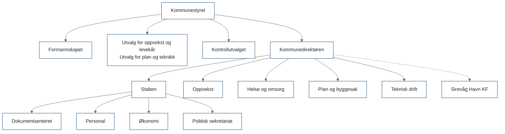

# Del 1 Organisering og ansvar

[← Arkivplanen](README.md) · Neste: [Del 2 Dokumentasjon og systemer](02-dokumentasjon-og-systemer.md)

Denne delen viser hvordan kommunen er organisert, og hvem som har ansvaret for dokumentasjonen på hvert nivå.

## Kommunen som arkivskaper

Sirevåg kommune er ett organ etter arkivlova og én arkivskaper. Alle enhetene, de folkevalgte organene og de
kommunale foretakene skaper arkiv på vegne av kommunen. Virksomheter som er egne rettssubjekter, har eget
arkivansvar.

| Virksomhet | Forhold til kommunen | Arkivansvar |
|---|---|---|
| Administrasjonen og de folkevalgte organene | Kommunen selv | Kommunen. Omfattes av arkivplanen |
| Sirevåg Havn KF | Kommunalt foretak, en del av kommunen | Kommunen. Foretaket følger arkivplanen og har egen arkivdel |
| Kontrollutvalget med sekretariat | Folkevalgt organ. Sekretariatet kjøpes fra et interkommunalt selskap | Kommunen. Avtalen står i [del 6](06-avtaler.md) |
| Havlandet Renovasjon IKS | Interkommunalt selskap, eget rettssubjekt | Selskapet selv. Arkivlova gjelder for selskapet i saker der det gjør enkeltvedtak eller gir forskrift (arkivlova § 3 første ledd bokstav b) |
| Havlandet interkommunale arkiv IKS | Interkommunalt selskap. Kommunens bevaringsinstitusjon | Selskapet for egen virksomhet. Kommunen beholder råderetten over arkivene som er overført |

## Organisasjonen

Dokumentsenteret er kommunens arkivtjeneste. Det ligger i kommunedirektørens stab, har 3,2 årsverk og ledes av
arkivlederen. Enhetene har ingen egne arkivtjenester, men hver enhet har en arkivkontakt.

## Ansvar og myndighet

| Rolle | Ansvar | Grunnlag |
|---|---|---|
| **Kommunestyret** | Kommunens øverste organ. Vedtar budsjettet som gir rammene for arkivtjenesten, og får rapport om internkontrollen | Kommuneloven § 25-2 |
| **Kommunedirektøren** | Øverste administrative ansvar for at kommunen oppfyller arkivlova. Ansvarlig for internkontrollen. Fastsetter arkivplanen og godkjenner kassasjon | Kommuneloven §§ 13-1 og 25-1, arkivforskrifta § 13 |
| **Arkivlederen** | Faglig ansvar på kommunedirektørens vegne: arkivplanen, rutinene, klassifikasjon, tilgangskoder, bevaring og kassasjon, overføring til langtidsbevaring, opplæring, kontakt med Nasjonalarkivet og bevaringsinstitusjonen | Delegert fra kommunedirektøren |
| **Dokumentsenteret** | Postmottak, journalføring, kvalitetskontroll, offentlig journal, innsynslogg, restanselister, veiledning og brukerstøtte i Ark-Ivar | Arkivplanen del 8 |
| **Enhetslederne** | At enheten følger arkivplanen. Fordeling av saker, godkjenning av utgående dokumenter, restanser, tilganger for egne ansatte | Lederavtalen |
| **Arkivkontakten i enheten** | Bindeledd til Dokumentsenteret. Første hjelp til kollegene, melder behov for opplæring og endringer | Oppnevnt av enhetslederen |
| **Saksbehandlerne** | At alt som hører til en sak, blir registrert i saken. Egen skjerming, avskriving og melding om ferdige saker | Arbeidsinstruksen |
| **Systemeierne** | At fagsystemet oppfyller kravene til systemer med arkiv, og at det finnes en oppdatert systembeskrivelse | Arkivforskrifta §§ 5 og 6, [del 2](02-dokumentasjon-og-systemer.md) |
| **IT-lederen** | Drift, sikkerhetskopiering, tilgangsstyring teknisk, og gjenoppretting | [Del 5](05-informasjonssikkerhet.md), [del 7](07-internkontroll-og-beredskap.md) |
| **Personvernombudet** | Råd om behandling av personopplysninger, og ved brudd på personopplysningssikkerheten | Personvernforordningen artikkel 37 til 39 |
| **Politisk sekretariat** | Sakslister, innkallinger og møtebøker | [P10](../prosesser/10-politisk-behandling.md) |

### Fullmakter

| Avgjørelse | Hvem avgjør |
|---|---|
| Endre arkivplanen | Kommunedirektøren, etter forslag fra arkivlederen |
| Opprette og endre klasser, arkivdeler og tilgangskoder | Arkivlederen |
| Gi og fjerne tilganger i Ark-Ivar | Dokumentsenteret, etter bestilling fra enhetslederen |
| Avslutte og gjenåpne saker | Dokumentsenteret |
| Avslå innsyn | Enhetslederen. Kommunedirektøren når saken er prinsipiell |
| Godkjenne kassasjon | Kommunedirektøren |
| Inngå avtaler om arkivtjenester | Kommunedirektøren |
| Melde brudd på personopplysningssikkerheten til Datatilsynet | Kommunedirektøren, etter råd fra personvernombudet |

## Kompetanse og opplæring

| Hvem | Opplæring | Når |
|---|---|---|
| Alle nyansatte med saksbehandling | Tre timers grunnkurs: arkivplikt, journalføring, skjerming og Ark-Ivar | Innen to uker etter tiltredelse. Tilgang gis etter kurset |
| Ledere | Lederkurs: ansvar, restanser, godkjenning og innsyn | Ved tiltredelse, og hvert annet år |
| Arkivkontaktene | Samling med Dokumentsenteret | To ganger i året |
| Folkevalgte | Taushetsplikt, innsyn og møteoffentlighet | Ved starten av hver valgperiode |
| Dokumentsenteret | Minst én ansatt skal ha arkivfaglig utdanning. Faglig oppdatering gjennom det interkommunale arkivet | Årlig plan |

Alle som utfører arbeid for kommunen, skriver under på en taushetserklæring før de får tilgang (forvaltningsloven
§ 13 c første ledd).

## Lovgrunnlag

| Regel | Hva den sier |
|---|---|
| Arkivlova § 5 | Organet skal forvalte dokumentasjonen som arkiv |
| Arkivlova § 8 første ledd | Planen skal vise hvordan organet har organisert arbeidet med å etterleve loven |
| Arkivforskrifta § 13 første ledd | Kommuner skal ha internkontroll med dokumentasjonsforvaltningen etter kommuneloven § 25-1 |
| Kommuneloven § 13-1 | Kommunedirektøren leder den samlede administrasjonen |
| Kommuneloven § 25-1 | Kommunedirektøren er ansvarlig for internkontrollen |
| Arkivlova § 3 første ledd | Loven gjelder for kommunene, og for andre rettssubjekter i saker der de gjør enkeltvedtak eller gir forskrift |
| Arkivlova § 21 | Nasjonalarkivet fører tilsyn |
| Forvaltningsloven § 13 c første ledd | Organet skal sørge for at taushetsplikten er kjent, og kan kreve skriftlig erklæring |

## Hvorfor står dette i planen?

**Ansvar som ikke er plassert, blir ikke tatt.** Arkivarbeidet er delt mellom mange. Når noe går galt, er det
nesten alltid i overgangene: mellom saksbehandler og arkiv, mellom enhet og IT, mellom kommunen og en leverandør.
Tabellen over fullmakter finnes for at ingen skal lure på hvem som bestemmer.

**Ansvaret kan delegeres, men ikke gis bort.** Kommunedirektøren har ansvaret uansett hvem som gjør arbeidet.
Derfor rapporterer arkivlederen til kommunedirektøren, og derfor er det kommunedirektøren som godkjenner kassasjon.

**Grensene mot egne rettssubjekter må være klare.** Et kommunalt foretak er en del av kommunen, og arkivet er
kommunens. Et interkommunalt selskap er et eget rettssubjekt. Forveksles de, kan dokumentasjon bli liggende uten
at noen har ansvaret for den.
