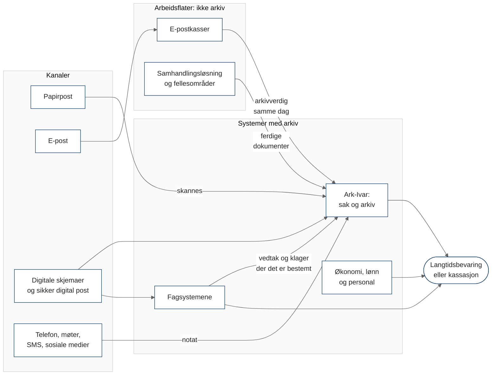

# Del 2 Dokumentasjon og systemer

[← Arkivplanen](README.md) · Forrige: [Del 1 Organisering og ansvar](01-organisering-og-ansvar.md) · Neste: [Del 3 Arkivoversikt og arkivlokaler](03-arkivoversikt.md)

Denne delen gir oversikt over hva slags dokumentasjon som blir til i kommunen, hva som forvaltes som arkiv, og i
hvilke systemer det lagres.

## Hvor blir dokumentasjonen til, og hvor ender den?

Hovedregelen i Sirevåg: **Saksdokumenter hører hjemme i Ark-Ivar, med mindre et fagsystem er utpekt i tabellen
under.** E-postkasser, samhandlingsløsningen og fellesområder er arbeidsflater. Det som skal bli stående som
dokumentasjon, flyttes derfra til et system med arkiv.

## Dokumentasjonen som blir til

| Oppgaveområde | Hva slags dokumentasjon | Hvor den lagres |
|---|---|---|
| Politisk styring | Saksframlegg, sakslister, møtebøker, delegeringsreglement | Ark-Ivar |
| Administrasjon og ledelse | Planer, reglement, avtaler, høringer, korrespondanse med andre myndigheter | Ark-Ivar |
| Økonomi | Budsjett, årsregnskap, bilag, fakturaer, anskaffelser | Budsjett, regnskap og anskaffelsessaker i Ark-Ivar. Bilag i økonomisystemet |
| Personal | Tilsettingssaker, personalmapper, lønnsgrunnlag, HMS | Tilsetting og personalmapper i Ark-Ivar. Lønn i lønns- og personalsystemet |
| Barnehage og skole | Opptak, vedtak om tilrettelegging, elevmapper, fravær og vurdering | Opptak i barnehagesystemet. Fravær og vurdering i det skoleadministrative systemet. Vedtak og elevmapper i Ark-Ivar |
| Helse og omsorg | Søknader og vedtak om tjenester, pasientjournaler | Pasientjournalen i journalsystemet. Søknader, vedtak og klager i Ark-Ivar |
| Barnevern | Meldinger, undersøkelser, tiltak og vedtak | Det interkommunale barnevernssystemet |
| Sosiale tjenester | Søknader, vedtak og utbetalinger | Fagsystemet for sosiale tjenester |
| Plan, bygg og oppmåling | Planer, byggesaker, delingssaker, kart | Saker i Ark-Ivar. Kart og planregister i kartsystemet |
| Tekniske tjenester | Vann og avløp, veg, kommunale eiendommer, ledningskart | Saker i Ark-Ivar. Ledningsnettet i kartsystemet |
| Næring, landbruk og miljø | Konsesjonssaker, tilskudd, forurensningssaker | Ark-Ivar |
| Beredskap | Risiko- og sårbarhetsanalyser, beredskapsplaner, logg fra hendelser | Ark-Ivar. Loggen føres i krisestøtteverktøyet og overføres etter hendelsen |

## Vurderingene bak hva som er arkiv

Kommunen skal særlig ta hensyn til om dokumentasjonen (a) bekrefter hvordan saker er behandlet og oppgaver løst,
(b) kan være bevis for privates rettigheter og plikter, og (c) allerede er sikret som arkiv i et annet system
(arkivforskrifta § 1). Vurderingene skal stå i planen (§ 12 bokstav b).

| Dokumentasjon | Forvaltes som arkiv? | Begrunnelse |
|---|---|---|
| Søknader, vedtak, klager og korrespondansen i saken | Ja | Bekrefter saksbehandlingen og er bevis for rettigheter og plikter |
| Interne notater som forklarer en avgjørelse, og notater fra telefon, møter og befaring | Ja | Bekrefter hvordan saken er behandlet |
| Avtaler og kontrakter med vedlegg | Ja | Bevis for kommunens og motpartens rettigheter og plikter |
| Opplysninger i fagsystemene om tjenester til enkeltpersoner | Ja | Bevis for den enkeltes rettigheter, og dokumentasjon av tjenesten |
| Regnskap og bilag | Ja | Dokumenterer bruken av kommunens midler |
| Utkast som ikke er sendt eller lagt fram for noen | Nei | Arbeidsmateriale. Det ferdige dokumentet er arkiv |
| Kopier til orientering, rundskriv og nyhetsbrev som ikke fører til saksbehandling | Nei | Bekrefter ingenting om kommunens egen saksbehandling |
| Reklame, kursinvitasjoner og lignende | Nei | Gjelder ikke kommunens oppgaveløsning |
| Praktiske meldinger: møtebooking, «jeg er forsinket», bestilling av rekvisita | Nei | Uten verdi som bekreftelse når dagen er over |
| Chat og e-post med saksinnhold | Ja, og flyttes til saken | Kanalen avgjør ikke. Innholdet avgjør |
| Logger og tekniske data i systemene | Bare endringsloggen i systemer med arkiv | Sporing av endringer er et krav til systemene (§ 5 andre ledd bokstav c). Driftslogger er ikke arkiv |
| Samme dokumentasjon i to systemer | I ett av dem | Det andre er en kopi (§ 1 bokstav c). Tabellen over systemene sier hvilket som gjelder |

Sorteringen i det daglige er beskrevet i [P1](../prosesser/01-postmottak.md).

## Systemene

Systemene er oppdiktet og har navn etter oppgaven. «Oppfyller § 5» viser om systemet har funksjonene arkivforskrifta
§ 5 krever: nødvendige metadata, vern mot uautoriserte endringer, sporing av endringer, kontrollert eksport,
kontrollert kassasjon, gjenfinning for innsyn og uttak til journal.

| System | Brukes av | Inneholder arkiv | Oppfyller § 5 | Systemeier | Merknad |
|---|---|---|---|---|---|
| **Ark-Ivar** (sak og arkiv, bygget etter Noark 5) | Alle | Ja. Kommunens hovedarkiv og journal | Ja | Arkivlederen | Fullelektronisk fra 2012 |
| Barnehagesystemet | Oppvekst | Ja. Opptak og register over barn | Ja | Enhetsleder Oppvekst | Vedtak og klager arkiveres i Ark-Ivar gjennom integrasjon |
| Skoleadministrativt system | Skolene | Ja. Fravær og vurdering | Delvis | Enhetsleder Oppvekst | Mangler kontrollert eksport. Avvik meldt i 2026, tiltak i [del 7](07-internkontroll-og-beredskap.md#risikovurdering) |
| Pasientjournalsystemet | Helse og omsorg | Ja. Pasientjournaler | Ja | Enhetsleder Helse og omsorg | Egne regler i helselovgivningen kommer i tillegg |
| Barnevernssystemet (interkommunalt) | Den interkommunale barneverntjenesten | Ja | Ja | Vertskommunen | Ansvaret er avtalt, se [del 6](06-avtaler.md#felles-systemer-med-andre-organer) |
| Fagsystemet for sosiale tjenester | Helse og omsorg | Ja | Ja | Enhetsleder Helse og omsorg | |
| Økonomisystemet | Økonomi, alle ledere | Ja. Regnskap og bilag | Ja | Økonomisjefen | |
| Lønns- og personalsystemet | Personal | Ja. Lønnsgrunnlag | Ja | Personalsjefen | Personalmappene ligger i Ark-Ivar |
| Kartsystemet | Plan og byggesak, Teknisk drift | Ja. Planregister og ledningskart | Delvis | Enhetsleder Plan og byggesak | Historiske versjoner tas ut årlig, fordi systemet ikke sporer alle endringer |
| Krisestøtteverktøyet | Kriseledelsen | Ja, inntil overføring | Nei | Beredskapskoordinatoren | Loggen eksporteres til Ark-Ivar etter hver hendelse og øvelse |
| E-post | Alle | Nei | – | IT-lederen | Arkivverdig e-post flyttes til Ark-Ivar samme dag |
| Samhandlingsløsningen (chat, møter, delte dokumenter) | Alle | Nei | – | IT-lederen | Ferdige dokumenter flyttes til Ark-Ivar. Arbeidsrom slettes ett år etter siste aktivitet |
| Fellesområder på filserver | Alle | Nei | – | IT-lederen | Skal ikke brukes til saksdokumenter |
| Nettsiden og skjemaløsningen | Alle | Skjemaene leveres til Ark-Ivar eller et fagsystem | – | Kommunikasjonsrådgiveren | Egenproduserte publikasjoner arkiveres i Ark-Ivar |
| Sosiale medier | Kommunikasjonsrådgiveren | Nei | – | Kommunikasjonsrådgiveren | Henvendelser med saksinnhold tas ut og registreres |

Et system som inneholder arkiv, men ikke oppfyller § 5 fullt ut, er et avvik. Det skal ha en plan for retting,
eller dokumentasjonen skal jevnlig overføres til et system som oppfyller kravene.

## Systembeskrivelser

Kommunen skal ha beskrivelser av systemene som inneholder arkiv (arkivforskrifta § 6). Systemeieren skriver
beskrivelsen etter malen under, og Dokumentsenteret oppbevarer den i sak 060 i Ark-Ivar.

| Punkt | Innhold | Krav |
|---|---|---|
| 1 | Hva slags dokumentasjon som er lagret i systemet | § 6 første ledd bokstav a |
| 2 | Opphavet og historikken: når systemet ble tatt i bruk, hva som er overført fra eldre systemer, og større endringer | § 6 første ledd bokstav b |
| 3 | Hvordan systemet er sikret mot utilsiktede eller udokumenterte endringer | § 6 første ledd bokstav c |
| 4 | Prosedyrene for registrering når noe av dokumentasjonen fortsatt er på papir | § 6 første ledd bokstav d |
| 5 | Oversikt over informasjonsstrukturen, når systemet inneholder noe som skal tas vare på for ettertiden | § 6 andre ledd |
| 6 | Systemeier, leverandør, driftssted og avtaler | Arkivplanen [del 6](06-avtaler.md) |
| 7 | Hvordan dokumentasjonen kan eksporteres, og hvordan kassasjon gjennomføres | § 5 andre ledd bokstav d og e |

### Eksempel: Ark-Ivar

| Punkt | Beskrivelse |
|---|---|
| Dokumentasjon | Saksdokumenter og journal for alle kommunens oppgaveområder, unntatt det som ligger i fagsystemene |
| Historikk | Tatt i bruk i 2012. Journaldata fra 2004 til 2011 ble overført fra det forrige journalsystemet |
| Sikring | Ferdigstilte dokumenter er låst. Alle endringer i registreringer logges med gammel og ny verdi, hvem og når. Avsluttede saker er skrivebeskyttet |
| Papir | Papirpost skannes ved mottak og makuleres etter kontroll. Ingen dokumentasjon oppbevares på papir etter 2012 |
| Struktur | Noark 5: arkiv, arkivdel, klasse, saksmappe, journalpost, dokumentbeskrivelse og dokumentobjekt |
| Drift | Driftes av kommunens leverandør i et datasenter i Norge |
| Eksport og kassasjon | Uttrekk etter Noark 5. Kassasjon etter regel på klassen, med protokoll |

## Når et system skal anskaffes, endres eller avvikles

| Tidspunkt | Hva skal gjøres | Hvem |
|---|---|---|
| Før anskaffelse | Arkivlederen deltar i kravspesifikasjonen. Kravene i arkivforskrifta § 5 tas med, og det avklares om systemet skal inneholde arkiv eller levere til Ark-Ivar | Systemeier og arkivleder |
| Ved innføring | Systembeskrivelsen skrives. Systemet føres inn i tabellen over. Bevaring og oppbevaringstid fastsettes | Systemeier og arkivleder |
| Ved større endringer | Systembeskrivelsen oppdateres. Det kontrolleres at dokumentasjonen fortsatt er lesbar og komplett | Systemeier |
| Ved avvikling | Dokumentasjonen overføres til et nytt system eller tas ut for langtidsbevaring *før* systemet slås av. Uttaket kontrolleres | Systemeier, arkivleder og IT-leder |

Flytting og konvertering skal ikke svekke informasjonen: det som var lesbart for mennesker eller maskiner, skal
fortsatt være det, og opplysninger om opphav, saksbehandling og sammenhenger skal følge med (arkivforskrifta § 7).

## Lovgrunnlag

| Regel | Hva den sier |
|---|---|
| Arkivlova § 8 andre ledd bokstav b til d | Planen skal gi oversikt over dokumentasjonen som blir til, hva som forvaltes som arkiv, og hvordan det lagres |
| Arkivforskrifta § 1 | Hva kommunen skal ta hensyn til når den avgjør hva som skal forvaltes som arkiv |
| Arkivforskrifta § 5 | Krav til systemer som inneholder arkiv |
| Arkivforskrifta § 6 | Krav til beskrivelser av systemene |
| Arkivforskrifta § 7 | Vedlikehold av digitale arkiv ved flytting og konvertering |
| Arkivforskrifta § 12 bokstav b, g og h | Vurderingene, systemene og systembeskrivelsene skal stå i planen |
| Bevaringsforskrifta § 29 bokstav c | Egenproduserte publikasjoner med forarbeid skal tas vare på |

## Hvorfor står dette i planen?

**Arkivet er ikke lenger ett system.** For tjue år siden lå nesten alt i ett sakarkiv. Nå blir mye av den viktigste
dokumentasjonen om innbyggerne til i fagsystemer. Uten en samlet oversikt blir fagsystemene glemt til den dagen de
skal byttes ut.

**Systemskifter er den største faren.** De fleste store tap av digital dokumentasjon skjer når et system slås av
uten at innholdet er tatt ut på en kontrollert måte. Derfor har planen en egen rutine for avvikling, og derfor skal
arkivlederen være med fra anskaffelsen.

**Arbeidsflater må skilles fra arkiv.** E-post og samhandlingsløsninger er laget for samarbeid. De sporer ikke
endringer og har ingen journal. Det er greit så lenge alle vet at det som skal vare, må flyttes.

**Vurderingene skal kunne etterprøves.** Når kommunen har bestemt at noe ikke er arkiv, skal det gå fram hvorfor.
Da kan avgjørelsen kontrolleres, og den blir lik fra enhet til enhet.
