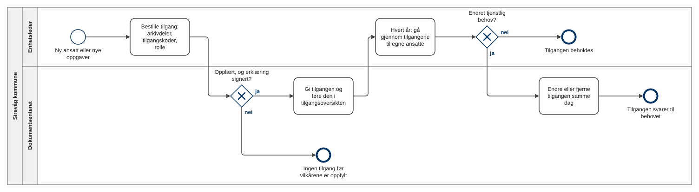

# Del 5 Informasjonssikkerhet og tilgang

[← Arkivplanen](README.md) · Forrige: [Del 4 Bevarings- og kassasjonsplan](04-bevarings-og-kassasjonsplan.md) · Neste: [Del 6 Avtaler](06-avtaler.md)

Denne delen viser hvilke regler om taushetsplikt og informasjonssikkerhet som gjelder for de ulike delene av
dokumentasjonen, og hvordan tilgangen styres. Skjerming av enkeltdokumenter står i
[P9](../prosesser/09-skjerming-og-tilgang.md).

## Tre mål

| Mål | Betydning for arkivet | Krav i arkivlova § 5 |
|---|---|---|
| **Konfidensialitet** | Bare de som skal ha opplysningene, får dem | – (følger av taushetsplikten og personvernreglene) |
| **Integritet** | Dokumentasjonen er ekte og uendret, og opphavet er kjent | Bokstav a og c |
| **Tilgjengelighet** | Dokumentasjonen kan finnes og brukes når den trengs, nå og senere | Første ledd andre punktum, og bokstav d |

Sikkerhet handler altså om mer enn hemmelighold. Et arkiv som ingen uvedkommende kan lese, men som går tapt i en
brann eller et dataangrep, er ikke sikkert.

## Regler og vern for hver del av dokumentasjonen

| Del | Typiske opplysninger | Regler om taushetsplikt | Hvem har tilgang | Særlige tiltak |
|---|---|---|---|---|
| SAK | Alminnelige saker. Noen med personlige forhold eller forretningshemmeligheter | Forvaltningsloven § 13 | Alle ansatte leser det som ikke har tilgangskode. Skjermede saker bare enheten og Dokumentsenteret | Tilgangskode på journalposten |
| BYGG | Eiendom, tegninger, nabomerknader. Sjelden taushetsbelagt | Forvaltningsloven § 13 | Plan og byggesak, Teknisk drift, Dokumentsenteret | – |
| PERS | Arbeidsavtaler, lønn, sykefravær, advarsler | Forvaltningsloven § 13. Personvernforordningen artikkel 9 for helseopplysninger | Personal og nærmeste leder for egne ansatte | Egen arkivdel. Oppslag logges og kontrolleres |
| ELEV | Vurdering, tilrettelegging, skolemiljøsaker | Forvaltningsloven § 13. Opplæringslovas regler om taushetsplikt | Rektor og de lærerne som har eleven | Tilgang følger skole og klasse. Fjernes ved skolebytte |
| HELSE | Søknader og vedtak om helse- og omsorgstjenester | Forvaltningsloven § 13, helsepersonelloven § 21 | Tildelingskontoret og enheten som yter tjenesten | Egen arkivdel. Sikker digital post ved utsending |
| Pasientjournalsystemet | Pasientjournaler | Helsepersonelloven § 21 | Helsepersonell med ansvar for pasienten | Tilgang etter tjenstlig behov, oppslag logges, pasienten kan be om å få se loggen |
| Barnevernssystemet | Meldinger, undersøkelser, tiltak | Barnevernsloven § 13-1 | Den interkommunale barneverntjenesten | Ingen i Sirevåg utenfor tjenesten har tilgang |
| Fagsystemet for sosiale tjenester | Søknader, økonomi, vedtak | Sosialtjenesteloven § 44 | Saksbehandlerne i tjenesten | Journalen er ikke offentlig |
| Økonomisystemet | Bilag, leverandører, kontonummer | Forvaltningsloven § 13 for det som gjelder enkeltpersoner | Økonomi, og ledere for eget budsjett | To personer må godkjenne utbetalinger |
| Bortsettingsarkivet | Eldre papirarkiver, også klientmapper | Som for tilsvarende digitale arkiver. Taushetsplikten varer som hovedregel i 60 år | Dokumentsenteret | Låst rom, adgangslogg, utlån bare mot kvittering |

Reglene om taushetsplikt er forklart i [P9](../prosesser/09-skjerming-og-tilgang.md#taushetsplikt).

## Tilgangsstyring

Figuren følger BPMN. Symbolene er forklart i [oversikten over prosessene](../prosesser/README.md#symbolene-i-figurene).

| Regel | Innhold |
|---|---|
| Tjenstlig behov | Tilgang gis bare til det den ansatte trenger for sine oppgaver. Stilling eller nysgjerrighet er ikke nok |
| Minste tilgang | Lesetilgang før skrivetilgang. Enkeltsak før hele arkivdelen |
| Personlig bruker | Ingen fellesbrukere. Innlogging med to faktorer |
| Bestilling fra leder | Dokumentsenteret gir ikke tilgang på forespørsel fra den ansatte selv |
| Midlertidig tilgang | Vikarer og prosjekter får tilgang med sluttdato |
| Oppslag logges | Oppslag i saker med tilgangskode logges. Dokumentsenteret tar ut stikkprøver for PERS og HELSE hvert kvartal |
| Årlig gjennomgang | Hver leder får listen over egne ansattes tilganger i november og bekrefter eller fjerner |
| Leverandører | Tilgang for feilretting gis for én oppgave om gangen, logges og avsluttes når oppgaven er løst |

### Rollene i Ark-Ivar

| Rolle | Kan |
|---|---|
| Leser | Lese saker og dokumenter i egne arkivdeler som ikke er skjermet |
| Saksbehandler | Opprette utgående og interne journalposter, skrive dokumenter, avskrive, melde saker ferdige |
| Leder | Som saksbehandler, og fordele, godkjenne og se restanser for enheten |
| Arkiv | Registrere inngående, journalføre, rette, flytte, avslutte og gjenåpne, lage offentlig journal |
| Arkivleder | Som arkiv, og vedlikeholde klasser, arkivdeler, tilgangskoder og kassasjonsregler |
| Systemadministrator | Brukere og teknisk oppsett. Har ikke lesetilgang til skjermede dokumenter |

## Vern av integritet og tilgjengelighet

| Tiltak | Beskrivelse |
|---|---|
| Låsing | Ferdigstilte dokumenter og avsluttede saker kan ikke endres |
| Endringslogg | Alle endringer i registreringer logges med gammel og ny verdi, hvem og når. Loggen kan ikke redigeres |
| Sjekksum | Hver fil får en sjekksum når den arkiveres. Den kontrolleres ved flytting og ved årlig stikkprøve |
| Arkivformat | Dokumenter lagres i et stabilt format ved ferdigstilling |
| Sikkerhetskopi | Daglig kopi, oppbevart på et annet sted enn driften. Gjenoppretting prøves to ganger i året |
| Atskilt kopi | Én kopi er ikke koblet til nettverket, som vern mot løsepengevirus |
| Driftssted | All lagring skjer i Norge, se [del 6](06-avtaler.md#lagring-utenfor-norge) |

## Utenfor kontoret

| Situasjon | Regel |
|---|---|
| Hjemmekontor | Bare på kommunens utstyr, og bare gjennom kommunens sikre tilkobling. Ingen lagring lokalt |
| Utskrifter | Taushetsbelagte dokumenter skrives ut med kode ved skriveren og makuleres etter bruk |
| E-post | Taushetsbelagte opplysninger sendes ikke i vanlig e-post, verken internt eller eksternt. Bruk sikker digital post, eller vis til saken i Ark-Ivar |
| Mobil | Ark-Ivar kan leses på kommunens telefoner. Skjermede dokumenter kan ikke lastes ned |
| Private kontoer og lagringstjenester | Skal aldri brukes til kommunens dokumentasjon |
| Samtaler | Taushetsbelagte saker omtales ikke i åpne landskap, på bussen eller i sosiale medier |

## Når noe går galt

| Hendelse | Første handling | Videre |
|---|---|---|
| Dokument sendt til feil mottaker | Be mottakeren slette, og meld fra til leder og Dokumentsenteret samme dag | Avvik. Personvernombudet vurderer melding til Datatilsynet innen 72 timer |
| Taushetsbelagt opplysning i offentlig journal | Dokumentsenteret skjermer straks | Rutinen i [P6](../prosesser/06-kvalitetskontroll.md#rutine-retting-av-feil) |
| Mistanke om oppslag uten tjenstlig behov | Leder varsler arkivlederen | Loggen hentes ut. Personalsak ved behov |
| Tapt telefon eller PC | Meld til IT straks, også utenom arbeidstid | Enheten sperres og slettes |
| Dataangrep eller driftsstans | Meld til IT. Ikke forsøk å rydde selv | Beredskapsplanen i [del 7](07-internkontroll-og-beredskap.md#beredskap-for-arkivene) |

## Lovgrunnlag

| Regel | Hva den sier |
|---|---|
| Arkivforskrifta § 12 bokstav e | Planen skal ha opplysninger om regler om taushetsplikt og informasjonssikkerhet for de ulike delene av dokumentasjonen |
| Arkivlova § 5 første ledd | Dokumentasjonen skal sikres slik at informasjonen ikke går tapt, og forvaltes slik at den ikke blir endret |
| Arkivforskrifta § 5 andre ledd bokstav b og c | Systemene skal verne mot uautoriserte endringer og spore endringer |
| Arkivforskrifta § 10 første ledd bokstav d | Lagringsmedier skal være vernet mot skadeverk, innbrudd og uautorisert tilgang |
| Forvaltningsloven § 13 c andre ledd | Dokumenter med taushetsbelagte opplysninger skal oppbevares på betryggende måte |
| Forvaltningsloven § 13 b første ledd nr. 3 | Opplysningene kan være tilgjengelige for andre ansatte så langt det trengs for en hensiktsmessig arbeids- og arkivordning |
| Personvernforordningen artikkel 5 nr. 1 bokstav f og artikkel 32 | Personopplysninger skal behandles med tilstrekkelig sikkerhet, tilpasset risikoen |
| Personvernforordningen artikkel 33 | Brudd på personopplysningssikkerheten meldes til Datatilsynet innen 72 timer når det er mulig |
| eForvaltningsforskriften § 15 | Organet skal ha internkontroll på informasjonssikkerhetsområdet, bygget på anerkjente standarder og tilpasset risikoen |

## Hvorfor står dette i planen?

**Ulike deler av arkivet trenger ulikt vern.** En byggesak og en barnevernssak kan ikke ha samme tilgangsregler.
Derfor krever forskriften at planen viser reglene for *hver del* av dokumentasjonen, og ikke bare en generell
setning om taushetsplikt.

**Tilgang er noe man får, ikke noe man har.** Uten en fast rutine vokser tilgangene med årene: folk bytter jobb og
beholder de gamle. Den årlige gjennomgangen er det eneste som stopper det.

**Loggen virker også når ingen leser den.** Vissheten om at oppslag kan spores, hindrer de fleste i å snoke. Men
loggen må kontrolleres av og til, ellers er vissheten uten grunnlag.

**Sikkerhet for arkivet er sikkerhet over tid.** De fleste sikkerhetstiltak verner mot hendelser i dag. Arkivet
skal i tillegg kunne leses om femti år. Derfor står arkivformat, sjekksum og gjenoppretting her sammen med
tilgangsstyringen.
