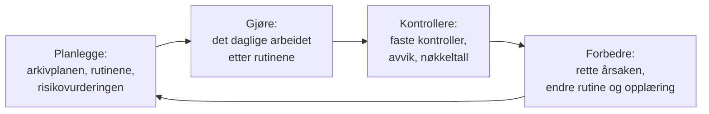
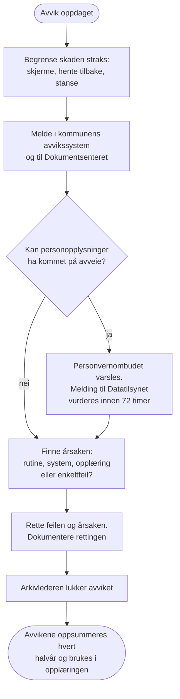

# Del 7 Internkontroll og beredskap

[← Arkivplanen](README.md) · Forrige: [Del 6 Avtaler](06-avtaler.md) · Neste: [Del 8 Rutiner](../prosesser/README.md)

Denne delen viser hvordan kommunen kontrollerer at arkivplanen følges, hvilke risikoer som er vurdert, og hva som
gjøres når arkivene er truet.

## Internkontrollen i ett bilde

Kommunen skal ha internkontroll med administrasjonens virksomhet for å sikre at lover og forskrifter følges.
Internkontrollen skal være systematisk og tilpasset størrelse, egenart, aktiviteter og risiko. Kommunedirektøren
skal ha nødvendige rutiner, avdekke og følge opp avvik og risiko for avvik, dokumentere internkontrollen og
evaluere og forbedre den (kommuneloven § 25-1). Det gjelder også dokumentasjonsforvaltningen (arkivforskrifta § 13
første ledd).

## Årshjulet

| Måned | Aktivitet | Ansvar |
|---|---|---|
| Januar | Kassasjon: liste, gjennomgang, godkjenning og protokoll ([P11](../prosesser/11-bevaring-og-kassasjon.md)) | Arkivleder |
| Februar | Nøkkeltall for fjoråret til kommunedirektøren | Arkivleder |
| Mars | Samling for arkivkontaktene. Prøve på gjenoppretting fra sikkerhetskopi | Dokumentsenteret, IT-leder |
| April | Gjennomgang av saker uten aktivitet på seks måneder | Dokumentsenteret |
| Mai | Tilsyn med bortsettingsarkivet etter sjekklisten i [del 3](03-arkivoversikt.md#kravene-til-bortsettingsarkivet) | Arkivleder |
| Juni | Restansestatus til kommunedirektøren. Kontroll av sommervikarenes tilganger | Arkivleder |
| August | Opplæring av nye ledere og nyansatte etter sommeren | Dokumentsenteret |
| September | Samling for arkivkontaktene. Beredskapsøvelse hvert annet år | Dokumentsenteret |
| Oktober | Gjennomgang av avtalene i [del 6](06-avtaler.md). Systemeierne bekrefter systembeskrivelsene. Prøve på gjenoppretting | Avtaleeierne, systemeierne, IT-leder |
| November | Årlig gjennomgang av tilganger. Revisjon av arkivplanen og risikovurderingen | Lederne, arkivleder |
| Desember | Arkivplanen og status legges fram for kommunedirektøren. Restansestatus | Arkivleder |
| Hver måned | Restanselisten til lederne ([P5](../prosesser/05-avskriving-og-avslutning.md)) | Dokumentsenteret |
| Hver uke og hver dag | Kontrollene i [P6](../prosesser/06-kvalitetskontroll.md#rutine-kontrollkalenderen) | Dokumentsenteret |

Ved periodeskiftet hvert fjerde år kommer avslutning av arkivperioden og overføring til langtidsbevaring i tillegg.

## Nøkkeltall

| Nøkkeltall | Mål | Hvorfor |
|---|---|---|
| Andel inngående dokumenter journalført senest neste arbeidsdag | Minst 95 prosent | Løpende journalføring |
| Restanser eldre enn en måned uten foreløpig svar | Ingen | Forvaltningsloven § 11 a |
| Innsynskrav avgjort innen tre arbeidsdager | Minst 95 prosent | Uten ugrunnet opphold |
| Innsynskrav uten svar etter fem arbeidsdager | Ingen | Regnes som avslag |
| Journalposter med tilgangskode uten hjemmel | Ingen | Avslag kan ikke begrunnes uten hjemmel |
| Journalposter med midlertidig skjerming eldre enn en uke | Ingen | Skjerming uten hjemmel |
| Reserverte journalposter eldre enn 14 dager | Under 10 | Dokumenter som aldri ble sendt, eller ble sendt utenom systemet |
| Saker uten aktivitet på tolv måneder som ikke er avsluttet | Under 50 | Oppbevaringstiden begynner ikke å løpe |
| Avvik med brudd på taushetsplikt | Ingen. Alle meldes og følges opp | Tillit og personvern |
| Nyansatte med opplæring før tilgang | Alle | Feil forebygges billigst før de skjer |

## Risikovurdering

Risikoene vurderes på nytt hvert år i november. Nivået er sannsynlighet ganget med konsekvens, på en skala fra
lav til høy.

| Risiko | Årsak | Nivå | Tiltak | Ansvar |
|---|---|---|---|---|
| Saksdokumenter blir liggende i e-post og samhandlingsløsningen | Travle saksbehandlere, uklare vaner | Høy | Opplæring, enkel overføring fra e-post, stikkprøver hos enhetene | Enhetslederne |
| Dokumentasjon går tapt når et fagsystem byttes ut | Arkivet er ikke tenkt på i anskaffelsen | Høy | Arkivlederen deltar i alle anskaffelser. Rutinen i [del 2](02-dokumentasjon-og-systemer.md#når-et-system-skal-anskaffes-endres-eller-avvikles) | Systemeierne |
| Det skoleadministrative systemet kan ikke eksportere kontrollert | Mangler i systemet | Høy | Krav til leverandøren i 2027. Inntil da årlig uttak av vurderinger og fravær til Ark-Ivar | Enhetsleder Oppvekst |
| Taushetsbelagte opplysninger publiseres i offentlig journal | Feil skjerming ved registrering | Middels | Daglig kontroll før publisering, tre dagers forsinkelse, automatisk varsel om fødselsnummer | Dokumentsenteret |
| Løsepengevirus gjør arkivet utilgjengelig | Angrep utenfra | Middels | Atskilt sikkerhetskopi, to-faktor, prøvd gjenoppretting, nødrutine | IT-leder |
| Digitale dokumenter kan ikke leses om tjue år | Foreldede formater | Middels | Arkivformat ved ferdigstilling, sjekksummer, overføring til langtidsbevaring hver periode | Arkivleder |
| Feil ved skanning oppdages etter at papiret er destruert | Manglende kontroll | Middels | Dagsbunker, kontrollrapport, godkjenning før destruksjon | Arkivleder |
| Vannskade i bortsettingsarkivet | Kjellerlokale | Lav | Fuktmåler, tilsyn, reoler over gulv, flytting av reolene ved yttervegg | Arkivleder |
| Dokumentasjon blir igjen hos en leverandør | Avtalen mangler bestemmelser | Middels | Sjekklisten i [del 6](06-avtaler.md#hva-en-tjenesteavtale-om-arkiv-skal-ha-med) | Avtaleeierne |
| Nøkkelkompetanse forsvinner | Liten arkivtjeneste | Middels | Skriftlige rutiner, to personer kan hver oppgave, samarbeid med det interkommunale arkivet | Arkivleder |
| Oppslag uten tjenstlig behov | For vide tilganger | Middels | Tilgang etter behov, logg, stikkprøver, årlig gjennomgang | Lederne |

Risiko ved vedlikehold av digitale arkiver og ved destruksjon av papir etter skanning er tatt med fordi forskriften
peker særlig på dem (arkivforskrifta § 13 andre ledd).

## Avvik

Et avvik er et brudd på lov, forskrift eller arkivplanen. Alle ansatte skal melde avvik. Den som melder, skal ikke
oppleve ubehag for det.

| Alvorlighet | Eksempel | Behandles av | Frist |
|---|---|---|---|
| Lav | Feil klasse, uklar tittel, forsinket journalføring | Dokumentsenteret | Rettes fortløpende |
| Middels | Saksdokumenter funnet utenfor arkivet, restanse uten foreløpig svar, tilgang ikke fjernet ved fratreden | Enhetsleder og arkivleder | To uker |
| Høy | Brudd på taushetsplikt, tap av dokumentasjon, kassasjon uten hjemmel, innsynskrav ikke besvart | Kommunedirektøren | Straks |

## Rapportering og tilsyn

| Til | Hva | Når |
|---|---|---|
| Lederne | Restanselister, og avvik i egen enhet | Hver måned |
| Kommunedirektøren | Nøkkeltall, avvik, risikovurdering og revidert arkivplan | Juni og desember |
| Kommunestyret | Internkontrollen inngår i kommunedirektørens årlige rapport om internkontroll og statlig tilsyn | Hvert år |
| Nasjonalarkivet | Opplysninger kommunen blir bedt om, og oppfølging av pålegg etter tilsyn | Ved forespørsel og tilsyn |

Nasjonalarkivet fører tilsyn med at kommunen følger arkivlova og internkontrollkravet, kan gi pålegg om retting,
og kan pålegge kommunen å rekonstruere dokumentasjon som er gått tapt ved brudd på reglene (arkivlova §§ 21 og 22).

## Beredskap for arkivene

### Verdiene som skal reddes først

| Prioritet | Arkiv | Hvor | Hvorfor |
|---|---|---|---|
| 1 | Den digitale dokumentasjonen i Ark-Ivar og fagsystemene | Driftsleverandøren, med kopi på et annet sted | Kommunens løpende drift og innbyggernes rettigheter |
| 2 | Kart og tegninger fra teknisk etat 1950–2005 | Rom K12, reol 14–18 | Finnes bare i ett eksemplar og brukes ved graving og bygging |
| 3 | Sakarkiv 1992–2011 | Rom K12, reol 1–10 | Ikke skannet. Journalen er bevart digitalt |
| 4 | Elevmapper og klassedagbøker | Rom K12, reol 11–13 | Dokumenterer skolegang og rettigheter |

De eldste arkivene står hos det interkommunale arkivet, som har egen beredskapsplan.

### Når noe skjer

| Hendelse | Første timer | Deretter |
|---|---|---|
| **Brann eller vann i bortsettingsarkivet** | Varsle brannvesenet og arkivlederen. Ingen går inn før det er trygt. Slokkeanlegget bruker gass, ikke vann | Det interkommunale arkivet kontaktes for hjelp. Vått papir fryses innen 48 timer for å hindre mugg. Skadene registreres og utbedres så langt det er mulig |
| **Ark-Ivar er nede** | IT og leverandøren varsles. Dokumentsenteret tar i bruk nødrutinen | Etterregistrering når systemet er oppe. Hendelsen meldes som avvik |
| **Dataangrep** | IT kobler fra. Kriseledelsen settes. Ingen betaler løsepenger eller forhandler | Gjenoppretting fra den atskilte kopien. Kontroll av sjekksummer. Personvernombudet vurderer melding til Datatilsynet |
| **Dokumentasjon er gått tapt** | Arkivlederen kartlegger hva som mangler | Rekonstruksjon fra kopier hos avsendere, mottakere og i sikkerhetskopier. Tapet dokumenteres i sak 060 |
| **Leverandøren går konkurs** | Kommuneadvokaten og arkivlederen varsles | Uttak etter avtalen, se [del 6](06-avtaler.md) |

### Nødrutinen når Ark-Ivar er nede

1. Dokumentsenteret tar imot post som vanlig og fører en **nødjournal** på papir eller i et regneark: løpenummer,
   mottatt dato, avsender, hva det gjelder, og hvem det er gitt til.
2. Papirpost stemples og oppbevares. E-post blir liggende i den felles e-postkassen.
3. Saksbehandlere skriver nødvendige brev i tekstbehandleren og tar vare på filen og en kopi av det som ble sendt.
4. Innsynskrav registreres i nødjournalen. Fristene løper som vanlig.
5. Når systemet er oppe, etterregistreres alt i riktig rekkefølge. Mottatt dato er den virkelige datoen.
   Journaldatoen blir registreringsdagen, og det skrives en merknad om nedetiden.
6. Nødjournalen arkiveres i sak 060 som dokumentasjon på hva som skjedde.

Skade på arkiv skal utbedres så langt det er mulig, og tiltak skal settes i verk med en gang det oppstår risiko
(arkivforskrifta § 10 tredje ledd).

## Lovgrunnlag

| Regel | Hva den sier |
|---|---|
| Kommuneloven § 25-1 | Internkontroll: systematisk, tilpasset risiko, med rutiner, avvikshåndtering, dokumentasjon og forbedring |
| Kommuneloven § 25-2 | Rapportering til kommunestyret om internkontroll og statlig tilsyn |
| Arkivlova § 8 andre ledd bokstav a | Planen skal kunne brukes som redskap i internkontrollen |
| Arkivforskrifta § 13 | Kommuner følger kommuneloven § 25-1. For andre organer skal ledelsen løpende vurdere risiko, særlig ved vedlikehold av digitale arkiver og destruksjon etter skanning, og få planen lagt fram minst én gang i året |
| Arkivforskrifta § 7 | Digitale arkiver skal holdes ved like slik at informasjonen ikke forringes |
| Arkivforskrifta § 10 | Sikring av lagringsmedier, og plikt til tiltak og utbedring ved risiko og skade |
| Arkivlova §§ 21 og 22 | Tilsyn, pålegg om retting, rekonstruksjon og tvangsmulkt |
| Personvernforordningen artikkel 33 og 34 | Melding til Datatilsynet og underretning til de berørte ved brudd på personopplysningssikkerheten |

## Hvorfor står dette i planen?

**En plan som ikke følges opp, er et stykke papir.** Rutinene i del 8 beskriver hva som skal gjøres. Internkontrollen
finner ut om det faktisk blir gjort. Uten den vet kommunen ingenting om sin egen etterlevelse før noen klager.

**Nøkkeltall gjør problemer synlige før de blir store.** Ti reserverte journalposter er en opprydding. Tusen er
et arkiv ingen stoler på. Tallene følges derfor hver måned.

**Avvik er informasjon, ikke skyld.** Den som melder en feil, gir kommunen mulighet til å rette årsaken. Blir folk
redde for å melde, forsvinner ikke feilene. De blir bare usynlige.

**Beredskap planlegges i rolige dager.** Når kjelleren står under vann, er det for sent å finne ut hvilke hyller
som er viktigst, og hvem som kan fryse våte dokumenter. Det samme gjelder nødrutinen: postmottaket må kunne
fortsette selv om systemet er nede, fordi fristene ikke stopper.
