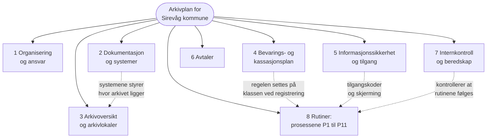

# Arkivplan for Sirevåg kommune

Arkivplanen viser hvordan Sirevåg kommune tar vare på dokumentasjonen sin: hvem som har ansvaret, hva som blir til,
hvor det lagres, hvem som får se det, hva som skal bevares, og hvilke rutiner som gjelder fra et dokument kommer inn
til det er bevart eller kassert.

Planen er kommunens **dokumentasjonsplan** etter arkivlova § 8. Loven bruker ordet dokumentasjonsplan fra 2026.
Sirevåg har beholdt navnet arkivplan, fordi det er innarbeidet hos de ansatte.

| | |
|---|---|
| **Gjelder for** | Hele kommunens administrasjon, de folkevalgte organene og kommunale foretak |
| **Fastsatt av** | Kommunedirektøren |
| **Faglig ansvarlig** | Arkivlederen |
| **Revideres** | Hvert år i november, og når organisasjonen, systemene eller regelverket endres |
| **Rettskildene kontrollert** | 20. november 2026 |

Sirevåg kommune finnes ikke. Planen er laget for øvingssystemet Ark-Ivar, og organisasjonen, systemene, avtalene,
arkivene, fristene og oppbevaringstidene er oppdiktet. Lovhenvisningene er virkelige.

## Innhold

| Del | Kapittel | Svarer på |
|---|---|---|
| 1 | [Organisering og ansvar](01-organisering-og-ansvar.md) | Hvem har ansvaret for hva? |
| 2 | [Dokumentasjon og systemer](02-dokumentasjon-og-systemer.md) | Hva blir til, hva er arkiv, og hvor lagres det? |
| 3 | [Arkivoversikt og arkivlokaler](03-arkivoversikt.md) | Hvilke arkiver har kommunen, og hvor er de? |
| 4 | [Bevarings- og kassasjonsplan](04-bevarings-og-kassasjonsplan.md) | Hva tas vare på for ettertiden, og hvor lenge oppbevares resten? |
| 5 | [Informasjonssikkerhet og tilgang](05-informasjonssikkerhet.md) | Hvordan vernes opplysningene, og hvem har tilgang? |
| 6 | [Avtaler](06-avtaler.md) | Hva er avtalt med andre som behandler kommunens dokumentasjon? |
| 7 | [Internkontroll og beredskap](07-internkontroll-og-beredskap.md) | Hvordan følges planen opp, og hva gjøres når noe går galt? |
| 8 | [Rutiner: prosessbeskrivelsene](../prosesser/README.md) | Hvordan gjøres arbeidet, steg for steg? |
| – | [Lovoversikt](../prosesser/lovoversikt.md) og [ordliste](../prosesser/ordliste.md) | Oppslag |

## Planen i ett bilde

## Hvor oppfyller planen kravene?

Arkivlova § 8 og arkivforskrifta § 12 sier hva en dokumentasjonsplan skal inneholde. Tabellen viser hvor i
arkivplanen hvert krav er oppfylt. Den brukes ved den årlige revisjonen og ved tilsyn.

| Krav | Innhold | Står i |
|---|---|---|
| Arkivlova § 8 første ledd | Planen skal vise hvordan arbeidet med å etterleve loven er organisert | [Del 1](01-organisering-og-ansvar.md) |
| § 8 andre ledd bokstav a | Planen skal kunne brukes som redskap i internkontrollen | [Del 7](07-internkontroll-og-beredskap.md), og denne tabellen |
| § 8 andre ledd bokstav b | Oversikt over hva slags dokumentasjon som blir til | [Del 2](02-dokumentasjon-og-systemer.md) |
| § 8 andre ledd bokstav c | Oversikt over dokumentasjonen som forvaltes som arkiv | [Del 2](02-dokumentasjon-og-systemer.md), [del 3](03-arkivoversikt.md) |
| § 8 andre ledd bokstav d | Hvordan dokumentasjonen lagres | [Del 2](02-dokumentasjon-og-systemer.md), [del 3](03-arkivoversikt.md) |
| Arkivforskrifta § 12 bokstav a | Tjenesteavtaler om arkiv med andre organer eller private | [Del 6](06-avtaler.md) |
| § 12 bokstav b | Vurderingene bak hva som forvaltes som arkiv | [Del 2](02-dokumentasjon-og-systemer.md#vurderingene-bak-hva-som-er-arkiv) |
| § 12 bokstav c | Hva som skal tas vare på for ettertiden | [Del 4](04-bevarings-og-kassasjonsplan.md) |
| § 12 bokstav d | Oppbevaringstider for det som ikke skal tas vare på for ettertiden | [Del 4](04-bevarings-og-kassasjonsplan.md) |
| § 12 bokstav e | Regler om taushetsplikt og informasjonssikkerhet for de ulike delene av dokumentasjonen | [Del 5](05-informasjonssikkerhet.md), [P9](../prosesser/09-skjerming-og-tilgang.md) |
| § 12 bokstav f | Avtaler om ansvaret i systemer for felles oppgaveløsning | [Del 6](06-avtaler.md#felles-systemer-med-andre-organer) |
| § 12 bokstav g | Hvilke systemer som brukes, og om de oppfyller kravene i § 5 | [Del 2](02-dokumentasjon-og-systemer.md#systemene) |
| § 12 bokstav h | Beskrivelser av systemene | [Del 2](02-dokumentasjon-og-systemer.md#systembeskrivelser) |
| § 12 bokstav i | Rutiner for retting av feil | [P6](../prosesser/06-kvalitetskontroll.md#rutine-retting-av-feil) |
| § 12 bokstav j | Rutiner for overføring til langtidsbevaring | [P11](../prosesser/11-bevaring-og-kassasjon.md#langtidsbevaring), [del 6](06-avtaler.md) |
| § 12 bokstav k | Rutiner for å kontrollere at dokumentasjon blir konvertert riktig | [P1](../prosesser/01-postmottak.md), [P6](../prosesser/06-kvalitetskontroll.md#rutine-kontrollkalenderen), [del 3](03-arkivoversikt.md#konverterte-arkiver) |
| § 12 bokstav l | Hvilke avsluttede analoge arkiver som er konvertert | [Del 3](03-arkivoversikt.md#konverterte-arkiver) |
| § 12 bokstav m | Oversikter når ansvaret for dokumentasjon er flyttet ved omorganisering | [Del 3](03-arkivoversikt.md#dokumentasjon-ved-omorganisering) |
| § 12 bokstav n | Hvordan analoge arkiver er ordnet | [Del 3](03-arkivoversikt.md#eldre-og-avsluttede-arkiver) |
| § 12 bokstav o | Hva som er avtalt med andre som løser lovpålagte oppgaver for kommunen | [Del 6](06-avtaler.md#private-som-løser-lovpålagte-oppgaver-for-kommunen) |

## Slik brukes planen

| Hvem | Bruker planen til |
|---|---|
| Ny ansatt | Å lese del 1 og rutinene som gjelder egne oppgaver |
| Saksbehandler | Rutinene i del 8, og del 5 når noe må skjermes |
| Leder | Del 1 (eget ansvar), restansekontrollen i P5 og årshjulet i del 7 |
| Dokumentsenteret | Hele planen. Den er arbeidsbeskrivelsen |
| Systemeier | Del 2 når et system skal anskaffes, endres eller avvikles |
| Kommunedirektøren | Del 7: årlig gjennomgang, risiko og avvik |
| Nasjonalarkivet ved tilsyn | Tabellen over, og dokumentasjonen den viser til |

## Hvorfor har kommunen en arkivplan?

**Loven krever det.** Kommunen skal ha en oppdatert plan som viser hvordan den oppfyller arkivlova (§ 8).

**Ansvaret må kunne pekes ut.** Dokumentasjon blir til i mange systemer og hos mange ansatte. Uten en samlet
oversikt vet ingen hvem som har ansvaret når et fagsystem skal byttes ut, eller når en enhet legges ned.

**Kunnskapen må overleve dem som har den.** Det meste av det som står i planen, finnes i hodet på erfarne ansatte.
Planen gjør at kommunen ikke mister det når de slutter.

**Planen er grunnlaget for kontroll.** Internkontroll betyr å sammenligne det som gjøres, med det som skal gjøres.
Da må det stå et sted hva som skal gjøres.

## Endringer i planen

| Dato | Endring |
|---|---|
| 05.01.2026 | Planen er skrevet om etter ny arkivlov og nye forskrifter. Arkivplanen fra 2021 er avsluttet og tas vare på |
| 20.11.2026 | Rutinene er skrevet ut som prosessbeskrivelser P1 til P11. Bevarings- og kassasjonsplanen er gjennomgått mot bevaringsforskrifta |

Tidligere arkivplaner og dokumentasjonsplaner skal tas vare på for ettertiden (bevaringsforskrifta § 27).
