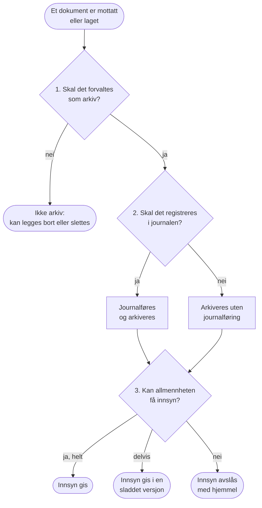
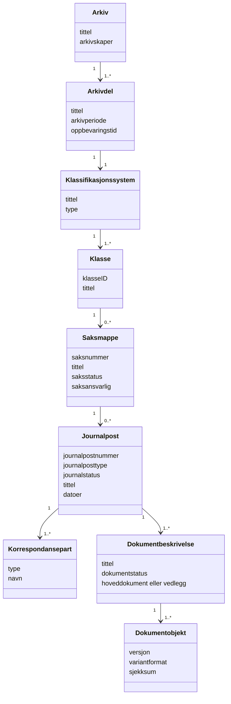
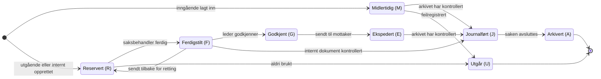

# Grunnlaget: begreper og arkivstruktur

[← Oversikt](README.md) · Neste: [P1 Mottak og sortering](01-postmottak.md)

Før prosessene gir mening, må du kjenne byggeklossene: hva som er dokumentasjon og arkiv, hvordan arkivet er bygget
opp, og hvilke tilstander en sak og et dokument kan være i.

## Dokument, dokumentasjon og arkiv

| Begrep | Betydning | Kilde |
|---|---|---|
| **Dokument** | En logisk avgrenset informasjonsmengde som er lagret på et medium for senere lesing, lytting, framvisning eller overføring. Et brev, en e-post, en SMS, et lydopptak og et kart er alle dokumenter | Offentleglova § 4 første ledd |
| **Saksdokument** | Dokument som er kommet inn til eller lagt fram for organet, eller som organet selv har opprettet, og som gjelder organets ansvarsområde eller virksomhet | Offentleglova § 4 andre ledd |
| **Dokumentasjon** | Dokumenter og annen informasjon organet har lagret i informasjonssystemene sine, og som gjelder saksbehandlingen, oppgaveløsningen eller andre vesentlige forhold ved virksomheten | Arkivlova § 2 bokstav e |
| **Arkiv** | Dokumentasjon som skal tas vare på i et avgrenset tidsrom eller for ettertiden | Arkivlova § 2 bokstav a |
| **Kassere** | Å tilintetgjøre dokumentasjon slik at den ikke lenger finnes | Arkivlova § 2 bokstav g |

Legg merke til at «dokumentasjon» er videre enn «dokument». Opplysninger i en database, for eksempel et
fagsystem for barnehageopptak, er dokumentasjon selv om de aldri har vært et brev.

Et dokument regnes som *opprettet* når det er sendt ut av organet. Blir det ikke sendt, er det opprettet når det
er ferdigstilt (offentleglova § 4 andre ledd). Et utkast som saksbehandleren fortsatt arbeider med, er altså ikke et
saksdokument ennå.

### Arkivplikten

Arkivlova § 5 sier at organet skal forvalte dokumentasjon som blir til som ledd i virksomheten, som arkiv.
Dokumentasjonen skal sikres slik at informasjonen ikke går tapt, og forvaltes slik at

- **opphavet** alltid er kjent (hvem laget det, og når),
- **sammenhengen** går fram (hvilken sak og hvilke andre dokumenter det hører sammen med),
- informasjonen **ikke blir endret**,
- informasjonen er **tilgjengelig** på en måte som ikke begrenser framtidig nytte.

De fire kravene er grunnen til nesten alt i prosessene. Saksmappen og journalposten finnes for å vise sammenhengen.
Låsing av ferdige dokumenter finnes for at ingenting skal bli endret. Titler og klassifikasjon finnes for at
dokumentasjonen skal kunne finnes igjen.

## Tre vurderinger for hvert dokument

**1. Skal det forvaltes som arkiv?** Organet skal særlig legge vekt på om dokumentasjonen er relevant for å
bekrefte hvordan organet har behandlet saker og løst oppgavene sine, og om den kan tjene som bevis for rettigheter
og plikter for privatpersoner eller virksomheter (arkivforskrifta § 1). Reklame, møteinvitasjoner uten saksinnhold,
kopier til orientering og private meldinger er vanligvis ikke arkiv.

**2. Skal det registreres i journalen?** Inngående og utgående saksdokumenter skal registreres i journalen
dersom de *er eller blir saksbehandlet* og *har verdi som bekreftelse på forholdene de gjelder* (arkivforskrifta
§ 14 første ledd). Begge vilkårene må være oppfylt. Organinterne dokumenter registreres så langt organet finner det
tjenlig, men noen interne dokumenter skal alltid journalføres, se [P4](04-utgaende-og-interne.md).

**3. Kan allmennheten få innsyn?** Hovedregelen er at saksdokumenter, journaler og lignende registre er åpne
for innsyn (offentleglova § 3). Unntak krever hjemmel i lov eller forskrift, se [P8](08-innsyn.md).

Rekkefølgen betyr noe. Spørsmål 3 stilles først når noen ber om innsyn, eller når journalen skal gjøres offentlig.
Det har ingen betydning for om dokumentet skal arkiveres eller journalføres.

## Arkivstrukturen

Ark-Ivar følger strukturen i Noark 5. Hvert nivå svarer på ett spørsmål.

| Nivå | Spørsmålet det svarer på | Eksempel fra Sirevåg |
|---|---|---|
| **Arkiv** | Hvem har skapt dette? | Sirevåg kommune |
| **Arkivdel** | Hvilken del av arkivet, og hvilke felles regler gjelder? | Sakarkivet 2024–2027 |
| **Klassifikasjonssystem** | Hvordan er sakene ordnet? | Arkivnøkkelen (emne) eller gårds- og bruksnummer (objekt) |
| **Klasse** | Hvilken oppgave eller hvilket objekt gjelder saken? | 613 Byggesak |
| **Saksmappe** | Hvilken sak hører dokumentet til? | 2026/412 Byggesak – gnr. 45 bnr. 112 – garasje – Fyrvegen 8 |
| **Journalpost** | Hvilken forsendelse eller hvilket dokument er dette? | 2026/412-1 Søknad om tillatelse til tiltak – garasje |
| **Korrespondansepart** | Hvem er avsender eller mottaker? | Avsender: Jorunn Havbrått |
| **Dokumentbeskrivelse** | Hva består forsendelsen av? | Hoveddokument: søknadsskjema. Vedlegg: situasjonskart, tegninger |
| **Dokumentobjekt** | Hvilken fil er dette? | Arkivformatet (PDF/A) og produksjonsformatet (tekstbehandling) |

**Et bilde som hjelper:** Tenk på arkivdelen som et arkivskap, klassen som en skuff med etikett, saksmappen som en
hengemappe i skuffen, journalposten som en stiftet bunke i mappen, og dokumentene som arkene i bunken.
Dokumentobjektet er selve papiret. Journalen er listen på skapdøren over alt som er lagt inn.

### Saksnummer og journalpostnummer

| Nummer | Oppbygning | Eksempel |
|---|---|---|
| Saksnummer | saksår / løpenummer i året | 2026/412 |
| Dokumentnummer | saksnummer – nummeret i saken | 2026/412-3 |
| Journalpostnummer | løpenummer i journalen / journalår | 5831/2026 |

Dokumentnummeret er identifikatoren arkivforskrifta § 15 bokstav a krever: et unikt kjennetegn som kan leses av
mennesker. Numrene deles ut fortløpende og brukes aldri om igjen, heller ikke når en registrering går ut.

### Typer journalposter

| Type | Kode | Brukes for |
|---|---|---|
| Inngående dokument | I | Alt som kommer inn utenfra |
| Utgående dokument | U | Alt organet sender ut |
| Organinternt dokument for oppfølging | N | Notat som noen i organet skal svare på eller følge opp |
| Organinternt dokument uten oppfølging | X | Notat til saken som ingen skal svare på, for eksempel et telefonnotat |
| Saksframlegg | S | Saksframstilling til et folkevalgt organ |

Navnene er de obligatoriske verdiene i Noark 5. Bokstavkodene er innarbeidet fra eldre versjoner av standarden og
brukes i de fleste systemer.

## Statusene

### Journalposten

Noark 5 krever statusene Journalført, Ekspedert, Arkivert og Utgår, og lar arkivskaperen legge til egne. Sirevåg
bruker i tillegg de fire som er merket med stjerne.

| Status | Kode | Betydning |
|---|---|---|
| Midlertidig registrert* | M | Inngående dokument er lagt inn, men ikke kontrollert av Dokumentsenteret |
| Reservert* | R | Saksbehandleren har opprettet en utgående eller intern journalpost og skriver på dokumentet |
| Ferdigstilt fra saksbehandler* | F | Dokumentet er ferdig skrevet og låst, men ikke godkjent eller sendt |
| Godkjent* | G | Leder har godkjent dokumentet |
| Ekspedert | E | Dokumentet er sendt |
| Journalført | J | Dokumentsenteret har kontrollert registreringen. Den står i journalen |
| Arkivert | A | Saken er avsluttet. Registreringen og dokumentene kan ikke endres |
| Utgår | U | Registreringen var feil og skal ikke brukes. Den slettes ikke |

### Saksmappen

| Status | Betydning |
|---|---|
| Under behandling | Saken er åpen. Nye journalposter kan legges til |
| Ferdig fra saksbehandler* | Saksbehandleren mener saken er ferdig og ber Dokumentsenteret avslutte den |
| Avsluttet | Dokumentsenteret har kontrollert og avsluttet saken. Den er låst |
| Utgår | Saken ble opprettet ved en feil og inneholder ingen gyldige journalposter |

### Dokumentet

| Status | Betydning |
|---|---|
| Dokumentet er under redigering | Kan endres. Regnes ikke som saksdokument ennå |
| Dokumentet er ferdigstilt | Låst. Endringer krever et nytt dokument eller en ny versjon som logges |

## Klassifikasjon

Klassifikasjonen bestemmer hvilken skuff saken ligger i. Den brukes til tre ting: å finne igjen saker om samme
oppgave, å styre hvem som har tilgang, og å bestemme oppbevaringstiden.

Sirevåg har to klassifikasjonssystemer:

- **Arkivnøkkelen (emne):** en nummerert oversikt over kommunens oppgaver. Hver sak får klassen for oppgaven den
  gjelder.
- **Objekt:** noen saker ordnes i tillegg etter det de gjelder, for eksempel eiendommen (gårds- og bruksnummer),
  den ansatte eller eleven. Er objektet et fødselsnummer, skal klassen skjermes.

Mange kommuner bruker KS' K-koder som arkivnøkkel. Sirevåg har en forenklet nøkkel laget for øving:

| Klasse | Oppgaveområde | Eksempler på underklasser |
|---|---|---|
| 0 | Organisasjon og styring | 030 Folkevalgte organer, 060 Arkiv og dokumentasjon, 065 Innsyn |
| 1 | Økonomi | 150 Budsjett, 160 Anskaffelser |
| 2 | Personal | 210 Tilsetting, 220 Personalmapper |
| 3 | Oppvekst | 310 Barnehage, 320 Grunnskole |
| 4 | Helse og omsorg | 410 Tjenester i hjemmet og på institusjon, 430 Sosiale tjenester |
| 5 | Kultur, idrett og fritid | 510 Tilskudd til lag og foreninger |
| 6 | Plan, bygg og eiendom | 610 Arealplan, 613 Byggesak, 620 Oppmåling |
| 7 | Tekniske tjenester | 710 Vann og avløp, 730 Veg |
| 8 | Næring, landbruk og miljø | 810 Landbruk, 840 Forurensning |
| 9 | Samfunnssikkerhet og beredskap | 910 Beredskapsplaner |

## Arkivdelene i Sirevåg

| Arkivdel | Innhold | Ordnet etter | Tilgang som utgangspunkt |
|---|---|---|---|
| SAK | Alminnelige saker | Arkivnøkkelen | Alle ansatte kan lese det som ikke er skjermet |
| BYGG | Byggesaker og delingssaker | Gårds- og bruksnummer, og arkivnøkkelen | Plan og byggesak, Dokumentsenteret |
| PERS | Personalmapper | Den ansatte | Personal og nærmeste leder |
| ELEV | Elevmapper | Eleven | Skolen eleven går på |
| HELSE | Saker om helse- og omsorgstjenester | Tjenestemottakeren | Enheten som yter tjenesten |
| HAVN | Saker i Sirevåg Havn KF | Arkivnøkkelen | Foretaket og Dokumentsenteret |

## Dokumentasjonsplanen

Kommunen skal ha en oppdatert dokumentasjonsplan som viser hvordan arbeidet med å oppfylle arkivlova er organisert
(arkivlova § 8). Planen skal blant annet gi oversikt over hva slags dokumentasjon som blir til, hva som forvaltes
som arkiv, hvordan det lagres, hvilke systemer som brukes, oppbevaringstider, regler om taushetsplikt og rutiner
for retting av feil (arkivforskrifta § 12). Dokumentasjonsplanen har overtatt for det som før 2026 het arkivplan.

Sirevåg har beholdt det innarbeidede navnet og kaller planen [Arkivplan for Sirevåg kommune](../arkivplan/README.md).
Prosessbeskrivelsene her er del 8 i arkivplanen: rutinene.

## Hvem har ansvaret?

Kommunedirektøren leder administrasjonen (kommuneloven § 13-1) og er ansvarlig for internkontrollen (kommuneloven
§ 25-1). Internkontrollen omfatter dokumentasjonsforvaltningen (arkivforskrifta § 13 første ledd). I det daglige er
ansvaret delt slik:

- **Saksbehandleren** har ansvar for at alt som hører til saken, blir registrert i saken.
- **Lederen** har ansvar for at enheten følger rutinene, og for restansene i enheten.
- **Dokumentsenteret** har ansvar for kvaliteten i journalen og arkivet.
- **Arkivlederen** har det faglige ansvaret for rutinene og dokumentasjonsplanen.

Nasjonalarkivet veileder og fører tilsyn (arkivlova §§ 4 og 21), og kan gi pålegg om retting (§ 22). Forsettlige
eller grovt uaktsomme brudd på blant annet arkivplikten kan straffes med bot (§ 23).

## Kontrollspørsmål

1. En saksbehandler får en SMS fra en innbygger med nye opplysninger i en byggesak. Er det et dokument?
2. Hva er forskjellen på en journalpost og et dokument?
3. Hvorfor slettes ikke en journalpost som er registrert ved en feil?

Løsningsforslag

1. Ja. Mediet er uten betydning (offentleglova § 4 første ledd). Meldingen gjelder en sak i kommunen og er et
   saksdokument. Den skal inn i saken, for eksempel som et skjermbilde eller en avskrift med dato og avsender.
2. Journalposten er registreringen av én forsendelse eller ett internt dokument i saken, med opplysninger om
   avsender eller mottaker, datoer og tittel. Dokumentene (hoveddokumentet og vedleggene) er innholdet som
   journalposten viser til.
3. Fordi informasjonen i arkivet ikke skal endres uten spor (arkivlova § 5 første ledd bokstav c), og fordi numre
   ikke skal brukes om igjen. Registreringen får status Utgår, og det går fram hvem som gjorde det og hvorfor.

