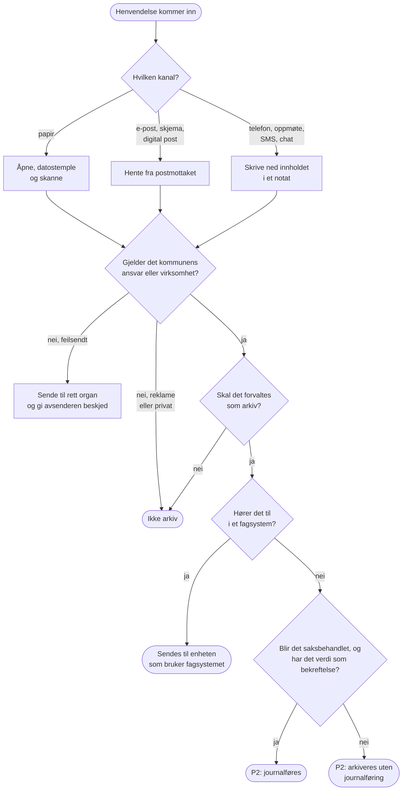

# P1 Mottak og sortering

[← Oversikt](README.md) · Forrige: [Grunnlaget](00-grunnlag.md) · Neste: [P2 Registrering og journalføring](02-registrering.md)

## Kort om prosessen

| | |
|---|---|
| **Formål** | Fange opp alt som kommer inn til kommunen, og avgjøre hva som skal inn i arkivet |
| **Starter når** | Et dokument eller en henvendelse kommer inn, uansett kanal |
| **Slutter når** | Dokumentet er sendt videre til registrering (P2), til et fagsystem, eller er vurdert som ikke arkiv |
| **Hvem** | Dokumentsenteret. Saksbehandlere som får henvendelser direkte |
| **Frist** | Samme arbeidsdag som dokumentet kom inn |

## Figur

## Rutine steg for steg

| Steg | Hvem | Hva gjøres | Resultat |
|---|---|---|---|
| 1 | Dokumentsenteret | Tømmer alle kanalene minst to ganger om dagen: postkassen, den felles e-postkassen, digitale skjemaer og sikker digital post | Ingenting blir liggende ulest |
| 2 | Dokumentsenteret | Åpner papirposten og datostempler den. Brev merket «personlig» til en ansatt leveres uåpnet. Den ansatte har plikt til å levere tilbake det som viser seg å gjelde kommunen | Mottaksdatoen er sikret |
| 3 | Dokumentsenteret | Skanner papirdokumenter i original størrelse, 300 PPI, 24 bits farger (RGB) og lavest mulig komprimering. Kontrollerer at alle sider er med og lesbare | En digital kopi som kan erstatte papiret |
| 4 | Dokumentsenteret | Vurderer om henvendelsen gjelder kommunens ansvar eller virksomhet. Feilsendte henvendelser sendes til rett organ, og avsenderen får beskjed | Feilsendt post kommer fram |
| 5 | Dokumentsenteret | Vurderer om dokumentet skal forvaltes som arkiv. Reklame, aviser, kursinvitasjoner og private meldinger legges bort | Arkivet fylles ikke med støy |
| 6 | Dokumentsenteret | Vurderer om dokumentet hører til i et fagsystem (for eksempel barnehageopptak). I så fall sendes det dit | Dokumentet havner i riktig system |
| 7 | Dokumentsenteret | Vurderer om dokumentet skal journalføres: Blir det saksbehandlet, og har det verdi som bekreftelse på det det gjelder? | Klart for P2 |
| 8 | Saksbehandler | Sender e-post og andre henvendelser som er kommet direkte, til Dokumentsenteret eller registrerer dem selv samme dag. Skriver notat fra telefonsamtaler og møter når det kommer fram opplysninger av betydning for saken | Det som kom utenom postmottaket, kommer også inn |
| 9 | Dokumentsenteret | Oppbevarer det skannede papiret i en dagsbunke til kontrollen i P6 er gjort, og makulerer det deretter. Unntak: dokumenter fra 1950 eller tidligere, dokumenter med særlig verdi som gjenstand, og dokumenter som andre regler krever i original | Papiret er borte først når kopien er kontrollert |

### Kanalene

| Kanal | Hvordan den håndteres | Særlig å passe på |
|---|---|---|
| Papirpost | Åpnes, stemples, skannes | Rekommanderte sendinger kvitteres. Konvolutten tas vare på når poststempelet kan ha betydning for en frist |
| E-post til den felles e-postkassen | Hentes rett inn i sak- og arkivsystemet | Vedlegg skal følge med. Hele e-posttråden registreres ikke på nytt for hvert svar |
| E-post rett til en saksbehandler | Saksbehandleren har ansvaret for at den kommer inn i saken | Den vanligste årsaken til hull i arkivet |
| Digitale skjemaer | Kommer ferdig utfylt, ofte med opplysninger som kan registreres automatisk | Kontroller at det havner i riktig sak |
| Sikker digital post | Hentes som e-post | Brukes for sensitive opplysninger |
| Telefon og oppmøte | Skrives ned av den som tok imot | Notatet skal ha dato, hvem som snakket med hvem, og hva som ble sagt |
| SMS, chat og sosiale medier | Innholdet tas ut som skjermbilde eller avskrift | Kanalen avgjør ikke om det er arkiv. Innholdet avgjør |

## Lovgrunnlag

| Regel | Hva den sier | Hvor i prosessen |
|---|---|---|
| Arkivlova § 5 | Dokumentasjon som blir til som ledd i virksomheten, skal forvaltes som arkiv og sikres slik at informasjonen ikke går tapt | Hele prosessen |
| Arkivforskrifta § 1 | Organet skal særlig ta hensyn til om dokumentasjonen bekrefter hvordan saker er behandlet, og om den kan være bevis for privates rettigheter og plikter | Steg 5 |
| Offentleglova § 4 | Definerer dokument og saksdokument. Reklame og lignende som ikke er knyttet til en bestemt sak, og dokumenter en ansatt mottar i en annen egenskap enn som ansatt, er ikke saksdokumenter | Steg 2, 4 og 5 |
| Arkivforskrifta § 14 første ledd | Inngående og utgående saksdokumenter journalføres når de er eller blir saksbehandlet og har verdi som bekreftelse | Steg 7 |
| Arkivforskrifta § 9 og § 16 første og andre ledd | Papir som skannes i den daglige oppgaveløsningen, skal skannes slik at informasjon ikke går tapt: original størrelse, 300 PPI, 24 bit RGB, lavest mulig komprimering. Papiret kan deretter destrueres | Steg 3 og 9 |
| Arkivforskrifta § 19 | Papir fra 1950 eller tidligere, og papir med særskilt historisk verdi som gjenstand, kan ikke destrueres | Steg 9 |
| Forvaltningsloven § 11 | Veiledningsplikten. Organet skal hjelpe den som har henvendt seg til feil sted | Steg 4 |
| Forvaltningsloven § 11 d andre ledd | Nye opplysninger av betydning som en part gir muntlig, skal så vidt mulig skrives ned | Steg 8 |
| eForvaltningsforskriften § 6 | Regler om bekreftelse på at en elektronisk henvendelse er mottatt | Steg 1 |

## Hvorfor gjør vi det slik?

**Kanalen avgjør ikke, innholdet avgjør.** Loven spør ikke om noe kom som brev eller som tekstmelding. Den spør
om informasjonen gjelder kommunens saksbehandling og oppgaver. En klage skrevet i en kommentar på kommunens side i
sosiale medier er like mye en klage som et rekommandert brev.

**Arkivet skal være komplett, men ikke overfylt.** Mangler det dokumenter, kan ingen se hva som egentlig skjedde i
saken. Fylles arkivet med reklame og kopier, blir det vanskelig å finne det som betyr noe. Sorteringen i steg 5 er
derfor like viktig som registreringen etterpå. Før 2026 het dette «arkivbegrensning», og ordet brukes fortsatt i
praksis.

**Mottaksdatoen er et bevis.** Klagefrister og søknadsfrister regnes ofte fra når noe kom fram. Derfor stemples
papiret, og derfor tar systemet vare på tidspunktet en e-post kom inn.

**Papiret makuleres ikke før kopien er kontrollert.** En skannet kopi med manglende sider kan ikke rettes når
originalen er borte.

## Eksempel fra Sirevåg

Mandag morgen ligger dette i postmottaket:

| Henvendelse | Vurdering | Hva skjer |
|---|---|---|
| E-post med søknad om å bygge garasje i Fyrvegen 8 | Gjelder kommunens myndighet, skal saksbehandles og har verdi som bekreftelse | Til P2, journalføres |
| Brev fra en leverandør med tilbud om kurs i presentasjonsteknikk | Reklame uten tilknytning til en sak | Legges bort |
| E-post der en nabo protesterer på garasjen | Blir en del av byggesaken | Til P2, journalføres i samme sak som søknaden |
| Brev om motorvognavgift, adressert til kommunen ved en feil | Gjelder ikke kommunen | Sendes til rett etat, avsenderen får beskjed |
| Telefon til byggesaksbehandleren: søkeren opplyser at garasjen skal være 0,5 meter lavere enn på tegningen | Ny opplysning av betydning | Saksbehandleren skriver et telefonnotat i saken |
| Kopi av et rundskriv fra et departement, sendt til alle kommuner til orientering | Blir ikke saksbehandlet | Arkiveres ikke. Enheten kan lagre det som arbeidsmateriale |
| Søknad om barnehageplass på papir | Hører til i fagsystemet for barnehageopptak | Skannes og sendes Oppvekst |

## Vanlige feil

| Feil | Følge | Slik unngås den |
|---|---|---|
| E-post blir liggende i innboksen til en saksbehandler | Saken er ikke komplett. Ingen andre kan ta over ved fravær | Fast rutine: videresend eller registrer samme dag |
| Telefonsamtaler blir ikke skrevet ned | Opplysninger som avgjorde saken, kan ikke dokumenteres | Mal for telefonnotat i systemet |
| Alt registreres «for sikkerhets skyld» | Journalen blir uoversiktlig, og innsynsarbeidet øker | Bruk vurderingene i steg 5 og 7 |
| Papiret makuleres rett etter skanning | Feil i skanningen kan ikke rettes | Dagsbunke som makuleres etter kontroll |
| Hver e-post i en lang tråd registreres med hele tråden | Samme tekst ligger mange ganger i saken | Registrer den siste meldingen når tråden er samlet, eller bare det nye |

## Hva systemet må støtte

| Behov | Forklaring |
|---|---|
| En innboks med eksempeldokumenter | Studenten får en bunke henvendelser i ulike kanaler, også noen som ikke skal arkiveres |
| Valgene i sorteringen | For hvert dokument: ikke arkiv, feilsendt, fagsystem, arkiveres uten journalføring, journalføres |
| Begrunnelse | Studenten velger hvilken regel vurderingen bygger på |
| Mottaksdato | Følger dokumentet videre til registreringen |
| Tilbakemelding | Systemet viser om vurderingen stemmer med fasiten, og forklarer hvorfor |

## Kontrollspørsmål

1. En innbygger sender en tekstmelding til ordførerens tjenestetelefon og ber om at fartsgrensen i Fyrvegen settes
   ned. Skal meldingen arkiveres?
2. Kommunen får en invitasjon til en konferanse. Skal den journalføres?
3. Hvorfor er det ikke nok å skanne papirposten i svart-hvitt med lav oppløsning?

Løsningsforslag

1. Ja. Meldingen gjelder kommunens virksomhet og er et saksdokument, uansett kanal. Den skal tas ut av telefonen
   og registreres. Fører den til at kommunen behandler spørsmålet, skal den også journalføres.
2. Som regel ikke. Den blir ikke saksbehandlet og har ingen verdi som bekreftelse. Blir en ansatt meldt på med
   kommunen som betaler, kan påmeldingen være dokumentasjon i regnskapet, men det er en annen vurdering.
3. Fordi kopien skal kunne erstatte originalen. Farger, stempler, håndskrift og små detaljer i kart og tegninger
   kan gå tapt. Arkivforskrifta § 16 andre ledd setter derfor minstekrav.

