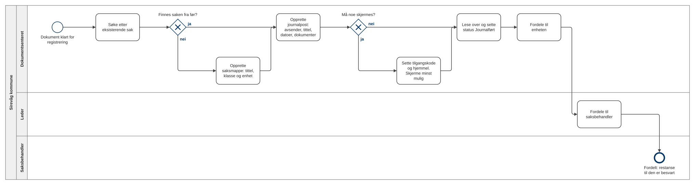

# P2 Registrering og journalføring

[← Oversikt](README.md) · Forrige: [P1 Mottak og sortering](01-postmottak.md) · Neste: [P3 Saksbehandling](03-saksbehandling.md)

## Kort om prosessen

| | |
|---|---|
| **Formål** | Gi dokumentet en plass i arkivet, slik at det kan finnes igjen, forstås i sammenheng og følges opp |
| **Starter når** | P1 har avgjort at et inngående dokument skal registreres |
| **Slutter når** | Journalposten har status Journalført og er fordelt til en saksbehandler |
| **Hvem** | Dokumentsenteret |
| **Frist** | Løpende. I Sirevåg betyr det samme arbeidsdag, og senest neste arbeidsdag |

Prosessen gjelder inngående dokumenter. Utgående og interne dokumenter registreres av saksbehandleren, se
[P4](04-utgaende-og-interne.md).

## Figur

Figuren følger BPMN. Symbolene er forklart i [oversikten](README.md#symbolene-i-figurene).

## Rutine steg for steg

| Steg | Hva gjøres | Slik gjøres det riktig |
|---|---|---|
| 1 | **Søk etter saken.** | Søk på avsenderens referanse, saksnummeret i brevet, navn, eiendom og emne. Et svar på et brev fra kommunen hører alltid til saken brevet ligger i |
| 2 | **Velg sak eller opprett ny.** | Én sak er ett saksforhold fra start til slutt. Opprett ny sak når henvendelsen starter noe nytt. Ikke lag samlesaker som «Diverse henvendelser 2026» |
| 3 | **Skriv sakstittelen** (bare for ny sak). | Sakstittelen sier hva saken gjelder: sakstype, objekt og sted. Den skal kunne stå i offentlig journal |
| 4 | **Velg klasse.** | Klassen for oppgaven saken gjelder. Byggesaker får i tillegg gårds- og bruksnummer |
| 5 | **Opprett journalposten.** | Type Inngående. Systemet gir neste dokumentnummer i saken |
| 6 | **Registrer avsenderen.** | Navnet slik avsenderen selv skriver det. Virksomheter registreres med virksomhetens navn, ikke kontaktpersonens |
| 7 | **Skriv tittelen på journalposten.** | Tittelen sier hva dokumentet er: «Søknad om …», «Klage på …», «Uttalelse til …» |
| 8 | **Registrer datoene.** | Dokumentets dato er datoen som står på dokumentet. Mottatt dato er datoen det kom til kommunen. Journaldatoen setter systemet |
| 9 | **Knytt til dokumentene.** | Ett hoveddokument. Resten er vedlegg med egne titler. Kontroller at filene kan åpnes |
| 10 | **Vurder skjerming.** | Se [P9](09-skjerming-og-tilgang.md). Skjerm bare det som må skjermes, og før alltid på hjemmelen |
| 11 | **Fordel.** | Til enheten som har oppgaven. Lederen fordeler videre til saksbehandler når Dokumentsenteret ikke vet hvem som skal ha saken |
| 12 | **Les over og journalfør.** | Kontroller stavemåte, datoer og at journalposten ligger i riktig sak. Sett status Journalført |

### Opplysningene journalen skal ha

Arkivforskrifta § 15 første ledd lister opp hva som skal registreres om alle journalføringspliktige saksdokumenter.
Tabellen viser hvilket felt i systemet som oppfyller hvert krav.

| Bokstav | Kravet | Felt i systemet |
|---|---|---|
| a | En identifikator som gir dokumentet et unikt kjennetegn mennesker kan lese | Dokumentnummeret, for eksempel 2026/412-1 |
| b | Informasjon om konteksten dokumentet brukes i, og hvilke andre dokumenter det hører sammen med | Saksmappen, klassen og koblingen til dokumentet det svarer på |
| c | En tittel eller andre opplysninger som viser hva dokumentet gjelder | Tittelen på journalposten og sakstittelen |
| d | Navnet på avsenderen eller mottakeren | Korrespondanseparten |
| e | Datoen på dokumentet, eller datoen det ble sendt eller mottatt | Dokumentets dato og mottatt dato |
| f | Tidspunktet for registreringen | Journaldatoen |

### Gode titler

| Regel | Dårlig | Bedre |
|---|---|---|
| Si hva dokumentet er og hva det gjelder | «Brev» | «Søknad om tillatelse til tiltak – garasje» |
| Det viktigste først | «Vedrørende deres brev av 3. mars om …» | «Svar på spørsmål om kommunale avgifter» |
| Bruk ord folk søker på | «Ad. tiltak 45/112» | «Byggesak – gnr. 45 bnr. 112 – garasje – Fyrvegen 8» |
| Ingen forkortelser som bare huset forstår | «Uttalelse KU PBE» | «Uttalelse fra kulturminnemyndigheten til byggesøknad» |
| Ikke kopier emnefeltet i e-posten ukritisk | «SV: VS: SV: spørsmål» | «Spørsmål om frist for nabovarsel» |
| Unngå opplysninger som må skjermes, når tittelen kan skrives uten | «Søknad om redusert betaling på grunn av sykdom» | «Søknad om redusert foreldrebetaling» |

Navn på privatpersoner skal bare stå i tittelen når det trengs for å skille saken fra andre. Må navnet stå der, og
navnet sammen med sakstypen røper noe taushetsbelagt, skjermes navnet.

## Lovgrunnlag

| Regel | Hva den sier | Hvor i prosessen |
|---|---|---|
| Arkivforskrifta § 14 første ledd | Organet fører journal for å legge til rette for offentlig innsyn. Inngående og utgående saksdokumenter som saksbehandles og har verdi som bekreftelse, skal registreres | Hele prosessen |
| Arkivforskrifta § 15 første ledd | Hvilke opplysninger som skal registreres, og at det skal skje løpende | Steg 5 til 9, og fristen |
| Arkivforskrifta § 15 andre ledd | Journalen skal være tilgjengelig for innsyn. Opplysninger i journalen kan bare unntas når dokumentet ikke kan registreres uten å røpe noe taushetsbelagt eller noe annet allmennheten ikke kan kreve innsyn i. En hel registrering kan bare unntas når det trengs for å ikke røpe taushetsbelagte opplysninger | Steg 10 |
| Offentleglova § 10 første ledd | Organet skal føre journal etter reglene i arkivlova med forskrifter | Hele prosessen |
| Offentleglova § 13, jf. forvaltningsloven § 13 | Taushetsbelagte opplysninger er unntatt fra innsyn | Steg 10 |
| Arkivlova § 5 første ledd bokstav a og b | Opphavet og sammenhengen skal alltid gå fram | Steg 1, 2, 6 og 9 |
| Arkivforskrifta § 5 andre ledd | Systemet skal sikre nødvendige metadata, verne mot uautoriserte endringer og spore endringer | Systemkravene |

## Hvorfor gjør vi det slik?

**Journalen er allmennhetens vindu inn i forvaltningen.** Arkivforskrifta § 14 sier rett ut at journalen føres
for å legge til rette for offentlig innsyn. En journalist eller en nabo kan ikke be om innsyn i et dokument de ikke
vet finnes. Derfor skal også taushetsbelagte dokumenter stå i journalen, med de taushetsbelagte opplysningene
skjermet.

**Riktig sak gir riktig sammenheng.** Et dokument i feil sak er i praksis borte. Saksbehandleren ser det ikke,
og den som senere leser saken, får et ufullstendig bilde. Derfor begynner registreringen alltid med et søk.

**Tittelen er det viktigste søkeordet.** De fleste finner fram ved å søke i titler, både internt og i offentlig
journal. En presis tittel sparer tid hver gang noen leter, i mange år framover.

**Løpende registrering.** Forskriften sier «løpende» og ikke et antall dager. Grunnen er at journalen skal vise hva
som faktisk ligger til behandling. Ligger posten uregistrert i en uke, er journalen feil i en uke, og svarfristene
løper uten at noen ser dem.

**Skjerm lite, men riktig.** For mye skjerming svekker innsynsretten. For lite skjerming kan være brudd på
taushetsplikten. Regelen i § 15 andre ledd er derfor todelt: skjerm bare det som er nødvendig, og unnta aldri en hel
registrering uten at taushetsplikt krever det.

## Eksempel fra Sirevåg

### Eksempel 1: Byggesøknad (ingen skjerming)

Jorunn Havbrått sender e-post 2. mars 2026 med søknad om å bygge garasje. Dokumentsenteret finner ingen sak på
eiendommen fra før og oppretter en ny.

| Felt | Verdi |
|---|---|
| Saksnummer | 2026/412 |
| Sakstittel | Byggesak – gnr. 45 bnr. 112 – garasje – Fyrvegen 8 |
| Arkivdel | BYGG |
| Klasse | 613 Byggesak, og gnr. 45 bnr. 112 |
| Ansvarlig enhet | Plan og byggesak |
| Dokumentnummer | 2026/412-1 |
| Journalposttype | Inngående dokument |
| Avsender | Jorunn Havbrått |
| Tittel | Søknad om tillatelse til tiltak – garasje |
| Dokumentets dato | 02.03.2026 |
| Mottatt dato | 02.03.2026 |
| Journaldato | 02.03.2026 |
| Hoveddokument | Søknadsskjema |
| Vedlegg | Situasjonskart, plan- og fasadetegninger, kvittering for nabovarsel |
| Tilgangskode | Ingen |
| Fordelt til | Plan og byggesak, saksbehandler Eilif Skarvheim |
| Status | Journalført |

Ti dager senere kommer en protest fra naboen. Den registreres som 2026/412-2 i samme sak: «Merknad til nabovarsel
– garasje».

### Eksempel 2: Søknad med taushetsbelagte opplysninger

En forelder søker om redusert foreldrebetaling i barnehagen og legger ved skattemelding og en legeerklæring.

| Felt | Verdi | I offentlig journal |
|---|---|---|
| Sakstittel | Søknad om redusert foreldrebetaling – barnehageåret 2026/2027 | Vises |
| Tittel på journalposten | Søknad om redusert foreldrebetaling | Vises |
| Avsender | Forelderens navn | Skjermet |
| Tilgangskode | 13 – Taushetsplikt | Vises |
| Hjemmel | Offentleglova § 13, jf. forvaltningsloven § 13 første ledd nr. 1 | Vises |
| Dokumentene | Søknad, skattemelding, legeerklæring | Ikke tilgjengelige |

Tittelen kan stå åpent fordi den ikke sier hvem det gjelder. Navnet skjermes fordi navnet sammen med sakstypen
forteller om familiens økonomi, som er et personlig forhold.

## Vanlige feil

| Feil | Følge | Slik unngås den |
|---|---|---|
| Ny sak opprettes uten søk | Samme saksforhold ligger i flere saker | Steg 1 hoppes aldri over |
| Flere saksforhold samles i én sak | Umulig å avslutte saken og sette riktig oppbevaringstid | Én sak per saksforhold |
| Kontaktpersonen registreres som avsender i stedet for virksomheten | Søk på virksomheten gir ikke treff | Virksomheten er avsender, kontaktpersonen står i eget felt |
| Dokumentets dato og mottatt dato forveksles | Frister beregnes feil | Les datoen på dokumentet, og bruk mottaksstempelet |
| Hele tittelen skjermes | Journalen sier ingenting, og innsynsretten svekkes | Skriv tittelen nøytralt og skjerm bare enkeltord eller navn |
| Tilgangskode settes uten hjemmel | Avslag på innsyn kan ikke begrunnes | Hjemmel er obligatorisk når tilgangskode er valgt |
| Vedlegg legges inn som én stor fil uten titler | Ingen kan se hva forsendelsen inneholder | Ett hoveddokument, og vedlegg med egne titler |

## Hva systemet må støtte

| Behov | Forklaring |
|---|---|
| Søk etter saker | På tittel, saksnummer, avsender, klasse og eiendom |
| Opprette saksmappe | Tittel, arkivdel, klasse (emne og eventuelt objekt), ansvarlig enhet, tilgangskode |
| Opprette journalpost | Type, avsender, tittel, dokumentets dato, mottatt dato. Journaldato og numre settes av systemet |
| Dokumenter | Ett hoveddokument og flere vedlegg, med titler |
| Skjerming | Tilgangskode med påkrevd hjemmel, og valg av hva som skjermes: navn, enkeltord i tittelen, dokumentet |
| Fordeling | Til enhet og saksbehandler |
| Statuser | Midlertidig registrert og Journalført |
| Endringslogg | Hvem som har registrert og endret hva, og når |
| Tilbakemelding til studenten | Sammenligning med en fasit felt for felt: riktig sak, klasse, tittel, datoer, skjerming og hjemmel |

## Kontrollspørsmål

1. Et brev er datert 27. februar, poststemplet 28. februar og kommer til kommunen 3. mars. Det registreres
   4. mars. Hvilke datoer registreres hvor?
2. Hvorfor skal en taushetsbelagt søknad stå i journalen?
3. En innbygger sender ett brev der hun både klager på et byggevedtak og søker om skjenkebevilling. Hvordan
   registreres det?

Løsningsforslag

1. Dokumentets dato er 27. februar, mottatt dato er 3. mars, og journaldatoen er 4. mars. Poststempelet
   registreres ikke, men konvolutten tas vare på hvis en frist kan avhenge av det.
2. Fordi journalføringsplikten ikke avhenger av om dokumentet kan unntas fra innsyn. Journalen skal vise at
   dokumentet finnes, og innsynsretten gjelder journalen også. De taushetsbelagte opplysningene skjermes, og en
   hel registrering kan bare unntas når det er nødvendig for ikke å røpe taushetsbelagte opplysninger
   (arkivforskrifta § 15 andre ledd).
3. Brevet gjelder to saksforhold og registreres i begge sakene, med hver sin journalpost og en tittel som passer i
   hver sak. Merk i begge at dokumentet også ligger i den andre saken.

