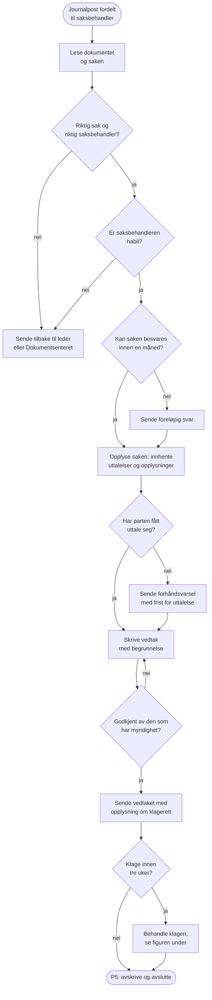
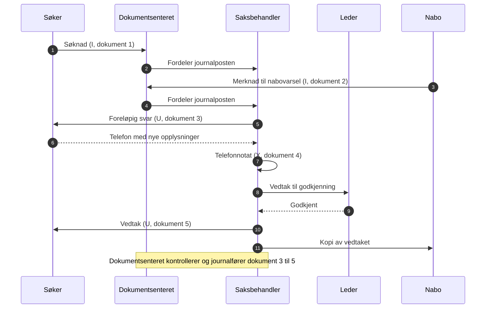
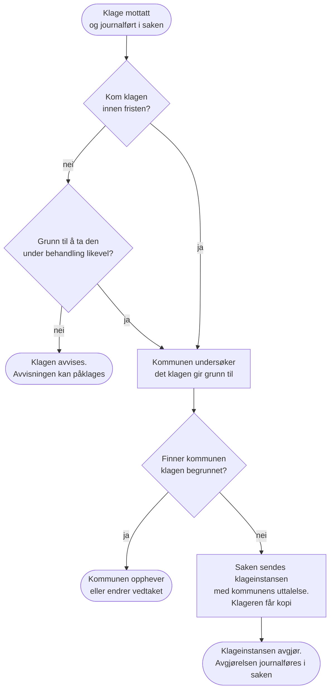

# P3 Saksbehandling

[← Oversikt](README.md) · Forrige: [P2 Registrering og journalføring](02-registrering.md) · Neste: [P4 Utgående og interne dokumenter](04-utgaende-og-interne.md)

## Kort om prosessen

| | |
|---|---|
| **Formål** | Behandle saken forsvarlig og sørge for at alt som skjer, er dokumentert i saken |
| **Starter når** | En journalpost er fordelt til en saksbehandler |
| **Slutter når** | Avgjørelsen er sendt, eventuell klage er behandlet, og saken kan avsluttes (P5) |
| **Hvem** | Saksbehandler og leder. Dokumentsenteret registrerer det som kommer inn underveis |
| **Frist** | Uten ugrunnet opphold. Foreløpig svar innen en måned når svaret tar lengre tid |

Prosessen beskriver saksgangen i en sak som ender med et enkeltvedtak, fordi den har flest lovbestemte steg.
Enklere saker, som et spørsmål som besvares med et brev, følger de samme stegene uten forhåndsvarsel, vedtak og
klage.

**Enkeltvedtak** er et vedtak som gjelder rettigheter eller plikter til en eller flere bestemte personer
(forvaltningsloven § 2 første ledd bokstav b). En byggetillatelse, et avslag på barnehageplass og et pålegg om
opprydding er enkeltvedtak. Et svar på et spørsmål om åpningstider er det ikke.

## Figur: saksgangen

## Figur: hvem gjør hva, og hva blir journalført

Hver pil mellom kommunen og omverdenen er en journalpost. Tallene viser dokumentnummeret i saken.

## Rutine steg for steg

| Steg | Hvem | Hva gjøres | Dokumentasjon i saken |
|---|---|---|---|
| 1 | Saksbehandler | Leser det fordelte dokumentet og resten av saken. Sender tilbake samme dag hvis det er fordelt feil | Fordelingen er logget |
| 2 | Saksbehandler | Vurderer egen habilitet. Er det tvil, tas det opp med lederen | Avgjørelsen noteres når noen fratrer |
| 3 | Saksbehandler | Vurderer hvor lang tid saken tar. Sender foreløpig svar når en henvendelse i en sak om enkeltvedtak ikke kan besvares innen en måned. Svaret sier hvorfor, og når avgjørelsen kan ventes | Utgående journalpost |
| 4 | Saksbehandler | Opplyser saken: ber om manglende dokumentasjon, innhenter uttalelser fra andre enheter og myndigheter, drar på befaring | Utgående og inngående journalposter, interne notater |
| 5 | Saksbehandler | Skriver notat fra telefonsamtaler, møter og befaringer når det kommer fram noe av betydning for avgjørelsen | Internt notat uten oppfølging |
| 6 | Saksbehandler | Legger fram for parten opplysninger kommunen har fått om parten, når parten har rett til å se dem og de har betydning | Utgående journalpost |
| 7 | Saksbehandler | Sender forhåndsvarsel til parter som ikke har uttalt seg, før vedtaket treffes. Varselet sier hva saken gjelder, og setter en frist | Utgående journalpost |
| 8 | Saksbehandler | Skriver vedtaket. Begrunnelsen viser til reglene, de faktiske forholdene og hovedhensynene i skjønnet | Utkast i saken med status Reservert |
| 9 | Leder | Godkjenner vedtaket, eller sender det tilbake med merknader | Godkjenningen er logget |
| 10 | Saksbehandler | Sender vedtaket til partene så snart som mulig, med opplysning om klagerett, klagefrist, klageinstans, framgangsmåten ved klage og retten til å se sakens dokumenter | Utgående journalpost, status Ekspedert |
| 11 | Saksbehandler | Avskriver de inngående dokumentene som vedtaket svarer på, se [P5](05-avskriving-og-avslutning.md) | Avskriving med kobling til vedtaket |
| 12 | Saksbehandler | Venter ut klagefristen før saken meldes ferdig | – |

### Når det kommer en klage

| Steg | Hva gjøres |
|---|---|
| 1 | Klagen settes fram for kommunen, som traff vedtaket. Den registreres i samme sak som vedtaket |
| 2 | Kommunen kontrollerer at klagen kom innen tre uker fra vedtaket kom fram til parten, og at den som klager, har klagerett |
| 3 | Kommunen gjør undersøkelsene klagen gir grunn til, og varsler eventuelle motparter |
| 4 | Finner kommunen klagen begrunnet, kan den oppheve eller endre vedtaket |
| 5 | Ellers sendes sakens dokumenter til klageinstansen så snart saken er tilrettelagt. Klageren får kopi av kommunens uttalelse |
| 6 | Klageinstansens avgjørelse kommer som inngående dokument og journalføres. Først da kan saken avsluttes |

Hvem som er klageinstans, avhenger av saken. For vedtak etter kommunens egne ordninger er det kommunestyret,
eller formannskapet eller en klagenemnd kommunestyret har bestemt (forvaltningsloven § 28 andre ledd). Mange
særlover legger klagen til statsforvalteren. Det gjelder blant annet byggesaker.

## Lovgrunnlag

| Regel | Hva den sier | Hvor i prosessen |
|---|---|---|
| Forvaltningsloven § 6 | Når en tjenesteperson er inhabil | Steg 2 |
| Forvaltningsloven § 11 | Veiledningsplikten overfor parter og andre | Hele prosessen |
| Forvaltningsloven § 11 a | Saken skal forberedes og avgjøres uten ugrunnet opphold. Foreløpig svar når svaret tar uforholdsmessig lang tid, og i saker om enkeltvedtak når henvendelsen ikke kan besvares innen en måned | Steg 3 |
| Forvaltningsloven § 11 d andre ledd | Nye opplysninger av betydning som gis muntlig, skal så vidt mulig skrives ned. Det samme gjelder iakttakelser ved befaring | Steg 5 |
| Forvaltningsloven § 16 | Forhåndsvarsel til parter som ikke har uttalt seg | Steg 7 |
| Forvaltningsloven § 17 | Saken skal være så godt opplyst som mulig. Opplysninger om parten skal legges fram for parten | Steg 4 og 6 |
| Forvaltningsloven §§ 18 og 19 | Partens rett til å se sakens dokumenter, og unntakene | Steg 10, og [P8](08-innsyn.md) |
| Forvaltningsloven § 23 | Enkeltvedtak skal være skriftlig | Steg 8 |
| Forvaltningsloven §§ 24 og 25 | Enkeltvedtak skal begrunnes, og hva begrunnelsen skal inneholde | Steg 8 |
| Forvaltningsloven § 27 | Partene skal underrettes om vedtaket så snart som mulig, med opplysning om klageadgang, frist, klageinstans og framgangsmåte | Steg 10 |
| Forvaltningsloven §§ 28 og 29 | Klagerett, klageinstans og klagefrist på tre uker | Klagen |
| Forvaltningsloven §§ 32 og 33 | Klagen settes fram for organet som traff vedtaket. Underinstansen forbereder klagesaken | Klagen |
| eForvaltningsforskriften § 8 | Vedtak og forhåndsvarsel kan gjøres tilgjengelig digitalt, og parten skal varsles | Steg 7 og 10 |
| Kommuneloven § 13-1 sjette ledd | Et folkevalgt organ kan gi kommunedirektøren myndighet til å treffe vedtak i saker som ikke har prinsipiell betydning | Steg 9, og [P10](10-politisk-behandling.md) |
| Arkivlova § 5 | Dokumentasjon av saksbehandlingen skal forvaltes som arkiv | Kolonnen «Dokumentasjon i saken» |

Særlover kan ha egne frister og egne saksbehandlingsregler som går foran. Plan- og bygningsloven har for eksempel
egne frister for byggesaker.

## Hvorfor gjør vi det slik?

**Saken skal kunne leses av en fremmed.** Tenk deg at saksbehandleren slutter i morgen. Den som overtar, skal
kunne åpne saken og se hva som har skjedd, hva som er lovet, og hva som gjenstår. Det samme gjelder klageinstansen,
en domstol og en forsker om femti år. Alt av betydning skal derfor inn i saken mens det skjer, ikke etterpå.

**Reglene verner den saken gjelder.** Forhåndsvarsel gir parten mulighet til å rette opp feil før vedtaket
treffes. Begrunnelsen gjør det mulig å forstå vedtaket og vurdere en klage. Opplysningen om klagerett gjør det
mulig å bruke den. Hvert av stegene etterlater et dokument, og dokumentet er beviset på at regelen ble fulgt.

**Foreløpig svar er respekt, og det er styring.** Innbyggeren får vite at saken ikke er glemt. For kommunen gir
fristen på en måned et fast kontrollpunkt: en restanse som er eldre enn en måned uten foreløpig svar, er et avvik.

**Muntlige opplysninger forsvinner.** Mye avklares på telefon og i møter. Uten notat finnes opplysningen bare i
hodet på saksbehandleren. Parten kan heller ikke kontrollere at kommunen har oppfattet riktig.

**Godkjenning og logg viser hvem som bestemte.** Et vedtak er bare gyldig når det er truffet av noen med
myndighet. Systemet skal derfor vise hvem som godkjente, og når.

## Eksempel fra Sirevåg

Sak 2026/412, garasjen i Fyrvegen 8, ser slik ut når den er ferdig:

| Nr. | Type | Dato | Tittel | Avsender eller mottaker | Avskrevet |
|---|---|---|---|---|---|
| 1 | I | 02.03.2026 | Søknad om tillatelse til tiltak – garasje | Jorunn Havbrått | Besvart med brev, dokument 5 |
| 2 | I | 12.03.2026 | Merknad til nabovarsel – garasje | Naboen i Fyrvegen 10 | Besvart med brev, dokument 5 |
| 3 | U | 16.03.2026 | Foreløpig svar – behov for flere opplysninger om høyde | Jorunn Havbrått | – |
| 4 | X | 19.03.2026 | Telefonnotat – søker opplyser at mønehøyden senkes med 0,5 meter | – | – |
| 5 | U | 30.03.2026 | Tillatelse til tiltak – garasje | Jorunn Havbrått, kopi til naboen | – |

Naboen klager ikke innen fristen. Saksbehandleren melder saken ferdig 22. april, og Dokumentsenteret avslutter den.

## Vanlige feil

| Feil | Følge | Slik unngås den |
|---|---|---|
| Svar sendes fra saksbehandlerens e-post uten å gå gjennom saken | Svaret mangler i arkivet, og det inngående dokumentet blir stående som restanse | Alle svar lages i saken |
| Telefonnotat skrives ikke | Avgjørende opplysninger kan ikke dokumenteres | Notatmal med dato, deltakere og innhold |
| Foreløpig svar sendes ikke | Brudd på forvaltningsloven § 11 a, og misfornøyde innbyggere | Restanselisten viser alder på hver restanse |
| Vedtaket mangler opplysning om klagerett | Klagefristen kan bli forlenget, og vedtaket kan bli angrepet | Vedtaksmal med fast avsnitt om klage |
| Klagen registreres som ny sak | Klageinstansen får ikke hele saken samlet | Klagen hører til saken vedtaket ligger i |
| Uttalelser fra andre enheter ligger i e-post | Saken viser ikke hva vedtaket bygger på | Interne uttalelser registreres som notat i saken |

## Hva systemet må støtte

| Behov | Forklaring |
|---|---|
| Min arbeidsliste | Journalposter fordelt til studenten, med alder og frist |
| Varsel om foreløpig svar | Restanser i saker om enkeltvedtak som nærmer seg en måned |
| Notat i saken | Enkel registrering av telefonnotat og møtereferat |
| Maler | Foreløpig svar, forhåndsvarsel, vedtak med klageopplysning |
| Godkjenning | Dokumentet sendes til en lærerstyrt eller simulert leder som godkjenner eller returnerer |
| Hendelser som kommer underveis | Øvingsoppgaven kan sende inn en nabomerknad, en telefon eller en klage mens saken pågår |
| Tidslinje | Alt som har skjedd i saken, i rekkefølge |

## Kontrollspørsmål

1. En søknad om tilskudd kom inn 1. april. Saksbehandleren ser 20. april at avgjørelsen tidligst kan tas i juni.
   Hva skal gjøres?
2. Saksbehandleren får vite på telefon at søkeren har solgt eiendommen. Hva gjør hun?
3. Hvor skal klagen sendes, og hvor registreres den?

Løsningsforslag

1. Det skal sendes et foreløpig svar snarest mulig, og i alle fall før det er gått en måned fra søknaden kom inn.
   Svaret skal si hvorfor saken ikke kan avgjøres tidligere, og så vidt mulig når avgjørelsen kan ventes
   (forvaltningsloven § 11 a).
2. Hun skriver et telefonnotat i saken med dato, hvem hun snakket med, og hva som ble opplyst (forvaltningsloven
   § 11 d andre ledd). Opplysningen har betydning for hvem som er part.
3. Klagen sendes til kommunen, som traff vedtaket (forvaltningsloven § 32). Den registreres som inngående
   dokument i samme sak som vedtaket. Kommunen vurderer klagen først, og sender saken videre til klageinstansen
   hvis vedtaket ikke endres (§ 33).

