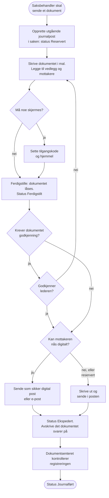
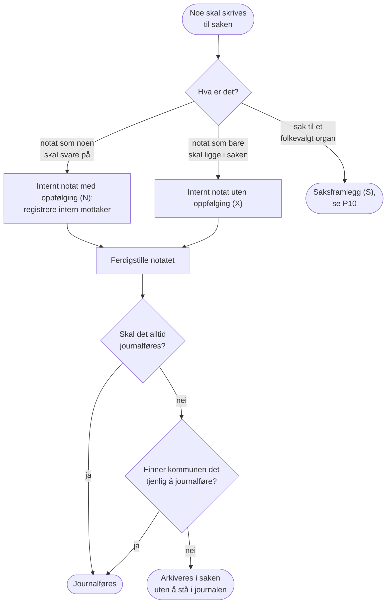

# P4 Utgående og interne dokumenter

[← Oversikt](README.md) · Forrige: [P3 Saksbehandling](03-saksbehandling.md) · Neste: [P5 Avskriving, restanser og avslutning](05-avskriving-og-avslutning.md)

## Kort om prosessen

| | |
|---|---|
| **Formål** | Sørge for at alt kommunen sender ut eller skriver til saken, er laget i saken, godkjent av rett person og bevart slik det ble sendt |
| **Starter når** | Saksbehandleren skal skrive et brev, et vedtak eller et notat |
| **Slutter når** | Dokumentet er sendt eller ferdigstilt, og Dokumentsenteret har journalført det |
| **Hvem** | Saksbehandler, leder og Dokumentsenteret |
| **Frist** | Dokumentsenteret kontrollerer senest neste arbeidsdag etter at dokumentet er sendt |

## Figur: utgående dokument

## Rutine: utgående dokument

| Steg | Hvem | Hva gjøres |
|---|---|---|
| 1 | Saksbehandler | Oppretter en utgående journalpost i riktig sak. Dokumentet skrives aldri utenfor saken og lastes opp etterpå |
| 2 | Saksbehandler | Skriver tittelen etter reglene i [P2](02-registrering.md#gode-titler). Tittelen sier hva dokumentet er: «Tillatelse til …», «Svar på …», «Foreløpig svar – …» |
| 3 | Saksbehandler | Registrerer mottakerne. Den dokumentet er rettet til, er mottaker. Andre som får det til orientering, er kopimottakere |
| 4 | Saksbehandler | Skriver dokumentet i kommunens mal og legger til vedlegg |
| 5 | Saksbehandler | Vurderer skjerming, se [P9](09-skjerming-og-tilgang.md). Et svar på en skjermet henvendelse må som regel skjermes på samme måte |
| 6 | Saksbehandler | Ferdigstiller. Dokumentet låses og lagres i arkivformat. Fra nå av er endringer bare mulig ved å sende det tilbake til redigering, og det logges |
| 7 | Leder | Godkjenner dokumenter som krever det: vedtak, uttalelser på kommunens vegne og brev med økonomiske forpliktelser. Returnerer med merknader hvis noe må rettes |
| 8 | Saksbehandler | Sender dokumentet. Digitalt når mottakeren kan nås digitalt og ikke har reservert seg. Ellers på papir |
| 9 | Saksbehandler | Avskriver det inngående dokumentet som blir besvart, se [P5](05-avskriving-og-avslutning.md) |
| 10 | Dokumentsenteret | Kontrollerer tittel, mottaker, datoer, skjerming og at dokumentet faktisk er sendt. Setter status Journalført |

### Hva er «sendt»?

Datoen dokumentet ble sendt, registreres i journalposten. Den har rettslig betydning: fristen i et forhåndsvarsel
løper fra den dagen varselet ble sendt (forvaltningsloven § 16 første ledd). Klagefristen løper derimot fra
vedtaket kom fram til parten (§ 29).

Enkeltvedtak og andre viktige meldinger som sendes digitalt, skal gjøres tilgjengelige i et egnet system, og
mottakeren skal varsles om at meldingen finnes, og hvor. Har parten ikke åpnet et enkeltvedtak innen en uke, skal
parten varsles en gang til (eForvaltningsforskriften § 8). Privatpersoner kan reservere seg mot digital post fra
forvaltningen (§ 9), og får da vedtaket på papir.

## Figur: internt dokument

## Rutine: interne dokumenter

| Type | Når brukes den | Eksempler |
|---|---|---|
| **Internt notat med oppfølging (N)** | Når en annen i kommunen skal svare eller gjøre noe. Notatet blir en restanse hos mottakeren til det er avskrevet | Byggesak ber Teknisk drift uttale seg om avkjørsel. Personal ber kommuneadvokaten om en vurdering |
| **Internt notat uten oppfølging (X)** | Når opplysninger skal dokumenteres i saken uten at noen skal svare | Telefonnotat, referat fra befaring, møtereferat, saksbehandlerens vurdering |
| **Saksframlegg (S)** | Når saken skal til et folkevalgt organ | Se [P10](10-politisk-behandling.md) |

**Journalføring av interne dokumenter.** Interne dokumenter registreres i journalen så langt organet finner det
tjenlig (arkivforskrifta § 14 andre ledd). Sirevåg journalfører alle interne notater som har betydning for utfallet
av en sak. Noen interne dokumenter skal *alltid* journalføres:

| Dokument | Regel |
|---|---|
| Dokument som inneholder organets endelige avgjørelse i en sak | Offentleglova § 14 andre ledd bokstav a |
| Generelle retningslinjer for saksbehandlingen | Offentleglova § 14 andre ledd bokstav b |
| Saksframlegg med vedlegg til et folkevalgt organ | Offentleglova § 16 første ledd bokstav a |
| Saksliste til møter i folkevalgte organer | Offentleglova § 16 første ledd bokstav b |
| Dokumenter fra eller til kontrollutvalget, revisjonen og klagenemnder | Offentleglova § 16 første ledd bokstav c |
| Dokumenter i saker der en kommunal enhet opptrer som ekstern part overfor en annen | Offentleglova § 16 første ledd bokstav d |
| Dokumenter fra eller til et kommunalt foretak eller et særlovsorgan | Offentleglova § 16 andre ledd |
| Dokumenter fra eller til en enhet på et område der enheten har selvstendig avgjørelsesrett | Offentleglova § 16 tredje ledd første punktum |

Listen følger av arkivforskrifta § 14 andre ledd bokstav a til c. Den omfatter også presedenskort (offentleglova
§ 14 andre ledd bokstav d) og noen dokumenter som bare finnes i staten, helseforetakene og universitetene.

Et internt dokument som ikke journalføres, skal likevel arkiveres i saken når det er dokumentasjon av
saksbehandlingen. Det er forskjell på å stå i journalen og å ligge i arkivet.

## Lovgrunnlag

| Regel | Hva den sier | Hvor i prosessen |
|---|---|---|
| Offentleglova § 4 andre ledd | Et dokument er opprettet når det er sendt ut av organet. Ellers når det er ferdigstilt | Steg 6 og 8. Fra dette tidspunktet gjelder innsynsretten |
| Arkivforskrifta § 14 første ledd | Utgående saksdokumenter som er saksbehandlet og har verdi som bekreftelse, skal journalføres | Hele prosessen |
| Arkivforskrifta § 14 andre ledd | Interne dokumenter journalføres så langt det er tjenlig, og noen alltid | Interne dokumenter |
| Arkivforskrifta § 15 første ledd | Opplysningene som skal registreres, blant annet mottaker og dato | Steg 2 og 3 |
| Arkivlova § 5 første ledd bokstav c | Informasjonen skal ikke bli endret | Steg 6 |
| Arkivforskrifta § 5 andre ledd bokstav b og c | Systemet skal verne mot uautoriserte endringer og spore endringer | Steg 6 og 7 |
| Offentleglova § 14 første ledd | Organinterne dokumenter kan unntas fra innsyn | Vurderes når noen ber om innsyn, se [P8](08-innsyn.md) |
| Forvaltningsloven § 27 | Underretning om vedtak, som regel skriftlig | Steg 8 |
| eForvaltningsforskriften §§ 8 og 9 | Digital utsending, varsling og reservasjon | Steg 8 |
| Kommuneloven § 13-1 | Kommunedirektøren leder administrasjonen. Myndigheten til å godkjenne følger delegeringen videre nedover | Steg 7 |

## Hvorfor gjør vi det slik?

**Arkivet skal ha det som faktisk ble sendt.** Skrives brevet utenfor systemet og lastes opp etterpå, er det
ingen sikkerhet for at versjonen i arkivet er den mottakeren fikk. Når dokumentet lages i saken og låses før det
sendes, er arkiveksemplaret og det sendte eksemplaret det samme.

**Låsing er det som gjør et dokument til et bevis.** Et dokument som kan endres etter at det er sendt, beviser
ingenting. Derfor er ferdigstilling et eget steg, og derfor logges det når noen åpner et ferdigstilt dokument
igjen.

**Utkast er arbeidsmateriale.** Før dokumentet er sendt eller ferdigstilt, er det ikke et saksdokument, og det
gjelder ingen innsynsrett. Det gir saksbehandleren rom til å tenke og skrive. Men rommet lukkes i det dokumentet
er ferdig.

**N og X handler om oppfølging, ikke om viktighet.** Forskjellen er bare om noen skal svare. Et telefonnotat kan
være det viktigste dokumentet i saken og er likevel et X-notat.

**Kontrollen til Dokumentsenteret er en ekstra sikring.** Saksbehandleren registrerer selv, men kjenner ikke
alltid reglene for titler og skjerming like godt. Derfor er det Dokumentsenteret som setter status Journalført.

## Eksempel fra Sirevåg

**Utgående:** Eilif Skarvheim i Plan og byggesak skal gi tillatelse til garasjen i sak 2026/412.

1. Han oppretter journalpost 2026/412-5 med tittelen «Tillatelse til tiltak – garasje», mottaker Jorunn Havbrått
   og naboen i Fyrvegen 10 som kopimottaker.
2. Han skriver vedtaket i vedtaksmalen, som har avsnittet om klagerett ferdig utfylt.
3. Han ferdigstiller og sender til godkjenning. Enhetslederen godkjenner samme dag.
4. Vedtaket sendes som sikker digital post. Naboen har reservert seg mot digital post og får kopien på papir.
5. Han avskriver dokument 1 (søknaden) og dokument 2 (nabomerknaden) med «Besvart med brev» og kobling til
   dokument 5.
6. Dokumentsenteret kontrollerer neste morgen og setter status Journalført.

**Internt:** Før vedtaket ba han Teknisk drift vurdere avkjørselen. Det var et notat med oppfølging (N) til
Teknisk drift. Svaret derfra er et nytt notat som avskriver det første.

## Vanlige feil

| Feil | Følge | Slik unngås den |
|---|---|---|
| Dokumentet skrives på egen maskin og lastes opp som PDF | Ingen sikkerhet for at arkivversjonen er den som ble sendt | Skriv alltid fra saken |
| Journalposter blir stående som Reservert | Journalen viser dokumenter som aldri ble sendt | Ukentlig kontroll av gamle reserverte, se [P6](06-kvalitetskontroll.md) |
| Dokumentet sendes før det er godkjent | Vedtaket kan være truffet uten myndighet | Systemet hindrer utsending av dokumenter som krever godkjenning |
| Kopimottakere registreres som mottakere | Uklart hvem dokumentet er rettet til | Bruk kopimottaker |
| Svar på en skjermet henvendelse sendes uten skjerming | Navnet på en person i en taushetsbelagt sak står åpent i journalen | Skjermingen følger saken som forslag |
| Interne uttalelser sendes på e-post | Saken viser ikke hva vedtaket bygger på | Bruk notat med oppfølging |

## Hva systemet må støtte

| Behov | Forklaring |
|---|---|
| Opprette utgående og interne journalposter | Med mottakere, kopimottakere og interne mottakere |
| Skrive dokumentet i systemet | En enkel editor med maler er nok for øving |
| Ferdigstilling | Dokumentet låses. Gjenåpning logges |
| Godkjenning | Send til leder, godkjenn, returner med merknad |
| Ekspedering | Valg av kanal, registrering av sendt dato, status Ekspedert |
| Avskriving ved ekspedering | Forslag om å avskrive det inngående dokumentet som blir besvart |
| Kontrollsteget | En rolle for Dokumentsenteret som går gjennom og journalfører |

## Kontrollspørsmål

1. En saksbehandler har skrevet et utkast til avslag som ligger i saken med status Reservert. En journalist ber
   om innsyn i utkastet. Er det et saksdokument?
2. Hva er forskjellen på et N-notat og et X-notat?
3. Saksbehandleren oppdager en skrivefeil i et vedtak dagen etter at det ble sendt. Hva gjør hun?

Løsningsforslag

1. Nei. Et dokument organet selv lager, er opprettet når det er sendt ut, eller når det er ferdigstilt
   (offentleglova § 4 andre ledd). Et utkast under arbeid er ikke et saksdokument, og innsynsretten gjelder
   ikke ennå.
2. N brukes når noen i organet skal følge opp eller svare, og notatet blir en restanse hos mottakeren. X brukes
   når notatet bare skal dokumentere noe i saken.
3. Hun retter ikke i det sendte dokumentet. Hun lager et nytt utgående dokument i saken, for eksempel «Retting av
   skrivefeil i vedtak», og sender det. Arkivet skal vise både det som ble sendt først, og rettingen.

