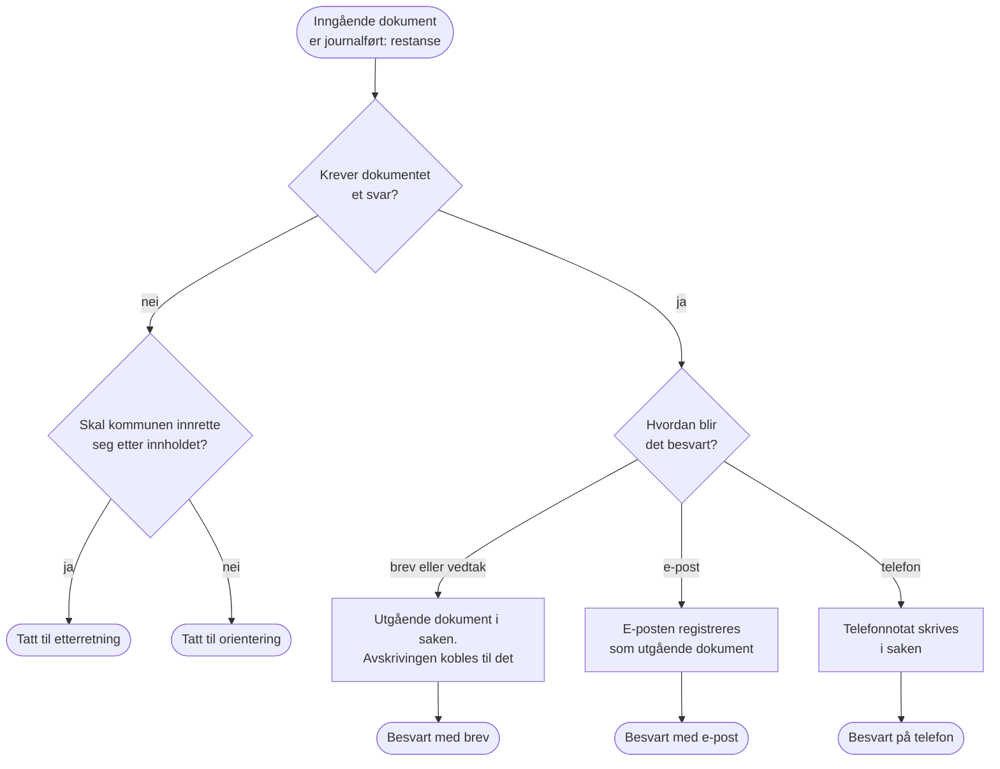
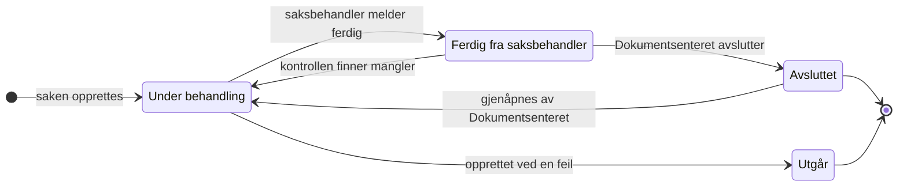

# P5 Avskriving, restanser og avslutning

[← Oversikt](README.md) · Forrige: [P4 Utgående og interne dokumenter](04-utgaende-og-interne.md) · Neste: [P6 Arkivets kvalitetskontroll](06-kvalitetskontroll.md)

## Kort om prosessen

| | |
|---|---|
| **Formål** | Vise at hver henvendelse er ferdig behandlet, holde oversikt over det som ikke er det, og lukke saker som er ferdige |
| **Starter når** | Et inngående dokument eller et internt notat med oppfølging er journalført. Da er det en restanse |
| **Slutter når** | Alle journalposter i saken er avskrevet, og saken har status Avsluttet |
| **Hvem** | Saksbehandler avskriver. Leder følger opp restansene. Dokumentsenteret avslutter saker |
| **Frist** | Avskriving skjer samtidig med svaret. Restanselisten går til lederne hver måned |

### Tre ord

| Ord | Betydning |
|---|---|
| **Restanse** | Et inngående dokument, eller et internt notat med oppfølging, som ikke er avskrevet. Altså noe kommunen ennå ikke har vist at den er ferdig med |
| **Avskriving** | Registreringen som viser at dokumentet er ferdig behandlet, og hvordan |
| **Avslutning** | Saken lukkes for nye dokumenter. Alt i den blir låst |

## Figur: avskriving

### Avskrivningsmåtene

| Måte | Kode | Brukes når |
|---|---|---|
| Besvart med brev | BU | Kommunen har svart med et utgående dokument. Avskrivingen viser til dokumentet |
| Besvart med e-post | BE | Kommunen har svart på e-post. E-posten ligger i saken |
| Besvart på telefon | TLF | Svaret er gitt muntlig. Det skal ligge et telefonnotat i saken |
| Tatt til etterretning | TE | Dokumentet krever ikke svar, men kommunen merker seg innholdet og innretter seg etter det. For eksempel et vedtak fra statsforvalteren |
| Tatt til orientering | TO | Dokumentet krever ikke svar og ingen handling. For eksempel en kopi til informasjon |

De fem måtene er obligatoriske verdier i Noark 5. Kodene er innarbeidet fra eldre versjoner av standarden.

## Figur: avslutning av saken

## Rutine steg for steg

### Avskriving

| Steg | Hvem | Hva gjøres |
|---|---|---|
| 1 | Saksbehandler | Avskriver det inngående dokumentet samtidig som svaret sendes. Systemet foreslår avskriving når et utgående dokument opprettes som svar |
| 2 | Saksbehandler | Velger avskrivningsmåte. Ved svar i brev eller e-post kobles avskrivingen til det utgående dokumentet |
| 3 | Saksbehandler | Avskriver dokumenter som ikke krever svar, med Tatt til etterretning eller Tatt til orientering når de er lest og vurdert |
| 4 | Saksbehandler | Avskriver ikke før svaret faktisk er gitt. Et foreløpig svar avskriver ikke søknaden |

### Restansekontroll

| Steg | Hvem | Hva gjøres |
|---|---|---|
| 1 | Dokumentsenteret | Tar ut restanselisten den første arbeidsdagen i hver måned, sortert på enhet, saksbehandler og alder |
| 2 | Leder | Går gjennom listen med saksbehandlerne. Restanser over en måned skal ha foreløpig svar. Restanser som i virkeligheten er besvart, avskrives |
| 3 | Leder | Melder tilbake til Dokumentsenteret innen to uker |
| 4 | Arkivleder | Rapporterer restansesituasjonen til kommunedirektøren to ganger i året, som en del av internkontrollen |

### Avslutning av saken

| Steg | Hvem | Hva gjøres |
|---|---|---|
| 1 | Saksbehandler | Kontrollerer at saken er komplett: alle e-poster, notater og svar er registrert, og alle inngående dokumenter er avskrevet |
| 2 | Saksbehandler | Venter til klagefristen er ute og eventuell klage er avgjort |
| 3 | Saksbehandler | Setter saken til Ferdig fra saksbehandler |
| 4 | Dokumentsenteret | Kontrollerer saken etter sjekklisten under |
| 5 | Dokumentsenteret | Setter saken til Avsluttet. Alle journalposter får status Arkivert, og dokumentene lagres i arkivformat |
| 6 | Dokumentsenteret | Sender saken tilbake til saksbehandleren med en merknad dersom kontrollen finner mangler |

**Sjekklisten før en sak avsluttes**

- [ ] Ingen journalposter har status Reservert, Ferdigstilt eller Midlertidig registrert
- [ ] Alle inngående dokumenter og notater med oppfølging er avskrevet
- [ ] Alle dokumenter er ferdigstilt og kan åpnes
- [ ] Sakstittelen beskriver det saken faktisk kom til å handle om
- [ ] Klassen er riktig
- [ ] Tilgangskoder og hjemler er riktige, og midlertidig skjerming er fjernet eller gjort varig
- [ ] Saken har riktig regel for bevaring eller kassasjon, se [P11](11-bevaring-og-kassasjon.md)

### Når det kommer noe nytt i en avsluttet sak

| Situasjon | Løsning |
|---|---|
| Et etternølerdokument som hører til saksforholdet, for eksempel en ferdigmelding | Dokumentsenteret gjenåpner saken, registrerer dokumentet og avslutter på nytt |
| En ny henvendelse om samme tema, men et nytt saksforhold | Ny sak, med henvisning til den gamle |
| Et innsynskrav i den avsluttede saken | Ny sak om innsyn. Den avsluttede saken åpnes ikke |

## Lovgrunnlag

Avskriving og avslutning står ikke som egne begreper i lov eller forskrift. De er arkivfaglige metoder fra Noark 5
som gjør det mulig å oppfylle disse reglene:

| Regel | Hva den sier | Hvordan prosessen oppfyller den |
|---|---|---|
| Forvaltningsloven § 11 a | Saker skal avgjøres uten ugrunnet opphold, og det skal gis foreløpig svar | Restanselisten viser hva som ikke er besvart, og hvor gammelt det er |
| Arkivlova § 5 første ledd bokstav b | Sammenhengen informasjonen inngår i, skal gå fram | Avskrivingen kobler henvendelsen til svaret |
| Arkivlova § 5 første ledd bokstav c | Informasjonen skal ikke bli endret | Avslutningen låser saken |
| Arkivforskrifta § 5 andre ledd | Systemet skal verne mot uautoriserte endringer og spore endringer | Bare Dokumentsenteret kan gjenåpne, og det logges |
| Arkivforskrifta § 3 | Organet fastsetter oppbevaringstider for det som ikke skal tas vare på for ettertiden | Oppbevaringstiden regnes fra saken ble avsluttet |
| Kommuneloven § 25-1 | Internkontroll: nødvendige rutiner, og avvik skal avdekkes og følges opp | Restansekontrollen og sjekklisten |

## Hvorfor gjør vi det slik?

**Restanselisten er kommunens huskeliste.** Uten avskriving vet ingen hvilke brev som er besvart. Med avskriving
kan en leder på et øyeblikk se alt enheten skylder svar på. Det er også slik en innbygger som purrer, raskt kan få
vite hvor saken står.

**Avskrivingen binder spørsmål og svar sammen.** Om ti år skal det være mulig å se at søknaden i dokument 1 ble
avgjort av vedtaket i dokument 5. Koblingen er en del av sammenhengen arkivlova krever.

**Feil avskriving er verre enn ingen avskriving.** Et brev som er avskrevet uten at det er besvart, forsvinner
fra alle lister. Da vil ingen oppdage at innbyggeren aldri fikk svar. Derfor avskrives det ikke «for å rydde».

**En sak som ikke avsluttes, kan aldri kasseres eller overføres.** Oppbevaringstiden regnes fra avslutningen. Åpne
saker blir liggende i det aktive systemet uten vern mot endringer. Avslutningen er derfor mer enn opprydding. Den
er det som gjør saken til et ferdig stykke dokumentasjon.

**To par øyne.** Saksbehandleren kjenner innholdet og vet når saken er ferdig. Dokumentsenteret kjenner
arkivreglene. Derfor melder den ene ferdig, og den andre avslutter.

## Eksempel fra Sirevåg

Restanselisten for Plan og byggesak 1. april 2026:

| Dokument | Mottatt | Alder | Tittel | Saksbehandler | Vurdering |
|---|---|---|---|---|---|
| 2026/380-1 | 20.02.2026 | 40 dager | Søknad om dispensasjon fra reguleringsplan | E. Skarvheim | Over en måned og uten foreløpig svar: avvik. Foreløpig svar sendes i dag |
| 2026/401-2 | 05.03.2026 | 27 dager | Spørsmål om gebyr | E. Skarvheim | Besvart på e-post 6. mars, men e-posten ligger ikke i saken. E-posten registreres, og dokumentet avskrives med Besvart med e-post |
| 2026/455-1 | 18.03.2026 | 14 dager | Kopi av uttalelse fra fylkeskommunen i annen kommunes plansak | E. Skarvheim | Krever ikke svar. Avskrives med Tatt til orientering |
| 2026/412-2 | 12.03.2026 | 20 dager | Merknad til nabovarsel – garasje | E. Skarvheim | Vedtaket ble sendt 30. mars, men merknaden ble ikke avskrevet. Avskrives med Besvart med brev, koblet til dokument 5 |

Listen viser tre ulike årsaker til en restanse: saken er faktisk ubehandlet, svaret mangler i arkivet, eller
avskrivingen er glemt.

## Vanlige feil

| Feil | Følge | Slik unngås den |
|---|---|---|
| Svar sendes utenom saken | Dokumentet blir stående som restanse selv om det er besvart | Alle svar lages i saken |
| Søknaden avskrives med det foreløpige svaret | Saken forsvinner fra restanselisten før den er avgjort | Foreløpig svar avskriver ikke |
| Alt avskrives med Tatt til orientering for å tømme listen | Ubesvarte henvendelser skjules | Leder kontrollerer stikkprøver |
| Besvart på telefon uten notat | Ingen dokumentasjon på hva som ble svart | Systemet krever et notat i saken ved denne måten |
| Saker avsluttes aldri | Ingen vern mot endringer, og oppbevaringstiden begynner aldri å løpe | Årlig gjennomgang av saker uten aktivitet |
| Saksbehandleren avslutter selv uten kontroll | Feil i titler, skjerming og klasse blir låst | Bare Dokumentsenteret kan sette Avsluttet |

## Hva systemet må støtte

| Behov | Forklaring |
|---|---|
| Avskriving | Fem avskrivningsmåter, dato og hvem som avskrev. Kobling til det utgående dokumentet |
| Restanseliste | Per saksbehandler og enhet, med alder og markering av restanser over en måned uten foreløpig svar |
| Regler | Besvart på telefon krever et notat i saken. Besvart med brev krever et utgående dokument |
| Saksstatus | Under behandling, Ferdig fra saksbehandler, Avsluttet, Utgår |
| Sjekk ved avslutning | Systemet viser hva som hindrer avslutning: åpne restanser, reserverte journalposter, dokumenter som ikke er ferdigstilt |
| Låsing og gjenåpning | Avsluttede saker er skrivebeskyttet. Gjenåpning er forbeholdt arkivrollen og logges |

## Kontrollspørsmål

1. Kommunen får et brev fra statsforvalteren som opphever et kommunalt vedtak. Hvilken avskrivningsmåte passer?
2. En saksbehandler svarer på en søknad med et foreløpig svar. Skal søknaden avskrives?
3. Hvorfor kan ikke saksbehandleren selv sette saken til Avsluttet?

Løsningsforslag

1. Tatt til etterretning, dersom opphevelsen ikke krever noe svar. Kommunen må innrette seg etter innholdet. Skal
   kommunen behandle saken på nytt, fortsetter saken, og brevet avskrives når den nye behandlingen er ferdig.
2. Nei. Søknaden er ikke ferdig behandlet før den er avgjort. Den skal stå på restanselisten til vedtaket er
   sendt.
3. Fordi avslutningen låser saken. Dokumentsenteret kontrollerer først at saken er komplett og riktig registrert:
   titler, klasse, skjerming, avskriving og regel for bevaring.

