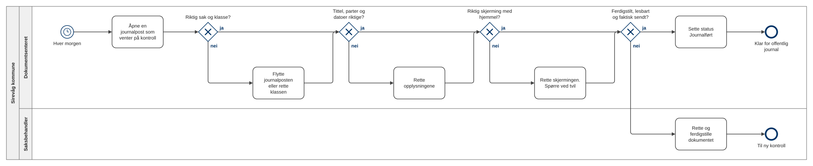
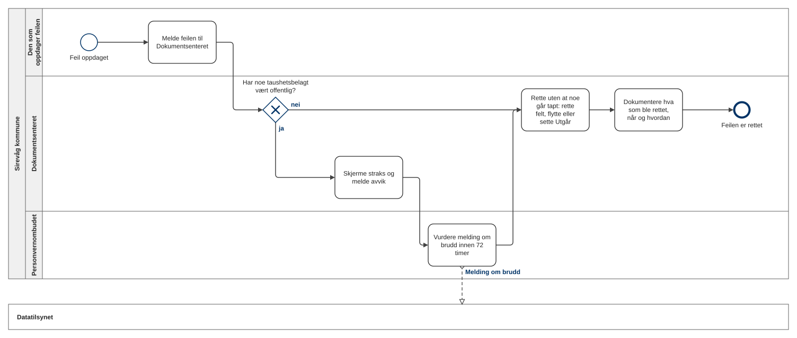

# P6 Arkivets kvalitetskontroll

[← Oversikt](README.md) · Forrige: [P5 Avskriving, restanser og avslutning](05-avskriving-og-avslutning.md) · Neste: [P7 Offentlig journal](07-offentlig-journal.md)

## Kort om prosessen

| | |
|---|---|
| **Formål** | Sikre at journalen og arkivet er riktige og komplette, og at feil rettes uten at spor forsvinner |
| **Starter når** | En journalpost er registrert av en saksbehandler, eller en fast kontroll forfaller |
| **Slutter når** | Registreringen er kontrollert og har status Journalført, eller feilen er rettet og dokumentert |
| **Hvem** | Dokumentsenteret. Arkivleder ved avvik |
| **Frist** | Daglig kontroll før offentlig journal lages. Øvrige kontroller etter kalenderen under |

## Figur: den daglige kontrollen

Figuren følger BPMN. Symbolene er forklart i [oversikten](README.md#symbolene-i-figurene).

## Rutine: kontrollkalenderen

| Når | Kontroll | Hva det ses etter | Tiltak |
|---|---|---|---|
| **Daglig** | Nye journalposter fra saksbehandlerne | Punktene i figuren | Rett, eller send tilbake. Sett Journalført |
| **Daglig** | Skannet papirpost fra i går | Alle sider med og lesbare, riktig dokument i riktig journalpost | Skann på nytt. Makuler dagsbunken når kontrollen er gjort |
| **Daglig** | Offentlig journal før publisering | Se [P7](07-offentlig-journal.md) | Rett skjerming før publisering |
| **Ukentlig** | Ufordelte journalposter | Inngående dokumenter uten saksbehandler | Purr lederen |
| **Ukentlig** | Reserverte og ferdigstilte journalposter eldre enn 14 dager | Dokumenter som aldri ble sendt, eller som ble sendt utenom systemet | Spør saksbehandleren. Sett Utgår når journalposten aldri ble brukt |
| **Ukentlig** | Midlertidig skjerming | Journalposter der skjermingen ikke er vurdert ferdig | Avklar og sett riktig hjemmel, eller fjern skjermingen |
| **Månedlig** | Restanselisten | Se [P5](05-avskriving-og-avslutning.md#restansekontroll) | Til lederne |
| **Halvårlig** | Saker uten aktivitet på seks måneder | Saker som burde vært avsluttet | Spør saksbehandleren |
| **Årlig** | Tilganger | Hvem som har tilgang til hvilke arkivdeler og tilgangskoder | Fjern tilganger for dem som har byttet oppgaver eller sluttet |
| **Årlig** | Rutinene og dokumentasjonsplanen | Om rutinene følges og fortsatt passer | Legges fram for kommunedirektøren |

### Sjekklisten for én journalpost

| Punkt | Spørsmål |
|---|---|
| Sak | Ligger journalposten i saken den hører til? Burde det vært en ny sak? |
| Klasse | Passer klassen med det saken gjelder? |
| Type | Er inngående, utgående og internt brukt riktig? |
| Tittel | Sier tittelen hva dokumentet er og gjelder? Er den uten skrivefeil, interne forkortelser og unødvendige personopplysninger? |
| Parter | Er avsender eller mottaker riktig navn, og virksomhet der det er en virksomhet? |
| Datoer | Er dokumentets dato, mottatt dato og sendt dato riktige og rimelige? |
| Skjerming | Er det som skal skjermes, skjermet, og bare det? Står det en presis hjemmel? |
| Dokument | Er hoveddokumentet riktig fil, ferdigstilt og lesbart? Har vedleggene titler? |
| Avskriving | Viser et svar til dokumentet det svarer på? |

## Figur: retting av feil

Figuren følger BPMN. Symbolene er forklart i [oversikten](README.md#symbolene-i-figurene).

## Rutine: retting av feil

| Steg | Hva gjøres |
|---|---|
| 1 | Den som oppdager feilen, melder den til Dokumentsenteret. Saksbehandlere retter ikke selv i journalførte registreringer |
| 2 | Dokumentsenteret avgjør hva slags feil det er, og velger framgangsmåte etter figuren |
| 3 | Rettingen gjøres slik at den opprinnelige informasjonen ikke går tapt. Systemet logger gammel verdi, ny verdi, hvem og når |
| 4 | Ingenting slettes. En feilregistrert journalpost får status Utgår |
| 5 | Feil i et dokument som er sendt, rettes med et nytt dokument. Det gamle blir liggende |
| 6 | Er noe taushetsbelagt blitt offentlig, skjermes det straks. Det meldes som avvik, og personvernombudet varsles når personopplysninger er berørt |
| 7 | Gjentatte feil av samme type tas opp med enheten og fører til endret rutine eller opplæring |

## Lovgrunnlag

| Regel | Hva den sier | Hvor i prosessen |
|---|---|---|
| Arkivlova § 5 første ledd | Dokumentasjonen skal sikres slik at informasjonen ikke går tapt, og forvaltes slik at opphav og sammenheng er kjent og informasjonen ikke blir endret | Grunnlaget for all kontroll |
| Arkivforskrifta § 11 | Organet kan legge til korrekt informasjon for å rette feil. Det skal dokumentere hva som ble rettet, når og hvordan. Feil må ikke rettes slik at den opprinnelige informasjonen går tapt. Organet skal ha rutiner for retting | Retting av feil |
| Arkivforskrifta § 5 andre ledd bokstav b og c | Systemet skal verne mot uautoriserte endringer og spore endringer | Loggen |
| Arkivforskrifta § 12 bokstav i | Rutinene for retting skal stå i dokumentasjonsplanen | Denne prosessen |
| Arkivforskrifta § 13 første ledd og kommuneloven § 25-1 | Kommunen skal ha internkontroll med dokumentasjonsforvaltningen. Kommunedirektøren er ansvarlig. Avvik og risiko for avvik skal avdekkes og følges opp | Kontrollkalenderen |
| Arkivforskrifta § 15 | Opplysningene i journalen, og at journalen skal være tilgjengelig for innsyn | Den daglige kontrollen |
| Arkivforskrifta § 9 | Papiret kan destrueres etter skanning som følger kravene | Kontrollen av skannet post |
| Personvernforordningen artikkel 33 | Brudd på personopplysningssikkerheten skal meldes til Datatilsynet uten ugrunnet opphold og når det er mulig innen 72 timer, med mindre bruddet neppe medfører risiko for de berørte | Retting når noe har vært offentlig ved en feil |
| Personvernforordningen artikkel 5 nr. 1 bokstav d | Personopplysninger skal være korrekte | Retting av feil i opplysninger om personer |

## Hvorfor gjør vi det slik?

**Feil skal rettes, men aldri viskes ut.** Arkivet er et bevis på hva som skjedde, også på det som gikk galt. Hvis
en tittel sto feil i offentlig journal i tre dager, skal det kunne dokumenteres i ettertid. Derfor sier
forskriften at rettingen skal *legge til* korrekt informasjon, og at den opprinnelige ikke skal gå tapt.

**Kontrollen kommer før publiseringen.** Det er lettere å rette en skjermingsfeil før journalen er offentlig, enn
å begrense skaden etterpå. Derfor ligger den daglige kontrollen mellom registreringen og offentlig journal.

**Saksbehandlerne registrerer, arkivet kvalitetssikrer.** I et elektronisk system gjør saksbehandlerne mye av
registreringen selv. Det er effektivt, men kvaliteten varierer. Statusen Journalført er arkivets stempel på at
registreringen holder mål.

**De faste kontrollene finner det ingen leter etter.** En journalpost som har stått som Reservert i tre måneder,
skaper ingen feilmelding og ingen klage. Den oppdages bare av noen som leter etter nettopp det.

**Gjentatte feil er et signal.** Én feil er en feil. Den samme feilen ti ganger betyr at rutinen er uklar,
at systemet gjør det lett å gjøre feil, eller at opplæringen mangler. Internkontroll betyr å rette årsaken.

## Eksempel fra Sirevåg

Onsdag morgen finner Dokumentsenteret dette i den daglige kontrollen:

| Funn | Vurdering | Tiltak |
|---|---|---|
| Utgående brev i sak 2026/401 har tittelen «Svar» | Tittelen sier ikke hva dokumentet gjelder | Rettes til «Svar på spørsmål om gebyr for byggesak». Endringen logges |
| Inngående klage på avslag om skoleskyss er lagt i en ny sak | Klagen hører til saken avslaget ligger i | Journalposten flyttes. Den nye saken settes til Utgår |
| Søknad om tilrettelagt undervisning har elevens navn i tittelen og ingen tilgangskode | Navnet sammen med sakstypen røper personlige forhold | Tilgangskode 13 med hjemmel settes, navnet skjermes. Journalposten var ikke publisert |
| Notat fra befaring har status Reservert fra januar | Dokumentet er skrevet, men aldri ferdigstilt | Saksbehandleren bes ferdigstille i dag |
| En journalpost fra i forgårs står med mottatt dato i 2062 | Tastefeil | Rettes til 2026 |

Den tredje feilen ville blitt et avvik hvis den ikke var oppdaget før publisering. Da skulle navnet vært skjermet
straks, avviket meldt og personvernombudet varslet.

## Vanlige feil

| Feil | Følge | Slik unngås den |
|---|---|---|
| En feilregistrert journalpost slettes | Hull i nummerserien, og ingen kan se hva som skjedde | Bruk status Utgår |
| Et sendt dokument erstattes med en rettet versjon | Arkivet viser noe annet enn det mottakeren fikk | Nytt dokument som retter |
| Kontrollen hoppes over i travle perioder | Feil blir publisert og låst | Kontrollen er en fast oppgave med vikarordning |
| Dokumentsenteret retter skjerming uten å spørre | Feil vurdering, fordi arkivet ikke kjenner saken | Ved tvil avgjør saksbehandleren, med veiledning fra arkivet |
| Avvik meldes ikke | De samme feilene gjentas | Lav terskel for å melde, og ingen jakt på syndebukker |

## Hva systemet må støtte

| Behov | Forklaring |
|---|---|
| Kontrolliste | Journalposter som venter på arkivets kontroll |
| Endringslogg | Gammel verdi, ny verdi, hvem, når, og en merknad om hvorfor |
| Flytting | En journalpost kan flyttes til en annen sak, og flyttingen vises i begge sakene |
| Utgår | Journalposter og saker kan settes til Utgår, men ikke slettes |
| Faste rapporter | Ufordelte, gamle reserverte, midlertidig skjermede, restanser, saker uten aktivitet |
| Øvingsmodus | Studenten får en bunke registreringer med innlagte feil og skal finne og rette dem |

## Kontrollspørsmål

1. En saksbehandler har registrert et brev i feil sak og ber Dokumentsenteret slette journalposten så hun kan
   registrere den på nytt. Hva gjør Dokumentsenteret?
2. En tittel med et taushetsbelagt navn har ligget i offentlig journal på nettet i to dager. Hva skal skje?
3. Hvorfor kontrolleres reserverte journalposter som er eldre enn 14 dager?

Løsningsforslag

1. Journalposten flyttes til riktig sak. Flyttingen logges. Ingenting slettes, fordi feil ikke skal rettes slik
   at den opprinnelige informasjonen går tapt (arkivforskrifta § 11).
2. Navnet skjermes straks, og journalen rettes der den er publisert. Hendelsen meldes som avvik.
   Personvernombudet varsles, og kommunen vurderer om bruddet skal meldes til Datatilsynet innen 72 timer
   (personvernforordningen artikkel 33) og om den det gjelder, skal få beskjed. Rettingen dokumenteres.
3. Fordi de ofte skjuler en feil: et dokument som ble sendt utenom systemet, et svar som aldri ble sendt, eller en
   journalpost som ble opprettet ved en feil. Ingen av delene oppdages av seg selv.

