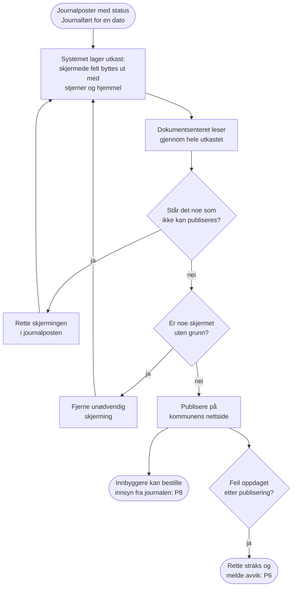

# P7 Offentlig journal

[← Oversikt](README.md) · Forrige: [P6 Arkivets kvalitetskontroll](06-kvalitetskontroll.md) · Neste: [P8 Innsynskrav](08-innsyn.md)

## Kort om prosessen

| | |
|---|---|
| **Formål** | Gjøre det mulig for alle å se hvilke dokumenter kommunen har mottatt og sendt, slik at de kan be om innsyn |
| **Starter når** | Dagens journalposter er kontrollert (P6) |
| **Slutter når** | Offentlig journal er publisert, og eventuelle feil er rettet |
| **Hvem** | Dokumentsenteret |
| **Frist** | Sirevåg publiserer journalen på kommunens nettside tre arbeidsdager etter journaldatoen |

**Journalen** er hele registeret over journalførte dokumenter. **Offentlig journal** er den versjonen av journalen
som allmennheten får se, der opplysninger som ikke kan være offentlige, er tatt ut og erstattet med en henvisning
til hjemmelen.

## Figur

## Rutine steg for steg

| Steg | Hva gjøres |
|---|---|
| 1 | Systemet tar ut alle journalposter med status Journalført for journaldatoen. Journalposter som ikke er kontrollert, er ikke med |
| 2 | For hver journalpost vises: dokumentnummer, journaldato, dokumentets dato, type, sakstittel, dokumenttittel, avsender eller mottaker, ansvarlig enhet, og tilgangskode med hjemmel når noe er skjermet |
| 3 | Skjermede opplysninger byttes ut med stjerner. Hjemmelen står alltid ved siden av |
| 4 | Dokumentsenteret leser gjennom utkastet. Det ses særlig etter personnavn sammen med sakstyper som røper noe, fødselsnummer, helseopplysninger og opplysninger om lønn |
| 5 | Feil rettes i selve journalposten, ikke i utkastet. Utkastet lages på nytt |
| 6 | Journalen publiseres. Fra journalen kan hvem som helst bestille innsyn i et dokument |
| 7 | Dokumenter legges ikke ut i fulltekst automatisk. Enheten kan velge å publisere dokumenter i saker av stor allmenn interesse, etter kriteriene kommunen har kunngjort |
| 8 | Journalen på nettet er satt opp slik at det ikke er mulig å søke på personnavn i innførsler som er eldre enn ett år |

### Hva som ikke skal stå i en journal på internett

| Opplysning | Regel |
|---|---|
| Opplysninger som er underlagt taushetsplikt | Offentlegforskrifta § 7 andre ledd bokstav a |
| Opplysninger som kan unntas etter offentlegforskrifta § 9, blant annet journalinnføringer i enkeltsaker etter barnevernsloven og sosialtjenesteloven | Bokstav b |
| Særlige kategorier av personopplysninger, og opplysninger om straffedommer og lovbrudd | Bokstav c, jf. personvernforordningen artikkel 9 og 10 |
| Fødselsnummer og lignende nummer | Bokstav d |
| Lønn og godtgjøring til fysiske personer, unntatt personer i ledende stillinger | Bokstav e |
| Materiale andre har opphavsrett til, med noen unntak | Bokstav f |

Forbudet gjelder også for organer som publiserer journalen frivillig (offentlegforskrifta § 6 femte ledd andre
punktum).

## Lovgrunnlag

| Regel | Hva den sier | Hvor i prosessen |
|---|---|---|
| Offentleglova § 3 | Journaler og lignende registre er åpne for innsyn. Alle kan kreve innsyn | Grunnlaget for prosessen |
| Offentleglova § 10 første ledd | Organet skal føre journal etter reglene i arkivlova med forskrifter | Grunnlaget for prosessen |
| Arkivforskrifta § 14 første ledd | Journalen føres for å legge til rette for offentlig innsyn | Formålet |
| Arkivforskrifta § 15 første ledd | Opplysningene som skal registreres i journalen | Steg 2 |
| Arkivforskrifta § 15 andre ledd | Journalen skal gjøres tilgjengelig for innsyn etter offentleglova. Opplysninger kan bare unntas når dokumentet ikke kan registreres uten å røpe noe taushetsbelagt eller noe annet allmennheten ikke kan kreve innsyn i. En hel registrering kan bare unntas for å ikke røpe taushetsbelagte opplysninger | Steg 3 til 5 |
| Offentleglova § 10 tredje ledd | Organet kan gjøre dokumenter allment tilgjengelige på internett, unntatt taushetsbelagte opplysninger | Steg 7 |
| Offentlegforskrifta § 6 første ledd | Plikt til å publisere journalen på internett for departementene, statlige direktorater og tilsyn med hele landet som virkeområde, og statsforvalterne. Kommuner er ikke nevnt | Sirevåg publiserer frivillig |
| Offentlegforskrifta § 6 fjerde ledd | Når opplysninger er utelatt fra offentlig journal, skal utelatelsen og fullstendig hjemmel gå fram | Steg 3 |
| Offentlegforskrifta § 6 femte ledd | Opplysninger nevnt i § 7 andre ledd skal ikke stå i journal på internett, heller ikke når publiseringen er frivillig. Organer med publiseringsplikt skal hindre søk på personnavn i innførsler eldre enn ett år | Steg 4 og 8 |
| Offentlegforskrifta § 7 | Hva som ikke skal legges ut på internett. Organet skal opplyse hvilke kriterier som ligger til grunn for utvalget av dokumenter som publiseres | Steg 7 |
| Offentlegforskrifta § 9 femte ledd | Det kan gjøres unntak fra innsyn for journalinnføringer i blant annet enkeltsaker etter barnevernsloven og sosialtjenesteloven | Steg 3 |

**Merk:** Offentlegforskrifta § 6 fjerde ledd viser fortsatt til «arkivforskrifta § 10», som var paragrafen om
journalens innhold i forskriften som gjaldt før 2026. De tilsvarende reglene står nå i arkivforskrifta § 15.

## Hvorfor gjør vi det slik?

**Du kan ikke be om noe du ikke vet finnes.** Innsynsretten er lite verdt uten en oversikt over dokumentene.
Journalen er den oversikten. Derfor skal den være så fullstendig som mulig, også for dokumenter som selv er unntatt
fra innsyn.

**Skjerming i journalen er et unntak fra et unntak.** Hovedregelen er at alt står i journalen. Opplysninger kan
bare tas ut når dokumentet ikke kan registreres uten å røpe dem. Det betyr at Dokumentsenteret først skal prøve å
skrive tittelen slik at ingenting røpes, og bare skjerme når det ikke går.

**Hjemmelen skal alltid stå der.** Når noe er skjermet, skal leseren kunne se hvorfor. Da kan de vurdere om de vil
be om innsyn likevel eller klage. Stjerner uten hjemmel gir ingen mulighet til kontroll.

**Tre dagers forsinkelse er et sikkerhetsnett.** Forsinkelsen gir tid til kontrollen i P6 og til at en
saksbehandler kan oppdage en skjermingsfeil. Innsynsretten gjelder likevel fra dokumentet er journalført: den som
ber om journalen for i dag, har krav på å få den.

**Nettet glemmer ikke.** En journal på papir i resepsjonen ble lest av få. En journal på internett kan høstes,
kopieres og søkes i for alltid. Derfor er reglene strengere for det som legges ut på nett, og derfor begrenses søk
på personnavn i eldre innførsler.

## Eksempel fra Sirevåg

Utdrag fra offentlig journal for 2. mars 2026:

| Dok.nr. | Type | Sak | Dokument | Avsender eller mottaker | Dok.dato | Enhet | Skjerming |
|---|---|---|---|---|---|---|---|
| 2026/412-1 | I | Byggesak – gnr. 45 bnr. 112 – garasje – Fyrvegen 8 | Søknad om tillatelse til tiltak – garasje | Jorunn Havbrått | 02.03.2026 | Plan og byggesak | – |
| 2026/415-1 | I | Søknad om redusert foreldrebetaling – barnehageåret 2026/2027 | Søknad om redusert foreldrebetaling | ***** | 28.02.2026 | Oppvekst | Tilgangskode 13. Offentleglova § 13, jf. forvaltningsloven § 13 første ledd nr. 1. Avsender skjermet, dokumentet unntatt |
| 2026/398-4 | U | Anskaffelse – rammeavtale for brøyting 2026–2029 | Tildeling av kontrakt | Tangvik Maskin AS med flere | 02.03.2026 | Teknisk drift | – |
| 2026/377-12 | I | Tilsetting – avdelingsleder hjemmetjenesten | Søknad på stilling | ***** | 01.03.2026 | Personal | Tilgangskode 25. Offentleglova § 25 første ledd. Avsender skjermet, dokumentet unntatt |

Legg merke til hva som *ikke* er skjermet. Navnet til den som søker om garasje, står åpent, fordi en byggesøknad
ikke røper personlige forhold. Tittelen på søknaden om foreldrebetaling står åpent, fordi den ikke sier hvem det
gjelder. I tilsettingssaken er navnet skjermet i journalen fordi en søker kan be om å ikke stå på den offentlige
søkerlisten, og det er ikke avgjort ennå (offentleglova § 25 andre ledd). Søkerlisten blir et eget dokument som
det kan kreves innsyn i, se [P8](08-innsyn.md).

## Vanlige feil

| Feil | Følge | Slik unngås den |
|---|---|---|
| Hele journalposter fjernes fra offentlig journal fordi dokumentet er unntatt | Allmennheten får ikke vite at dokumentet finnes | Bare skjerm det som må skjermes. Hele registreringer unntas bare for taushetsplikt |
| Skjerming uten hjemmel, eller med «u.off.» som eneste forklaring | Ingen kan kontrollere eller klage | Hjemmel med paragraf og ledd er obligatorisk |
| Navn skjermes i avsenderfeltet, men står i tittelen | Taushetsbelagte opplysninger publiseres | Kontrollen leser tittel og avsender sammen |
| Feil rettes i den publiserte journalen, men ikke i journalposten | Feilen kommer tilbake neste gang journalen lages | Rett alltid i kilden |
| Fødselsnummer står i tittelen eller filnavnet | Brudd på forbudet mot fødselsnummer på nett | Automatisk varsel ved elleve sifre i tittelen |
| Alle dokumenter legges ut i fulltekst | Personopplysninger og opphavsrettslig vernet materiale publiseres | Fulltekst er et aktivt valg per dokument |

## Hva systemet må støtte

| Behov | Forklaring |
|---|---|
| Lage offentlig journal for en dato eller periode | Bare journalposter med status Journalført |
| Skjermingsvisning | Skjermede felt erstattes med stjerner. Tilgangskode og hjemmel vises |
| Forhåndsvisning | Dokumentsenteret ser journalen slik allmennheten vil se den, før publisering |
| Varsler | Mulig fødselsnummer i en tittel. Tilgangskode uten hjemmel. Navn i tittelen på en sak med tilgangskode |
| Bestille innsyn | En knapp per journalpost som lager et innsynskrav (P8) |
| Øving | Studenten får et utkast med feil og skal finne dem før publisering |

## Kontrollspørsmål

1. Må Sirevåg kommune legge journalen ut på internett?
2. En journalpost gjelder en bekymringsmelding til barnevernet. Hvordan vises den i offentlig journal?
3. Hvorfor er det ikke nok å skrive «Unntatt offentlighet» ved en skjermet journalpost?

Løsningsforslag

1. Nei. Plikten i offentlegforskrifta § 6 gjelder bestemte statlige organer. Journalen skal likevel være
   tilgjengelig for den som ber om innsyn i den (offentleglova § 3). Når kommunen velger å publisere, gjelder
   forbudet i § 6 femte ledd mot å legge ut opplysningene i § 7 andre ledd.
2. Bekymringsmeldingen ligger normalt i barnevernets fagsystem, ikke i sakarkivet. Uansett kan journalinnføringer
   i enkeltsaker etter barnevernsloven unntas fra innsyn (offentlegforskrifta § 9 femte ledd bokstav c), og en
   hel registrering kan unntas når det er nødvendig for ikke å røpe taushetsbelagte opplysninger
   (arkivforskrifta § 15 andre ledd). Den skal ikke stå i journalen på nettet.
3. Fordi leseren skal kunne se det rettslige grunnlaget og vurdere det. Utelatelsen og fullstendig hjemmel skal
   gå fram (offentlegforskrifta § 6 fjerde ledd). Et avslag på innsyn krever også henvisning til paragraf, ledd og
   bokstav (offentleglova § 31).

