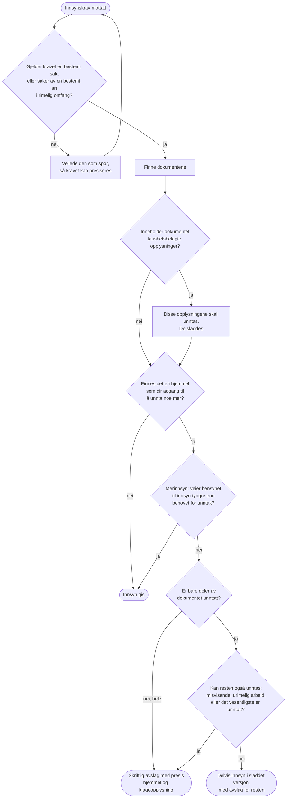
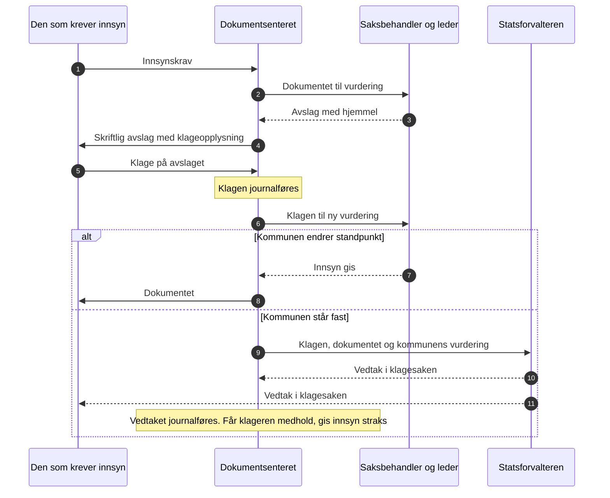

# P8 Innsynskrav

[← Oversikt](README.md) · Forrige: [P7 Offentlig journal](07-offentlig-journal.md) · Neste: [P9 Skjerming, tilgang og taushetsplikt](09-skjerming-og-tilgang.md)

## Kort om prosessen

| | |
|---|---|
| **Formål** | Gi alle som ber om det, innsyn i kommunens dokumenter så langt loven tillater, raskt og med riktig begrunnelse når noe holdes tilbake |
| **Starter når** | Noen ber om innsyn i et dokument, en sak eller journalen |
| **Slutter når** | Dokumentet er utlevert, eller avslaget er sendt og en eventuell klage er avgjort |
| **Hvem** | Dokumentsenteret tar imot og følger opp fristen. Saksbehandleren for saken vurderer. Leder avgjør avslag |
| **Frist** | Uten ugrunnet opphold. I Sirevåg er målet samme dag, og senest innen tre arbeidsdager |

## Fire slags innsyn

Ordet «innsyn» brukes om fire ulike rettigheter. De har ulike regler, og det første som må avklares, er hvilken
som gjelder.

| Type | Hvem kan kreve | Hva gjelder det | Regel | Klage |
|---|---|---|---|---|
| **Allmennhetens innsyn** | Alle. Ingen begrunnelse trengs | Saksdokumenter, journaler og registre | Offentleglova § 3 | Statsforvalteren |
| **Partsinnsyn** | Den som er part i en sak | Dokumentene i egen sak. Går lenger enn allmennhetens innsyn | Forvaltningsloven §§ 18 og 19 | Overordnet organ eller klageinstansen i saken (forvaltningsloven § 21) |
| **Innsyn i egne personopplysninger** | Den opplysningene gjelder | Hvilke opplysninger kommunen behandler om en selv | Personvernforordningen artikkel 15 | Datatilsynet |
| **Folkevalgtes innsyn** | Et folkevalgt organ | Kommunens saksdokumenter, også mye som er unntatt for allmennheten | Kommuneloven § 11-13 | – |

Resten av prosessen handler om allmennhetens innsyn etter offentleglova. Den som har partsrettigheter, skal få
veiledning om det, fordi partsinnsynet gir mer.

## Figur: vurderingen av et innsynskrav

## Rutine steg for steg

| Steg | Hvem | Hva gjøres |
|---|---|---|
| 1 | Dokumentsenteret | Tar imot kravet. Det kan komme skriftlig eller muntlig, og den som spør, trenger ikke oppgi navn eller grunn. Kravet føres i innsynsloggen med tidspunkt |
| 2 | Dokumentsenteret | Kontrollerer at kravet gjelder en bestemt sak, eller i rimelig utstrekning saker av en bestemt art. Er kravet for vidt, veiledes den som spør. Krav om innsyn i journalen trenger ikke være avgrenset |
| 3 | Dokumentsenteret | Dokumenter uten tilgangskode som åpenbart kan gis ut, sendes med en gang |
| 4 | Dokumentsenteret | Dokumenter med tilgangskode, og dokumenter det er tvil om, sendes til saksbehandleren for saken med frist samme dag eller neste arbeidsdag |
| 5 | Saksbehandler | Leser dokumentet og vurderer det konkret og selvstendig. Tilgangskoden fra registreringen er et varsel, ikke en avgjørelse |
| 6 | Saksbehandler | Finner taushetsbelagte opplysninger. De *skal* unntas. Kan taushetsplikten falle bort med samtykke, kan kravet legges fram for den det gjelder |
| 7 | Saksbehandler | Vurderer om en annen hjemmel gir *adgang* til å unnta noe. Gjør den det, skal merinnsyn vurderes: Bør innsyn gis likevel? |
| 8 | Saksbehandler | Unntar bare opplysningene hjemmelen gjelder. Resten av dokumentet gis ut, med mindre vilkårene i offentleglova § 12 er oppfylt |
| 9 | Saksbehandler | Lager en sladdet versjon når deler unntas. Originalen beholdes uendret, og den sladdede versjonen lagres som egen variant |
| 10 | Leder | Godkjenner avslag og delvise avslag |
| 11 | Dokumentsenteret | Sender dokumentet, eller avslaget, til den som spurte. Innsyn er gratis. Kopi kan kreves på papir eller elektronisk |
| 12 | Dokumentsenteret | Fører resultatet og tidspunktet i innsynsloggen |

### Avslaget

Et avslag skal være skriftlig og inneholde:

- hvilken bestemmelse avslaget bygger på, med **ledd, bokstav eller nummer**
- bestemmelsen som pålegger taushetsplikt, når avslaget bygger på offentleglova § 13
- at det er adgang til å **klage**, og at **klagefristen** er tre uker
- at den som har fått avslag, innen tre uker kan kreve en nærmere begrunnelse. Den skal gis snarest og senest
  innen ti arbeidsdager

### Fristene

| Hva | Frist | Regel |
|---|---|---|
| Avgjøre innsynskravet | Uten ugrunnet opphold. Justisdepartementets veileder og Sivilombudets praksis legger til grunn at det normalt betyr samme dag, eller i alle fall innen en til tre arbeidsdager | Offentleglova § 29 første ledd |
| Ikke svar innen fem arbeidsdager | Regnes som et avslag som kan påklages | Offentleglova § 32 andre ledd |
| Kreve nærmere begrunnelse | Tre uker fra avslaget ble mottatt | Offentleglova § 31 andre ledd |
| Gi nærmere begrunnelse | Snarest, senest ti arbeidsdager | Offentleglova § 31 andre ledd |
| Klage | Tre uker fra avslaget kom fram | Offentleglova § 32 tredje ledd, jf. forvaltningsloven § 29 |
| Behandle klagen | Uten ugrunnet opphold | Offentleglova § 32 tredje ledd |

## Figur: klage på avslag

## De vanligste unntakene i en kommune

Offentleglova har to slags unntak. Ordlyden avslører hvilket det er:

- **«er unntatt»**: organet har *plikt* til å unnta. Det gjelder taushetsbelagte opplysninger (§ 13).
- **«kan gjøres unntak»**: organet har *adgang* til å unnta, men skal vurdere merinnsyn (§ 11).

| Hjemmel | Gjelder | Skal eller kan | Eksempel fra en kommune |
|---|---|---|---|
| § 13 første ledd, jf. forvaltningsloven § 13 første ledd nr. 1 | Opplysninger om noens personlige forhold | Skal | Helse, økonomi og familieforhold i en søknad om tjenester |
| § 13 første ledd, jf. forvaltningsloven § 13 første ledd nr. 2 | Forretningshemmeligheter det er av konkurransemessig betydning å hemmeligholde | Skal | Kalkyler og tekniske løsninger i et tilbud |
| § 14 første ledd | Dokumenter organet har utarbeidet for sin egen interne saksforberedelse | Kan | Et notat fra saksbehandler til leder |
| § 15 | Dokumenter innhentet utenfra til den interne saksforberedelsen, på nærmere vilkår | Kan | Råd fra en advokat om hvordan kommunen bør stille seg i en tvist |
| § 23 første ledd | Opplysninger, når unntak er påkrevd av hensyn til en forsvarlig gjennomføring av økonomi-, lønns- eller personalforvaltningen | Kan | Kommunens forhandlingsstrategi før lønnsforhandlinger |
| § 23 tredje ledd | Tilbud og protokoll i anskaffelser, til valget av leverandør er gjort | Kan | Tilbudene i en konkurranse som pågår |
| § 24 første ledd | Opplysninger, når innsyn ville motvirke kontroll- eller reguleringstiltak | Kan | Plan for uanmeldte tilsyn med skjenkesteder |
| § 24 andre ledd | Anmeldelser, tips og lignende om lovbrudd fra private | Kan | Et tips om ulovlig bygging |
| § 25 første ledd | Dokumenter i saker om tilsetting eller forfremmelse | Kan | Søknader, innstilling og intervjureferater |
| § 26 femte ledd | Fødselsnummer og nummer med tilsvarende funksjon | Kan | Fødselsnummeret i et ellers åpent brev |

**Særregler for kommuner:** Unntakene i §§ 14 og 15 gjelder *ikke* for blant annet saksframlegg med vedlegg til
et folkevalgt organ, sakslister, og dokumenter fra eller til kontrollutvalget, revisjonen og klagenemnder
(offentleglova § 16 første ledd).

**Søkerlister:** Selv om dokumentene i en tilsettingssak kan unntas, skal kommunen sette opp en søkerliste snarest
etter søknadsfristen, med navn, alder, stilling eller yrkestittel og bosteds- eller arbeidskommune for hver søker.
Listen er offentlig. En søker kan be om å bli unntatt, og kommunen skal da legge vekt på om det knytter seg særlig
offentlig interesse til stillingen (offentleglova § 25 andre ledd).

## Lovgrunnlag

| Regel | Hva den sier | Hvor i prosessen |
|---|---|---|
| Offentleglova § 3 | Saksdokumenter, journaler og registre er åpne for innsyn når ikke annet følger av lov eller forskrift. Alle kan kreve innsyn | Utgangspunktet |
| Offentleglova § 28 | Innsyn kan kreves skriftlig eller muntlig. Kravet må gjelde en bestemt sak eller i rimelig utstrekning saker av en bestemt art | Steg 1 og 2 |
| Offentleglova § 29 første ledd | Organet skal vurdere kravet konkret og selvstendig, og avgjøre det uten ugrunnet opphold | Steg 5, og fristen |
| Offentleglova § 13 | Taushetsbelagte opplysninger er unntatt. Kravet kan legges fram for den som har krav på taushet, når samtykke opphever plikten | Steg 6 |
| Offentleglova § 11 | Merinnsyn skal vurderes når det er adgang til unntak. Innsyn bør gis når hensynet til offentlig innsyn veier tyngre enn behovet for unntak | Steg 7 |
| Offentleglova § 12 | Resten av dokumentet kan bare unntas når delene alene gir et klart misvisende inntrykk, det er urimelig arbeidskrevende å skille dem ut, eller de unntatte opplysningene er den vesentligste delen | Steg 8 |
| Offentleglova § 5 | Innsyn kan utsettes i bestemte tilfeller, blant annet til dokumentet er kommet fram til mottakeren | Steg 5 |
| Offentleglova § 9 | Alle kan kreve en sammenstilling fra organets databaser når den kan lages med enkle framgangsmåter | Steg 2 |
| Offentleglova § 30 | Organet bestemmer hvordan dokumentet gjøres kjent. Det kan kreves papirkopi eller elektronisk kopi | Steg 11 |
| Offentleglova § 8 og offentlegforskrifta § 4 | Innsyn er som hovedregel gratis. Betaling for papirkopier bare over hundre ark i én sak | Steg 11 |
| Offentleglova § 31 | Avslag skal være skriftlig, vise til presis hjemmel og opplyse om klage. Nærmere begrunnelse på forespørsel | Avslaget |
| Offentleglova § 32 | Klage. Statsforvalteren er klageinstans for kommunale avgjørelser. Avgjørelser om å gi innsyn kan ikke påklages. Manglende svar innen fem arbeidsdager regnes som avslag | Klagen |
| Forvaltningsloven §§ 29, 32 og 33 | Klagefrist tre uker. Klagen settes fram for kommunen, som vurderer den før den sendes videre | Klagen |
| Arkivforskrifta § 14 tredje ledd | Dokumenter i innsynssaker journalføres ikke, bortsett fra dokumenter som gjelder eller inneholder en nærmere begrunnelse, en klage, et krav om betaling eller et spørsmål om hvordan innsyn skal gis | Steg 1 og 12, og klagen |
| Arkivforskrifta § 5 andre ledd bokstav f | Systemet skal gjøre det mulig å finne og hente ut dokumentasjon med enkle framgangsmåter for å gi innsyn | Steg 3 |

## Hvorfor gjør vi det slik?

**Åpenhet er hovedregelen, hemmelighold må begrunnes.** Loven er bygget slik at kommunen ikke trenger noen grunn
for å gi innsyn, men alltid trenger en hjemmel for å nekte. Den som spør, trenger heller ikke forklare hvorfor.
Formålet er at alle skal kunne kontrollere forvaltningen.

**Tilgangskoden er ikke svaret.** Skjermingen ved registreringen ble satt raskt, ofte før saken var ferdig.
Forholdene kan ha endret seg: et tilbud som var hemmelig under konkurransen, er det ikke nødvendigvis etterpå.
Derfor sier loven at kravet skal vurderes konkret og selvstendig hver gang.

**Opplysninger unntas, ikke dokumenter.** De fleste hjemlene gjelder opplysninger. Et brev med ett taushetsbelagt
avsnitt skal gis ut med avsnittet sladdet. Å avslå hele dokumentet fordi én setning er taushetsbelagt, er den
vanligste feilen i innsynssaker.

**Merinnsyn er en plikt til å tenke seg om.** Selv om loven gir adgang til unntak, skal kommunen spørre seg:
Trenger vi egentlig å holde dette tilbake? Er svaret nei, bør innsyn gis.

**Fart er en del av retten.** Innsyn som kommer etter at saken er avgjort eller nyheten er gammel, har liten
verdi. Derfor er fristen kort, og derfor regnes taushet i fem arbeidsdager som et avslag det kan klages på.

**Presis hjemmel gjør avslaget etterprøvbart.** «Unntatt offentlighet» forklarer ingenting. «Offentleglova § 13
første ledd, jf. forvaltningsloven § 13 første ledd nr. 1» forteller hva kommunen mener, og gjør det mulig for
statsforvalteren å kontrollere det.

## Eksempel fra Sirevåg

### Eksempel 1: Tilbud i en anskaffelse

En journalist i lokalavisen ber 20. februar om innsyn i alle tilbudene i konkurransen om brøyting (sak 2026/398).
Kontrakten er ikke tildelt.

| Tidspunkt | Vurdering | Resultat |
|---|---|---|
| 20. februar, før tildeling | Tilbud kan unntas til valget av leverandør er gjort (§ 23 tredje ledd). Merinnsyn vurderes: innsyn nå kan skade konkurransen | Avslag samme dag, med hjemmel og klageopplysning |
| 3. mars, etter tildeling | § 23 tredje ledd gjelder ikke lenger. Tilbudene inneholder kalkyler og beskrivelser av arbeidsmetoder som kan være forretningshemmeligheter | Innsyn gis i tilbudene. Enhetspriser og kalkyler som er forretningshemmeligheter, sladdes med hjemmel i § 13, jf. forvaltningsloven § 13 første ledd nr. 2. Totalprisen gis ut |

Eksempelet viser at svaret på samme krav kan endre seg med tiden, og at et avslag ikke varer evig.

### Eksempel 2: Nabo ber om innsyn i byggesaken

Naboen i Fyrvegen 10 ber om å få se søknaden i sak 2026/412.

- Dokumentet har ingen tilgangskode, og en byggesøknad inneholder normalt ikke taushetsbelagte opplysninger.
- Dokumentsenteret sender søknaden med vedlegg samme dag (steg 3).
- Naboen har dessuten fått nabovarsel og kan ha partsrettigheter. Hun får veiledning om det.

### Eksempel 3: Krav som er for vidt

En innbygger ber om «alt kommunen har om vei de siste ti årene». Kravet gjelder ikke en bestemt sak, og ikke saker
av en bestemt art i rimelig utstrekning. Dokumentsenteret avslår ikke, men ringer og veileder: Hvilken vei gjelder
det? Hvilken periode? Hun får tilsendt journalutdrag for klassen 730 Veg og velger sakene hun vil se.

## Vanlige feil

| Feil | Følge | Slik unngås den |
|---|---|---|
| Hele dokumentet avslås fordi noe er taushetsbelagt | Brudd på offentleglova. Avslaget oppheves ved klage | Sladd opplysningene og gi ut resten |
| Avslag uten ledd og bokstav | Avslaget oppfyller ikke § 31 | Mal for avslag med felt for presis hjemmel |
| Merinnsyn vurderes ikke, eller vurderingen vises ikke | Feil ved saksbehandlingen | Avslagsmalen har et fast punkt om merinnsyn |
| Kravet blir liggende hos en saksbehandler som er borte | Fem arbeidsdager går, og taushet regnes som avslag | Innsynsloggen følges daglig, og krav har stedfortreder |
| Den som spør, bes om å begrunne kravet | Loven krever ingen begrunnelse | Spør bare om det som trengs for å finne dokumentet |
| Avslag fordi tilgangskoden sier det | Ingen konkret og selvstendig vurdering | Koden er et varsel. Dokumentet leses hver gang |
| § 14 brukes på saksframlegg til kommunestyret | Unntaket gjelder ikke i kommuner for disse dokumentene | Kjenn § 16 |

## Hva systemet må støtte

| Behov | Forklaring |
|---|---|
| Registrere innsynskrav | Fra offentlig journal eller manuelt, med tidspunkt og hvilke dokumenter det gjelder |
| Frister | Nedtelling i arbeidsdager, med varsel før tre og fem arbeidsdager |
| Vurderingsskjema | Steg for steg som i figuren: taushetsplikt, annen hjemmel, merinnsyn, resten av dokumentet |
| Sladding | Markere tekst som skal sladdes, og lagre resultatet som en egen variant av dokumentet |
| Avslagsmal | Hjemmel med ledd og bokstav, merinnsynsvurdering, klageadgang og frist |
| Innsynslogg | Mottatt, avgjort, resultat og tid brukt |
| Klage | Klagen journalføres, kommunen vurderer på nytt, og saken kan sendes en simulert statsforvalter |
| Tilbakemelding til studenten | Riktig hjemmel, riktig omfang av sladdingen og overholdt frist |

## Kontrollspørsmål

1. En anonym person ringer og ber om å få tilsendt et brev hun har sett i offentlig journal. Kan kommunen kreve
   navn og begrunnelse?
2. Et brev fra en innbygger inneholder en klage på snøbrøytingen og ett avsnitt om avsenderens sykdom. Hvordan
   behandles et innsynskrav?
3. Kommunen har ikke svart på et innsynskrav etter seks arbeidsdager. Hva kan den som ba om innsyn, gjøre?
4. Kan kommunen unnta saksframlegget til formannskapet som et internt dokument?

Løsningsforslag

1. Nei. Alle kan kreve innsyn, og kravet kan settes fram muntlig (offentleglova §§ 3 og 28). Kommunen trenger
   bare en adresse å sende dokumentet til.
2. Avsnittet om sykdom er taushetsbelagt og sladdes (offentleglova § 13, jf. forvaltningsloven § 13 første ledd
   nr. 1). Resten av brevet gis ut. Avslaget for det sladdede avsnittet skal vise til hjemmelen og opplyse om
   klageadgang. Vilkårene i § 12 for å unnta resten er ikke oppfylt.
3. Hun kan klage, fordi manglende svar innen fem arbeidsdager regnes som et avslag (offentleglova § 32 andre
   ledd). Klagen sendes til kommunen, som enten gir innsyn eller sender saken til statsforvalteren.
4. Nei. Unntakene for interne dokumenter gjelder ikke saksframlegg med vedlegg til et kommunalt folkevalgt organ
   (offentleglova § 16 første ledd bokstav a). Taushetsbelagte opplysninger i saksframlegget skal likevel unntas.

