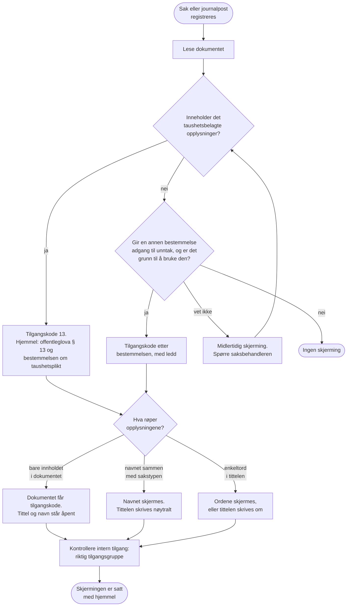

# P9 Skjerming, tilgang og taushetsplikt

[← Oversikt](README.md) · Forrige: [P8 Innsynskrav](08-innsyn.md) · Neste: [P10 Politisk behandling](10-politisk-behandling.md)

## Kort om prosessen

| | |
|---|---|
| **Formål** | Hindre at opplysninger kommer til noen som ikke skal ha dem, uten å skjule mer enn loven krever |
| **Starter når** | En sak eller journalpost registreres, og hver gang noen ber om tilgang eller innsyn |
| **Slutter når** | Riktig tilgangskode og hjemmel er satt, og bare det nødvendige er skjermet |
| **Hvem** | Den som registrerer. Dokumentsenteret kontrollerer. Saksbehandleren avgjør ved tvil |
| **Frist** | Samtidig med registreringen. Midlertidig skjerming avklares innen en uke |

Prosessen går på tvers av de andre. Den brukes i P2 (registrering), P4 (utgående dokumenter), P6 (kontroll), P7
(offentlig journal) og P8 (innsyn).

## Tre nivåer som ikke må blandes

| Nivå | Spørsmålet | Hvem det gjelder | Styres av |
|---|---|---|---|
| **1. Intern tilgang** | Hvem i kommunen får åpne saken og dokumentet? | Ansatte | Tilgangsgrupper og tjenstlig behov |
| **2. Skjerming i journalen** | Hva vises i offentlig journal? | Allmennheten | Tilgangskode, hjemmel og hvilke felt som skjermes |
| **3. Innsyn i dokumentet** | Får den som ber om det, se dokumentet? | Den som krever innsyn | En konkret vurdering hver gang, se [P8](08-innsyn.md) |

En ansatt har ikke tilgang til alt bare fordi hun er ansatt. Og et dokument er ikke unntatt fra innsyn for
all framtid bare fordi det fikk en tilgangskode ved registreringen.

## Figur: skjerming ved registrering

## Rutine steg for steg

| Steg | Hva gjøres |
|---|---|
| 1 | **Les dokumentet.** Skjerming kan ikke vurderes ut fra tittelen eller avsenderen alene |
| 2 | **Let etter taushetsbelagte opplysninger.** Personlige forhold og forretningshemmeligheter. Finnes de, skal de skjermes |
| 3 | **Vurder andre hjemler.** Bare når det faktisk er grunn til det. Et internt notat skjermes ikke automatisk fordi § 14 gir adgang til unntak |
| 4 | **Velg tilgangskode og skriv hjemmelen** med paragraf og ledd. For kode 13 også bestemmelsen som pålegger taushetsplikten |
| 5 | **Skjerm minst mulig.** Prøv i denne rekkefølgen: (a) Skriv tittelen slik at ingenting røpes, og skjerm bare dokumentet. (b) Skjerm navnet. (c) Skjerm enkeltord i tittelen. Hele tittelen skjermes bare når ingenting annet er mulig |
| 6 | **Kontroller den interne tilgangen.** Saken skal ligge i en arkivdel og en tilgangsgruppe der bare de med tjenstlig behov kommer inn |
| 7 | **Bruk midlertidig skjerming ved tvil.** Da skjermes alt inntil saksbehandleren har vurdert. Den skal ikke bli stående |
| 8 | **Vurder på nytt når noe endrer seg.** Når en konkurranse er avgjort, en tilsetting er gjort eller en sak er avsluttet, kan grunnen til skjermingen være borte |

### Sirevågs tilgangskoder

| Kode | Navn | Hjemmel | Typisk bruk |
|---|---|---|---|
| 13 | Taushetsplikt | Offentleglova § 13, jf. bestemmelsen som pålegger taushetsplikt | Personlige forhold, forretningshemmeligheter |
| 14 | Organinternt | Offentleglova § 14 første ledd | Interne notater når det er behov for unntak |
| 15 | Innhentet utenfra | Offentleglova § 15, med ledd | Råd og vurderinger innhentet til intern saksforberedelse |
| 23 | Forhandlinger og anskaffelser | Offentleglova § 23, med ledd | Tilbud før tildeling, forhandlingsstrategi |
| 24 | Kontroll og lovbrudd | Offentleglova § 24, med ledd | Tips om lovbrudd, planlagte kontroller |
| 25 | Tilsetting | Offentleglova § 25 første ledd | Søknader og innstillinger |
| 26 | Fødselsnummer med mer | Offentleglova § 26, med ledd | Fødselsnummer, eksamensbesvarelser |
| M | Midlertidig skjerming | Ingen. Skal erstattes | Skjermingsbehovet er ikke vurdert ferdig |

Kodene er laget for Sirevåg. Andre kommuner har andre koder, men prinsippet er det samme: koden viser til en
bestemmelse.

### Feltene som styrer skjermingen

| Felt i Noark 5 | Innhold |
|---|---|
| Tilgangsrestriksjon | Tilgangskoden |
| Skjermingshjemmel | Paragraf og ledd |
| Skjerming av metadata | Hva som skjermes i journalen: navn på avsender, mottaker eller part, første linje eller utvalgte ord i tittelen, klassen, merknader, eller midlertidig skjerming av alt |
| Skjerming av dokument | Hele dokumentet, eller deler av det. Skjermes deler, må det finnes en sladdet variant |
| Skjermingens varighet | Hvor lenge skjermingen skal gjelde |
| Offentlig tittel | Tittelen slik den vises i offentlig journal når ord er skjermet |

## Taushetsplikt

### Forvaltningslovens taushetsplikt

Alle som utfører tjeneste eller arbeid for et forvaltningsorgan, har plikt til å hindre at andre får kjennskap til
det de får vite om (forvaltningsloven § 13 første ledd):

1. **noens personlige forhold**, eller
2. **tekniske innretninger og framgangsmåter og drifts- eller forretningsforhold** som det er av konkurransemessig
   betydning å hemmeligholde.

| Regnes som personlige forhold | Regnes vanligvis ikke som personlige forhold |
|---|---|
| Helse og sykdom | Fødested og fødselsdato |
| Økonomiske problemer, sosialhjelp | Personnummer |
| Familieforhold, samlivsbrudd, omsorgssvikt | Statsborgerskap og sivilstand |
| Rusbruk og straffbare forhold | Yrke, bosted og arbeidssted |
| Opplysninger som røper et klientforhold | |

Høyre kolonne følger av forvaltningsloven § 13 andre ledd, og har et viktig forbehold: Opplysningene er likevel
taushetsbelagte når de røper et klientforhold eller andre personlige forhold. En adresse er ikke taushetsbelagt.
Adressen til en beboer på et krisesenter er det.

Noen regler om hvor lenge og overfor hvem:

| Regel | Innhold |
|---|---|
| Forvaltningsloven § 13 tredje ledd | Taushetsplikten gjelder også etter at den ansatte har sluttet |
| Forvaltningsloven § 13 a | Taushetsplikten hindrer ikke at opplysningene gjøres kjent for den de gjelder, at de brukes når den det gjelder samtykker, eller når de er anonymisert |
| Forvaltningsloven § 13 b første ledd nr. 1 og 2 | Opplysningene kan gjøres kjent for sakens parter og brukes til formålet de er innhentet for |
| Forvaltningsloven § 13 b første ledd nr. 3 | Opplysningene kan være tilgjengelige for andre ansatte i organet så langt det trengs for en hensiktsmessig arbeids- og arkivordning |
| Forvaltningsloven § 13 c andre ledd | Dokumenter med taushetsbelagte opplysninger skal oppbevares på betryggende måte |
| Forvaltningsloven § 13 c tredje ledd | Taushetsplikten faller bort etter 60 år når ikke annet er bestemt |

### Strengere taushetsplikt i særlover

| Lov | Hva som er særskilt |
|---|---|
| Helsepersonelloven § 21 | Helsepersonell har taushetsplikt om legems- og sykdomsforhold og andre personlige forhold de får vite om som helsepersonell |
| Barnevernsloven § 13-1 | Taushetsplikten omfatter også fødested, fødselsdato, personnummer, statsborgerforhold, sivilstand, yrke, bopel og arbeidssted |
| Sosialtjenesteloven § 44 | Samme utvidelse som i barnevernet |

På disse områdene er det i praksis taushetsbelagt *at* en person har en sak. Derfor ligger sakene i egne
fagsystemer eller egne arkivdeler med snever tilgang, og journalinnføringene kan unntas fra innsyn
(offentlegforskrifta § 9 femte ledd).

## Gradering

Gradering er noe annet enn tilgangskode. Den brukes når innholdet må beskyttes særskilt mot at uvedkommende får
kjennskap til det.

| Regelverk | Grader | Gjelder |
|---|---|---|
| Beskyttelsesinstruksen §§ 2 til 4 | FORTROLIG og STRENGT FORTROLIG | Dokumenter som kan unntas etter offentleglova, når det kan skade offentlige interesser, en bedrift, en institusjon eller en enkeltperson at innholdet blir kjent |
| Sikkerhetsloven § 5-3 | BEGRENSET, KONFIDENSIELT, HEMMELIG og STRENGT HEMMELIG | Informasjon som kan skade nasjonale sikkerhetsinteresser |

En kommune møter gradering først og fremst i beredskapsarbeid, og når en innbygger har adressesperre. Graderte
dokumenter behandles ikke i det vanlige sak- og arkivsystemet. Ark-Ivar har ikke graderte dokumenter.

## Lovgrunnlag

| Regel | Hva den sier | Hvor i prosessen |
|---|---|---|
| Offentleglova § 13 første ledd | Taushetsbelagte opplysninger er unntatt fra innsyn | Steg 2 og 4 |
| Forvaltningsloven §§ 13 til 13 c | Taushetspliktens innhold, begrensninger og varighet | Steg 2 og 6 |
| Arkivforskrifta § 15 andre ledd | Opplysninger i journalen kan bare unntas når dokumentet ikke kan registreres uten å røpe dem. En hel registrering bare for taushetsplikt | Steg 5 |
| Offentlegforskrifta § 6 fjerde ledd | Utelatelser fra offentlig journal skal vises med fullstendig hjemmel | Steg 4 |
| Offentlegforskrifta § 7 andre ledd | Opplysninger som ikke skal legges ut på internett | Steg 2, og [P7](07-offentlig-journal.md) |
| Offentleglova § 26 femte ledd | Fødselsnummer kan unntas fra innsyn | Kode 26 |
| Offentleglova § 11 | Merinnsyn skal vurderes når unntaket er en adgang og ikke en plikt | Steg 3 og 8 |
| Arkivforskrifta § 5 andre ledd bokstav b og c | Systemet skal verne mot uautoriserte endringer og spore endringer | Tilgangsstyring og logg |
| Arkivforskrifta § 12 bokstav e | Dokumentasjonsplanen skal ha opplysninger om regler om taushetsplikt og informasjonssikkerhet for de ulike delene av dokumentasjonen | Tilgangskodene og arkivdelene |
| Personvernforordningen artikkel 5 og 32 | Personopplysninger skal behandles med tilstrekkelig sikkerhet, og ikke i større omfang enn nødvendig | Steg 6 |
| Beskyttelsesinstruksen og sikkerhetsloven § 5-3 | Gradering | Gradering |

## Hvorfor gjør vi det slik?

**To feil er mulige, og begge er alvorlige.** Skjermer du for lite, kan en persons helseopplysninger bli
offentlige. Det kan ikke gjøres om. Skjermer du for mye, mister allmennheten muligheten til å kontrollere
kommunen, og tilliten til at skjerming betyr noe, forsvinner. God skjerming er presis.

**Hjemmelen tvinger fram en vurdering.** Den som må skrive «offentleglova § 13, jf. forvaltningsloven § 13 første
ledd nr. 1», må ha funnet et personlig forhold i dokumentet. Den som bare kan krysse av for «unntatt», trenger ikke
tenke. Derfor er hjemmelen obligatorisk.

**Navnet er ofte nøkkelen.** Tittelen «Søknad om redusert foreldrebetaling» røper ingenting. Navnet «Jorunn
Havbrått» røper ingenting. Sammen røper de noe om familiens økonomi. Den minst inngripende skjermingen er derfor
som regel å skjerme navnet og la tittelen stå.

**Tjenstlig behov gjelder også internt.** Taushetsplikten gjelder overfor kolleger. Unntaket i forvaltningsloven
§ 13 b gjelder bare så langt det trengs for en hensiktsmessig arbeids- og arkivordning. Derfor har ikke alle
ansatte tilgang til alle arkivdeler, og derfor logges oppslag i skjermede saker.

**Skjerming har en utløpsdato.** Grunnen til skjermingen kan falle bort lenge før 60 år er gått. Derfor er
tilgangskoden bare et varsel når noen ber om innsyn, og derfor skal skjermingen vurderes på nytt når saken endrer
seg.

## Eksempel fra Sirevåg

| Dokument | Vurdering | Skjerming |
|---|---|---|
| Søknad om byggetillatelse for garasje | Ingen personlige forhold. Navn, adresse og eiendom er ikke taushetsbelagt | Ingen |
| Søknad om redusert foreldrebetaling med skattemelding | Familiens økonomi er et personlig forhold | Kode 13. Navnet skjermes, tittelen står, dokumentet unntas |
| Klage på støy fra nabo, der klageren forteller om egen angstlidelse | Klagen er ikke taushetsbelagt, men helseopplysningene er det | Kode 13 på dokumentet. Navn og tittel står åpent. Ved innsyn sladdes avsnittet om helse |
| Tilbud fra tre firmaer i en anskaffelse, før tildeling | Kan unntas til leverandør er valgt | Kode 23, hjemmel § 23 tredje ledd. Vurderes på nytt etter tildeling |
| Brev der kommunen oppgir fødselsnummeret til en ansatt til pensjonskassen | Fødselsnummer skal ikke på nett og kan unntas | Kode 26, hjemmel § 26 femte ledd. Bare nummeret sladdes ved innsyn |
| Notat fra saksbehandler til leder med forslag til vedtak | Internt dokument. Ingen grunn til å skjerme i journalen | Ingen kode ved registrering. § 14 vurderes hvis noen ber om innsyn |
| E-post fra en innbygger som forteller at naboen «sikkert jobber svart» | Tips om lovbrudd fra en privatperson | Kode 24, hjemmel § 24 andre ledd første punktum. Navnet på tipseren skjermes |

## Vanlige feil

| Feil | Følge | Slik unngås den |
|---|---|---|
| Hele saken skjermes fordi ett dokument er taushetsbelagt | Åpne dokumenter blir utilgjengelige | Tilgangskoden settes på journalposten, ikke på saken, når det er mulig |
| Kode 13 uten henvisning til bestemmelsen om taushetsplikt | Hjemmelen er ufullstendig | To felt: offentleglova § 13 og taushetsbestemmelsen |
| Fødselsdato og adresse skjermes som taushetsbelagt | Unødvendig skjerming | Kjenn forvaltningsloven § 13 andre ledd |
| Interne notater får alltid kode 14 | Journalen skjuler mer enn nødvendig, og merinnsyn vurderes aldri | § 14 er en adgang, ikke en plikt |
| Midlertidig skjerming blir stående | Journalposten er skjult uten hjemmel | Ukentlig kontroll, se [P6](06-kvalitetskontroll.md) |
| Alle ansatte har lesetilgang til alle arkivdeler | Brudd på taushetsplikten internt | Tilgangsgrupper etter tjenstlig behov, årlig gjennomgang |
| Skjermingen fjernes aldri | Dokumenter er utilgjengelige lenge etter at grunnen er borte | Ny vurdering ved avslutning og ved hvert innsynskrav |

## Hva systemet må støtte

| Behov | Forklaring |
|---|---|
| Tilgangskoder | En liste som administratoren kan vedlikeholde, der hver kode har en standardhjemmel |
| Påkrevd hjemmel | En journalpost med tilgangskode kan ikke journalføres uten hjemmel |
| Valg av hva som skjermes | Avsender eller mottaker, utvalgte ord i tittelen, hele tittelen unntatt første linje, dokumentet |
| Offentlig tittel | Vises i offentlig journal når ord er skjermet |
| Midlertidig skjerming | Med rapport over hvor lenge den har stått |
| Intern tilgang | Roller og tilgangsgrupper per arkivdel og tilgangskode |
| Logg | Oppslag i skjermede saker og dokumenter |
| Øving | Studenten får dokumenter og skal velge kode, hjemmel og omfang. Fasiten viser både for mye og for lite skjerming |

## Kontrollspørsmål

1. En innbygger skriver til kommunen og klager på at gatelyset utenfor huset er mørkt. Hun oppgir navn, adresse
   og telefonnummer. Skal noe skjermes?
2. En søknad om omsorgsbolig inneholder opplysninger om søkerens demens. Hvordan skjermes journalposten?
3. Hva er forskjellen på en tilgangskode og en gradering?
4. En saksbehandler i Teknisk drift er nysgjerrig og åpner personalmappen til en kollega. Hva er galt?

Løsningsforslag

1. Nei. Navn, adresse og en klage på gatelys er ikke personlige forhold (forvaltningsloven § 13 andre ledd).
2. Tilgangskode 13 med hjemmel offentleglova § 13, jf. forvaltningsloven § 13 første ledd nr. 1, eller
   helsepersonelloven § 21 når opplysningene kommer fra helsepersonell. Navnet skjermes, fordi navnet sammen med
   sakstypen røper helse- og omsorgsbehov. Tittelen «Søknad om omsorgsbolig» kan stå. Dokumentet er unntatt.
3. Tilgangskoden viser til en bestemmelse som gir grunnlag for å unnta opplysninger fra innsyn. Gradering er en
   merking av at dokumentet krever særskilt beskyttelse, etter beskyttelsesinstruksen eller sikkerhetsloven.
4. Hun har ikke tjenstlig behov. Taushetsplikten gjelder også overfor kolleger, og unntaket i forvaltningsloven
   § 13 b første ledd nr. 3 gjelder bare det som trengs for en hensiktsmessig arbeids- og arkivordning. Systemet
   skulle ikke gitt henne tilgang, og oppslaget skal kunne spores i loggen.

