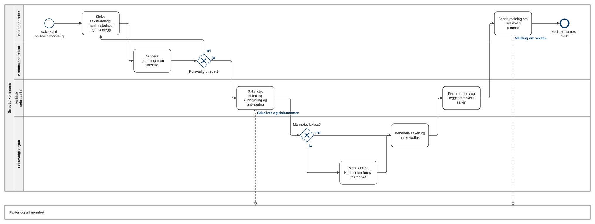

# P10 Politisk behandling

[← Oversikt](README.md) · Forrige: [P9 Skjerming, tilgang og taushetsplikt](09-skjerming-og-tilgang.md) · Neste: [P11 Bevaring og kassasjon](11-bevaring-og-kassasjon.md)

## Kort om prosessen

| | |
|---|---|
| **Formål** | Legge en sak fram for et folkevalgt organ med forsvarlig utredning, dokumentere vedtaket og sørge for at det blir kjent og gjennomført |
| **Starter når** | En sak skal avgjøres av kommunestyret, formannskapet eller et utvalg, og ikke av administrasjonen |
| **Slutter når** | Vedtaket er protokollert, partene er underrettet, og vedtaket er satt i verk |
| **Hvem** | Saksbehandler, kommunedirektør, politisk sekretariat, lederen av det folkevalgte organet |
| **Frist** | Sakslisten og dokumentene sendes ut med rimelig varsel. I Sirevåg er det sju dager før møtet |

### Hvilke saker går til politisk behandling?

Kommunestyret er kommunens øverste organ. Det meste av den daglige saksbehandlingen er likevel delegert til
kommunedirektøren. Et folkevalgt organ kan gi kommunedirektøren myndighet til å treffe vedtak i saker som ikke har
prinsipiell betydning (kommuneloven § 13-1 sjette ledd). Saker *med* prinsipiell betydning, og saker loven legger
til kommunestyret selv, skal til politisk behandling. Kommunens delegeringsreglement sier hvor grensen går.

| Avgjøres av administrasjonen | Avgjøres politisk |
|---|---|
| Byggetillatelse i tråd med plan | Dispensasjon av prinsipiell betydning, reguleringsplaner |
| Tildeling av barnehageplass | Barnehagestruktur og opptaksregler |
| Utbetaling av tilskudd etter faste satser | Budsjett og retningslinjer for tilskudd |

## Figur

Figuren følger BPMN. Symbolene er forklart i [oversikten](README.md#symbolene-i-figurene).

## Rutine steg for steg

| Steg | Hvem | Hva gjøres | Dokumentasjon |
|---|---|---|---|
| 1 | Saksbehandler | Oppretter saksframlegget som journalpost av typen Saksframlegg i saken. Bruker malen: bakgrunn, fakta, rettslig grunnlag, vurdering, økonomiske følger og forslag til vedtak | Saksframlegg (S) |
| 2 | Saksbehandler | Legger ved de dokumentene organet trenger. Vedleggene følger saksframlegget til møtet. Andre dokumenter i saken kan listes som «utrykte vedlegg» | Vedlegg |
| 3 | Saksbehandler | Vurderer skjerming. Taushetsbelagte opplysninger holdes ute av saksframlegget og legges i et eget, skjermet vedlegg når det er mulig | Tilgangskode med hjemmel |
| 4 | Kommunedirektør | Påser at saken er forsvarlig utredet, og godkjenner saksframlegget med sin innstilling | Godkjenningen logges |
| 5 | Politisk sekretariat | Lederen av organet setter opp sakslisten. Saken får et utvalgssaksnummer for møtet, for eksempel 45/26 | Saksliste |
| 6 | Politisk sekretariat | Sender innkalling med saksliste og dokumenter til medlemmene med rimelig varsel, kunngjør møtet og gjør sakslisten og de offentlige dokumentene tilgjengelige for allmennheten | Innkalling, publisering |
| 7 | Folkevalgt organ | Behandler saken i åpent møte. Møtet lukkes når saken angår en arbeidstakers tjenstlige forhold eller inneholder opplysninger underlagt lovbestemt taushetsplikt | Vedtak om lukking med hjemmel |
| 8 | Politisk sekretariat | Fører møtebok: tid og sted, hvem som møtte og hvem som var fraværende, sakene som ble behandlet, vedtakene og avstemningsresultatene | Møtebok |
| 9 | Politisk sekretariat | Legger vedtaket inn i saken. Skal saken videre til kommunestyret, går den til neste saksliste | Vedtaket i saken |
| 10 | Saksbehandler | Sender melding om vedtaket til partene. Er det et enkeltvedtak, skal meldingen opplyse om klagerett, frist og klageinstans | Utgående journalpost (U) |
| 11 | Kommunedirektør | Påser at vedtaket blir satt i verk uten ugrunnet opphold | Videre saksbehandling |
| 12 | Saksbehandler og Dokumentsenteret | Avskriver og avslutter saken etter [P5](05-avskriving-og-avslutning.md) | Avsluttet sak |

### To nummerserier

En politisk sak har to numre, og de må ikke forveksles:

| Nummer | Eksempel | Hva det er |
|---|---|---|
| Saksnummeret | 2026/518 | Saksmappen i arkivet. Følger saken hele veien |
| Utvalgssaksnummeret | 45/26 i formannskapet, 62/26 i kommunestyret | Sakens nummer på sakslisten i ett organ i ett år |

## Lovgrunnlag

| Regel | Hva den sier | Hvor i prosessen |
|---|---|---|
| Kommuneloven § 13-1 tredje ledd | Kommunedirektøren skal påse at saker som legges fram for folkevalgte organer, er forsvarlig utredet. Utredningen skal gi et faktisk og rettslig grunnlag for å treffe vedtak | Steg 1 og 4 |
| Kommuneloven § 13-1 fjerde ledd | Kommunedirektøren skal påse at vedtak blir iverksatt uten ugrunnet opphold | Steg 11 |
| Kommuneloven § 13-1 sjette ledd | Delegering til kommunedirektøren i saker uten prinsipiell betydning | Hvilke saker som går politisk |
| Kommuneloven § 11-3 | Lederen av organet setter opp sakslisten. Innkallingen sendes med rimelig varsel og skal inneholde sakslisten og dokumentene. Møtet kunngjøres. Sakslisten og møtedokumenter som ikke er unntatt, skal være tilgjengelige for allmennheten | Steg 5 og 6 |
| Kommuneloven § 11-4 | Det skal føres møtebok. Hva den skal inneholde. Den skal være tilgjengelig for allmennheten, unntatt delene som er unntatt offentlighet. Hjemmelen for lukking skal stå i møteboka | Steg 8 |
| Kommuneloven § 11-5 | Møtene er åpne. Organet *skal* lukke møtet ved arbeidstakers tjenstlige forhold og ved lovbestemt taushetsplikt, og *kan* lukke av hensyn til personvern eller tungtveiende offentlige interesser | Steg 7 |
| Offentleglova § 16 første ledd bokstav a og b | Unntakene for interne dokumenter gjelder ikke saksframlegg med vedlegg og sakslister til folkevalgte organer | Steg 3 og 6 |
| Arkivforskrifta § 14 andre ledd bokstav b | Saksframlegg og sakslister skal alltid journalføres | Steg 1 og 5 |
| Forvaltningsloven § 27 | Partene skal underrettes om vedtaket | Steg 10 |
| Bevaringsforskrifta § 21 bokstav f | Dokumentasjon om administrativ og politisk behandling av saker som legges fram for eller behandles i formannskapet, skal tas vare på for ettertiden | Bevaring, se [P11](11-bevaring-og-kassasjon.md) |

## Hvorfor gjør vi det slik?

**De folkevalgte bestemmer, administrasjonen utreder.** Politikerne skal ta stilling til saken, ikke lete fram
fakta selv. Derfor har kommunedirektøren et lovfestet ansvar for at utredningen er forsvarlig. Saksframlegget er
beviset på hva organet visste da det bestemte.

**Åpenheten er sterkere i kommunene enn ellers.** I staten kan interne saksforberedende dokumenter som regel
unntas. I kommunene er saksframlegget til et folkevalgt organ offentlig. Grunnen er at innbyggerne skal kunne
følge med på og påvirke sakene *før* de avgjøres. Derfor publiseres dokumentene sammen med innkallingen.

**Taushetsbelagte opplysninger holdes utenfor saksframlegget.** Siden saksframlegget er offentlig, er det god
praksis å skrive det slik at det kan leses av alle, og legge det sensitive i et skjermet vedlegg. Da kan mest
mulig av saken være åpen.

**Møteboka er vedtakets originaldokument.** Det som står i møteboka, er det organet vedtok. Meldingen til parten
er en underretning om vedtaket, ikke vedtaket selv. Derfor er kravene til møteboka lovfestet, og derfor bevares
den for alltid.

**Vedtaket er ikke slutten.** En sak der vedtaket aldri ble sendt til parten, eller aldri ble gjennomført, er
ikke ferdig. Derfor fortsetter prosessen til melding om vedtak er sendt og saken er avsluttet på vanlig måte.

## Eksempel fra Sirevåg

Sirevåg Vel søker om 400 000 kroner i tilskudd til ny lekeplass. Beløpet er over grensen administrasjonen kan
avgjøre selv.

| Dato | Hva skjer | I saken 2026/518 |
|---|---|---|
| 13.04.2026 | Søknaden kommer inn og journalføres | Dokument 1 (I): Søknad om tilskudd til lekeplass |
| 04.05.2026 | Saksbehandleren i Økonomi skriver saksframlegg. Kommunedirektøren innstiller på 250 000 kroner | Dokument 2 (S): Saksframlegg – tilskudd til lekeplass, Sirevåg Vel |
| 12.05.2026 | Innkalling til formannskapet sendes ut og legges på nettsiden | Sak 45/26 på sakslisten |
| 19.05.2026 | Formannskapet vedtar 300 000 kroner med fem mot to stemmer | Vedtaket legges i saken. Møteboka arkiveres i saken for møtet |
| 21.05.2026 | Melding om vedtak sendes til Sirevåg Vel, med vilkår for utbetaling | Dokument 3 (U). Avskriver dokument 1 |
| 15.09.2026 | Sirevåg Vel sender sluttrapport med regnskap | Dokument 4 (I). Avskrives med Tatt til etterretning etter utbetaling |
| 22.09.2026 | Saken meldes ferdig og avsluttes | Status Avsluttet |

## Vanlige feil

| Feil | Følge | Slik unngås den |
|---|---|---|
| Saksframlegget skrives utenfor saken og limes inn i møtesystemet | Saksmappen mangler grunnlaget for vedtaket | Saksframlegget opprettes som journalpost i saken |
| Taushetsbelagte opplysninger står i saksframlegget som publiseres | Brudd på taushetsplikten | Skjermet vedlegg, og kontroll før publisering |
| Hele saken unntas fordi ett vedlegg er taushetsbelagt | Innbyggerne får ikke fulgt saken | Bare vedlegget skjermes |
| Møtet lukkes uten at hjemmelen føres i møteboka | Brudd på kommuneloven § 11-4 | Fast punkt i møtebokmalen |
| Melding om vedtak sendes ikke | Parten får ikke vite utfallet, og klagefristen begynner ikke å løpe | Saken kan ikke avsluttes før søknaden er avskrevet |
| Saksnummer og utvalgssaksnummer forveksles | Dokumenter legges i feil sak | Begge numrene står på saksframlegget |

## Hva systemet må støtte

| Behov | Forklaring |
|---|---|
| Journalposttypen Saksframlegg | Med mal og kobling til saken |
| Godkjenning med innstilling | En simulert kommunedirektør godkjenner eller returnerer |
| Møter og sakslister | Et organ, en møtedato og saker med utvalgssaksnummer |
| Publisering | Saksliste og offentlige dokumenter vises slik en innbygger ser dem. Skjermede vedlegg er ikke med |
| Møtebok | Vedtak, avstemningsresultat og eventuell lukking med hjemmel |
| Vedtaket tilbake i saken | Og påminnelse om melding om vedtak |
| Øving | Studenten får et saksframlegg med et taushetsbelagt avsnitt og skal gjøre saken klar for publisering |

## Kontrollspørsmål

1. Kan kommunen unnta kommunedirektørens saksframlegg til formannskapet fra innsyn fordi det er et internt
   dokument?
2. Formannskapet skal behandle en klage fra en ansatt på en advarsel. Kan møtet være åpent?
3. Hva er forskjellen på møteboka og meldingen om vedtak?

Løsningsforslag

1. Nei. Unntakene i offentleglova §§ 14 og 15 gjelder ikke saksframlegg med vedlegg til et kommunalt folkevalgt
   organ (§ 16 første ledd bokstav a). Saksframlegget skal også alltid journalføres (arkivforskrifta § 14 andre
   ledd bokstav b).
2. Nei. Organet skal vedta å lukke møtet når det behandler en sak som angår en arbeidstakers tjenstlige forhold
   (kommuneloven § 11-5 andre ledd). Hjemmelen skal føres i møteboka (§ 11-4).
3. Møteboka er organets egen dokumentasjon av hva som ble vedtatt, hvem som var til stede, og hvordan det ble
   stemt. Meldingen om vedtak er et utgående brev til parten som forteller om vedtaket og om klageretten.

