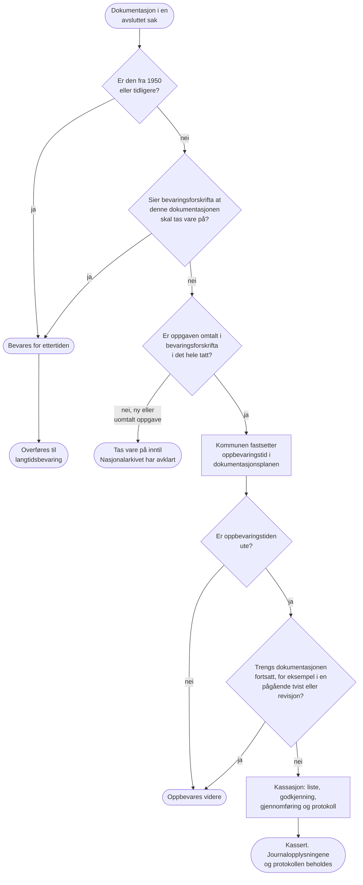
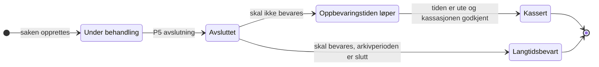

# P11 Bevaring og kassasjon

[← Oversikt](README.md) · Forrige: [P10 Politisk behandling](10-politisk-behandling.md) · Videre: [Lovoversikt](lovoversikt.md)

## Kort om prosessen

| | |
|---|---|
| **Formål** | Sørge for at dokumentasjon med varig verdi tas vare på for ettertiden, og at resten fjernes på en kontrollert måte når den ikke trengs lenger |
| **Starter når** | En sak opprettes og får en klasse. Da bestemmes det i praksis hva som skal skje med den til slutt |
| **Slutter når** | Dokumentasjonen er overført til langtidsbevaring, eller kassert og kassasjonen dokumentert |
| **Hvem** | Arkivleder. Dokumentsenteret gjennomfører. Kommunedirektøren godkjenner kassasjonen |
| **Frist** | Årlig gjennomgang av hva som har nådd oppbevaringstiden |

Ark-Ivar er et øvingssystem og lager ikke arkivuttrekk. Prosessen er likevel med, fordi valgene i P2 (klasse) og
P5 (avslutning) får følger her.

### Fire ord som ofte forveksles

| Ord | Betydning |
|---|---|
| **Bevaring** | Dokumentasjonen tas vare på for ettertiden og overføres til langtidsbevaring |
| **Oppbevaringstid** | Hvor lenge dokumentasjon som *ikke* skal bevares for ettertiden, likevel skal tas vare på |
| **Kassasjon** | Dokumentasjon som har vært arkiv, tilintetgjøres slik at den ikke lenger finnes |
| **Sletting** | Brukes i personvernreglene om å fjerne personopplysninger. En plikt til å slette gir ikke uten videre rett til å kassere |

Sorteringen i P1, der reklame og kopier aldri kommer inn i arkivet, er ikke kassasjon. Kassasjon gjelder bare det
som først er blitt arkiv.

## Figur: bevares eller kasseres?

## Figur: livsløpet til en sak

## Rutine steg for steg

### Ved opprettelse og avslutning av saken

| Steg | Hvem | Hva gjøres |
|---|---|---|
| 1 | Arkivleder | Fører inn i dokumentasjonsplanen, for hver klasse i arkivnøkkelen, om dokumentasjonen skal bevares, eller hvor lang oppbevaringstiden er, og hvilken regel det bygger på |
| 2 | Den som registrerer | Velger riktig klasse (P2). Saken arver regelen fra klassen |
| 3 | Dokumentsenteret | Kontrollerer regelen når saken avsluttes (P5). En sak kan ha fått et annet innhold enn klassen tilsier. Regelen kan da overstyres på saken, med begrunnelse |

### Årlig kassasjon

| Steg | Hvem | Hva gjøres |
|---|---|---|
| 1 | Dokumentsenteret | Tar ut en liste over avsluttede saker der oppbevaringstiden er ute |
| 2 | Arkivleder | Går gjennom listen. Kontrollerer at ingen av sakene skal bevares etter bevaringsforskrifta, og at det ikke finnes saker med et annet innhold enn klassen tilsier |
| 3 | Enhetene | Får listen for sine saker og melder fra om dokumentasjon som fortsatt trengs, for eksempel på grunn av en tvist, en revisjon eller et pågående innsynskrav |
| 4 | Kommunedirektør | Godkjenner kassasjonslisten |
| 5 | Dokumentsenteret | Gjennomfører kassasjonen. Dokumentene tilintetgjøres, også i sikkerhetskopier etter hvert som de skiftes ut. Papir makuleres |
| 6 | Dokumentsenteret | Fører kassasjonsprotokoll: hva som ble kassert, etter hvilken regel, når, og hvem som godkjente. Journalen beholdes, fordi journaler skal tas vare på for ettertiden |

### Langtidsbevaring

| Steg | Hvem | Hva gjøres |
|---|---|---|
| 1 | Arkivleder | Avslutter arkivperioden. I Sirevåg følger periodene kommunestyreperiodene |
| 2 | Dokumentsenteret | Avslutter alle saker som kan avsluttes. Saker som fortsatt er åpne, føres over til den nye perioden |
| 3 | Arkivleder | Sørger for at dokumentasjonen som skal bevares, overføres til bevaringsinstitusjonen kommunen har avtale med. Sirevåg er med i et interkommunalt arkiv |
| 4 | Kommunen | Beholder råderetten over arkivene også etter overføringen. Bevaringsinstitusjonen skal følge arkivlova |

## Hva sier bevaringsforskrifta om en kommune?

Kapittel 3 i bevaringsforskrifta lister opp, oppgave for oppgave, hvilken dokumentasjon fra kommuner som skal tas
vare på for ettertiden. Noen eksempler:

| Paragraf | Skal tas vare på for ettertiden |
|---|---|
| § 19 | Dokumentasjon fra 1950 eller tidligere |
| § 20 | Journaler, også journaldatabaser og journalregistre |
| § 21 bokstav f | Dokumentasjon om behandlingen av saker som legges fram for eller behandles i formannskapet |
| § 26 | I anskaffelser: strategi, reglement, behovsanalyse, anskaffelsesprotokoller og vedtatte tilbud |
| § 27 | Dokumentasjonsplaner, og arkivplaner fra før 2026 |
| § 32 bokstav c | I tilsettinger: kunngjøring, utvidet søkerliste, innstilling, protokoller og klager |
| § 33 bokstav a | For den som blir tilsatt: stillingssøknaden, tilsettingsbrevet og arbeidsavtalen |
| § 35 bokstav b | Byggesaker |

Listen viser et mønster: det som dokumenterer *avgjørelser, rettigheter og hvordan kommunen har styrt*, bevares. Det
som bare var nødvendig for å gjennomføre en avgjørelse, kan som regel kasseres etter en tid.

To praktiske følger av eksemplene:

- I en tilsettingssak bevares søknaden fra den som fikk stillingen. Søknadene fra de andre søkerne er ikke nevnt
  og kan kasseres når oppbevaringstiden er ute.
- I en anskaffelse bevares tilbudet som ble valgt. Tilbudene som ikke nådde opp, er ikke nevnt.

## Lovgrunnlag

| Regel | Hva den sier | Hvor i prosessen |
|---|---|---|
| Arkivlova § 12 første ledd | Dokumentasjon med stor kulturell eller vitenskapelig verdi, og viktig dokumentasjon om rettslige forhold eller om forvaltningens virksomhet, skal tas vare på og gjøres tilgjengelig for ettertiden | Formålet med bevaring |
| Arkivlova § 12 andre ledd | Nasjonalarkivet kan gi forskrift om hvilken dokumentasjon som skal tas vare på | Bevaringsforskrifta |
| Arkivlova § 13 første ledd | Et organ kan bare kassere dokumentasjon som ikke skal tas vare på etter forskriften, eller som Nasjonalarkivet har gitt tillatelse til å kassere | Kassasjonen |
| Arkivlova § 13 andre ledd | Regler i andre lover om plikt til å slette opplysninger gir bare grunnlag for kassasjon når det er klart fastsatt eller forutsatt at opplysningene ikke skal finnes i arkivene for ettertiden | Forholdet til personvernreglene |
| Arkivlova § 14 andre ledd | Kommuner skal ha ordninger for langtidsbevaring av arkivene sine, og beholder råderetten etter overføring | Langtidsbevaring |
| Arkivforskrifta § 3 | Organet fastsetter selv oppbevaringstider for dokumentasjon som ikke omfattes av bevaringsforskrifta, ut fra regler i annet regelverk, egne administrative og juridiske behov, andres juridiske behov og borgernes behov | Oppbevaringstidene |
| Arkivforskrifta § 5 andre ledd bokstav e | Systemet skal gjøre det mulig å kassere på en kontrollert, systematisk og etterprøvbar måte | Kassasjonen |
| Arkivforskrifta § 7 | Digitale arkiv skal holdes ved like slik at informasjonen ikke forringes ved flytting og konvertering | Mens dokumentasjonen oppbevares |
| Arkivforskrifta § 12 bokstav c, d og j | Dokumentasjonsplanen skal vise hva som skal bevares, oppbevaringstidene og rutinene for overføring til langtidsbevaring | Steg 1 |
| Bevaringsforskrifta § 3 | Dokumentasjon om nye oppgaver, og om oppgaver som ikke er nevnt i forskriften, skal tas vare på inntil Nasjonalarkivet har avklart | Figuren |
| Bevaringsforskrifta kapittel 3 | Hva som skal tas vare på fra kommuner og fylkeskommuner | Tabellen over |
| Arkivlova § 23 | Forsettlig eller grovt uaktsom overtredelse av blant annet § 13 første ledd kan straffes med bot | Ulovlig kassasjon |
| Personvernforordningen artikkel 5 nr. 1 bokstav e, artikkel 17 nr. 3 bokstav d og artikkel 89 | Personopplysninger skal ikke lagres lenger enn nødvendig, men kan lagres lenger for arkivformål i allmennhetens interesse, og retten til sletting gjelder ikke når behandlingen er nødvendig for slike formål | Forholdet til personvernreglene |

## Hvorfor gjør vi det slik?

**Alt kan ikke bevares, og alt bør ikke bevares.** Et arkiv der alt er tatt vare på, er dyrt å holde ved like
og vanskelig å finne fram i. Det inneholder også mange personopplysninger som ingen har bruk for. Kassasjon er
derfor en del av god arkivforvaltning.

**Men kassasjon kan ikke gjøres om.** Derfor er det snudd på hodet i forhold til det meste annet: du trenger
hjemmel for å fjerne noe. Uten at bevaringsforskrifta åpner for det, eller Nasjonalarkivet har gitt tillatelse,
skal dokumentasjonen bli liggende.

**Kommunen bestemmer oppbevaringstiden, staten bestemmer hva som bevares for alltid.** Nasjonalarkivet avgjør hva
som har verdi for ettertiden. Kommunen kjenner sine egne behov best og fastsetter derfor selv hvor lenge resten
trengs: så lenge noen kan klage, så lenge et krav ikke er foreldet, så lenge regnskapet kan bli revidert.

**Valget tas tidlig.** Når saken får en klasse i P2, får den samtidig en regel for bevaring. En sak i feil klasse
kan bli kassert når den skulle vært bevart. Det er en av grunnene til at klassen kontrolleres både i P6 og ved
avslutning.

**Personvern og arkiv går sammen.** Personvernreglene krever at opplysninger ikke lagres lenger enn nødvendig.
Arkivformål i allmennhetens interesse er et lovlig grunnlag for å lagre lenger. Derfor sier arkivlova at en
sletteplikt i en annen lov ikke automatisk betyr at opplysningene skal ut av arkivet.

**Journalen overlever dokumentene.** Selv når dokumentene i en sak er kassert, skal journalen finnes. Ettertiden
kan da se at saken har eksistert, hva den gjaldt, og etter hvilken regel dokumentene ble fjernet.

## Eksempel fra Sirevåg

Utdrag fra Sirevågs dokumentasjonsplan. Oppbevaringstidene er kommunens egne valg og er laget for øving.

| Klasse | Dokumentasjon | Regel | Begrunnelse |
|---|---|---|---|
| 613 Byggesak | Hele saken | Bevares | Bevaringsforskrifta § 35 bokstav b |
| 030 Folkevalgte organer | Saksframlegg, sakslister, møtebøker | Bevares | Bevaringsforskrifta § 21 |
| 210 Tilsetting | Kunngjøring, utvidet søkerliste, innstilling, protokoll | Bevares | Bevaringsforskrifta § 32 bokstav c |
| 210 Tilsetting | Søknader fra dem som ikke ble tilsatt | Kasseres 2 år etter at saken er avsluttet | Ikke nevnt i §§ 32 og 33. Tiden dekker eventuelle klager og krav |
| 160 Anskaffelser | Protokoll og vedtatt tilbud | Bevares | Bevaringsforskrifta § 26 |
| 160 Anskaffelser | Tilbud som ikke ble valgt | Kasseres 10 år etter at saken er avsluttet | Ikke nevnt i § 26. Tiden dekker kontraktsperioden og eventuelle krav |

Ved den årlige gjennomgangen i januar 2030 står tilsettingssaken 2026/377 på listen: saken ble avsluttet i 2027,
og to år er gått. Arkivlederen kontrollerer at søkerlisten, innstillingen og søknaden fra den som ble tilsatt, er
merket for bevaring. Personal bekrefter at det ikke pågår noen sak om tilsettingen. Søknadene fra de andre
søkerne kasseres, og kassasjonen føres i protokollen.

## Vanlige feil

| Feil | Følge | Slik unngås den |
|---|---|---|
| Ingenting kasseres noen gang | Unødvendig lagring av personopplysninger, og et arkiv som blir stadig vanskeligere å forvalte | Fast årlig gjennomgang |
| Dokumenter slettes fordi «GDPR krever det» | Ulovlig kassasjon | Arkivlova § 13 andre ledd: sletteplikt er ikke automatisk kassasjonshjemmel |
| Kassasjon uten protokoll | Ingen kan vise hva som ble fjernet, eller at det var lovlig | Protokoll er et fast steg |
| Hele saken kasseres når bare deler kan kasseres | Bevaringspliktig dokumentasjon går tapt | Regelen settes per dokumenttype der forskriften skiller |
| Saker i feil klasse | Feil regel arves | Kontroll av klasse i P6 og ved avslutning |
| Dokumentasjon om en ny oppgave kasseres fordi den ikke er nevnt i forskriften | Brudd på bevaringsforskrifta § 3 | Uomtalte oppgaver tas vare på inntil de er avklart |

## Hva systemet må støtte

| Behov | Forklaring |
|---|---|
| Regel per klasse | Bevares, eller kasseres etter et antall år. Arves av sakene, og kan overstyres med begrunnelse |
| Visning på saken | Hvilken regel som gjelder, og hvor den kommer fra |
| Kassasjonsliste | Avsluttede saker der oppbevaringstiden er ute |
| Simulert kassasjon | Studenten går gjennom listen, finner sakene som likevel ikke kan kasseres, og fører protokoll. Ingenting slettes fra øvingsarkivet |
| Forklaring | For hver sak: hvilken paragraf i bevaringsforskrifta som gjelder, eller at kommunen selv har fastsatt tiden |

Uttrekk og overføring til langtidsbevaring bygges ikke i Ark-Ivar.

## Kontrollspørsmål

1. En tidligere søker til en stilling krever at kommunen sletter søknaden hennes med henvisning til
   personvernforordningen. Hun fikk ikke stillingen. Hva gjør kommunen?
2. Kommunen har fått en helt ny oppgave som ikke er nevnt i bevaringsforskrifta. Kan dokumentasjonen kasseres
   etter fem år?
3. Hvorfor beholdes journalen når dokumentene kasseres?

Løsningsforslag

1. Søknaden er arkiv og kan bare kasseres etter reglene i arkivlova § 13. En sletteplikt etter annen lov gir ikke
   uten videre grunnlag for kassasjon (§ 13 andre ledd). Søknader fra dem som ikke ble tilsatt, er ikke nevnt i
   bevaringsforskrifta §§ 32 og 33 og kasseres når kommunens oppbevaringstid er ute. Kommunen svarer henne med
   det, og opplyser når det skjer.
2. Nei. Dokumentasjon om nye oppgaver, og oppgaver som ikke er nevnt i forskriften, skal tas vare på inntil
   Nasjonalarkivet har avklart om den skal bevares (bevaringsforskrifta § 3).
3. Fordi journaler skal tas vare på for ettertiden (bevaringsforskrifta § 20). Journalen viser at saken har
   eksistert, og hva den gjaldt, også når dokumentene er borte.

