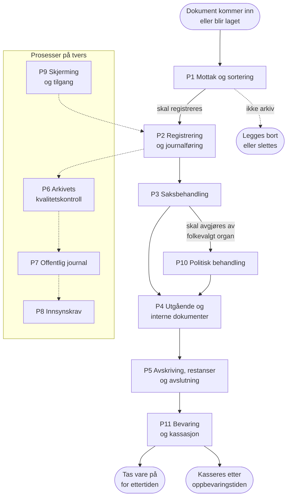

# Prosessbeskrivelser for sak og arkiv i Sirevåg kommune

Her står arbeidsprosessene i et sak- og arkivsystem slik de skal øves på i Ark-Ivar: fra et dokument kommer inn i
postmottaket, til saken er avsluttet og dokumentasjonen enten tas vare på for ettertiden eller kasseres. Hver prosess
har en figur, en rutine steg for steg, lovgrunnlaget og en forklaring på *hvorfor* det gjøres slik.

Beskrivelsene har to formål:

1. **Læremateriell for studenten.** De forklarer hva en arkivar og en saksbehandler gjør, og hvilken regel som
   ligger bak hvert steg.
2. **Grunnlag for systemet.** Arkivdelen av Ark-Ivar er ikke bygget ennå. Avsnittet «Hva systemet må støtte» i hver
   prosess sier hva som trengs for at prosessen skal kunne øves.

Sirevåg kommune finnes ikke. Personer, saker, adresser og dokumenter i eksemplene er oppdiktet.

> **Rettskildene er kontrollert mot Lovdata 20. november 2026.** Regelverket for arkiv ble nytt 1. januar 2026, se
> [Nytt i 2026](#nytt-i-2026). Beskrivelsene er læremateriell og ikke juridiske råd. Slå alltid opp i lovteksten når
> du skal avgjøre en virkelig sak.

## Det store bildet

Figuren viser hovedløpet et dokument følger, og de fire prosessene som går på tvers av løpet.

## Prosessene

| Nr. | Prosess | Hva den svarer på | Hvem gjør det meste |
|---|---|---|---|
| – | [Grunnlaget: begreper og arkivstruktur](00-grunnlag.md) | Hva er arkiv, sak, journalpost og dokument? | Alle |
| P1 | [Mottak og sortering](01-postmottak.md) | Hva skal inn i arkivet, og hva skal ikke? | Dokumentsenteret |
| P2 | [Registrering og journalføring](02-registrering.md) | Hvordan registreres et inngående dokument riktig? | Dokumentsenteret |
| P3 | [Saksbehandling](03-saksbehandling.md) | Hva skjer fra saken er fordelt til vedtaket er sendt? | Saksbehandler, leder |
| P4 | [Utgående og interne dokumenter](04-utgaende-og-interne.md) | Hvordan lages, godkjennes og sendes et dokument? | Saksbehandler, leder |
| P5 | [Avskriving, restanser og avslutning](05-avskriving-og-avslutning.md) | Når er et dokument og en sak ferdig? | Saksbehandler, Dokumentsenteret |
| P6 | [Arkivets kvalitetskontroll](06-kvalitetskontroll.md) | Hvordan oppdages og rettes feil? | Dokumentsenteret |
| P7 | [Offentlig journal](07-offentlig-journal.md) | Hva får allmennheten se av journalen? | Dokumentsenteret |
| P8 | [Innsynskrav](08-innsyn.md) | Hvordan behandles et krav om innsyn? | Saksbehandler, Dokumentsenteret |
| P9 | [Skjerming, tilgang og taushetsplikt](09-skjerming-og-tilgang.md) | Hvem får se hva, og med hvilken hjemmel? | Alle |
| P10 | [Politisk behandling](10-politisk-behandling.md) | Hvordan går en sak gjennom et folkevalgt organ? | Saksbehandler, politisk sekretariat |
| P11 | [Bevaring og kassasjon](11-bevaring-og-kassasjon.md) | Hva tas vare på, og hva kan fjernes? | Arkivleder |
| – | [Lovoversikt](lovoversikt.md) | Hvilken paragraf gjelder hvor? | Oppslag |
| – | [Ordliste](ordliste.md) | Hva betyr ordet? | Oppslag |

Les [grunnlaget](00-grunnlag.md) først. Deretter kan P1 til P5 leses i rekkefølge, fordi de følger ett dokument
gjennom huset. P6 til P11 kan leses i den rekkefølgen du trenger dem.

## Slik er hver prosess bygget opp

| Avsnitt | Innhold |
|---|---|
| Kort om prosessen | Formålet, hva som starter prosessen, hva som avslutter den, og hvem som deltar |
| Figur | Flyten som diagram. Firkanter er arbeidssteg, romber er valg, avrundede bokser er start og slutt |
| Rutine steg for steg | Hva som gjøres, av hvem, og hva resultatet er |
| Lovgrunnlag | Paragrafene som styrer prosessen, og hvor i prosessen de slår inn |
| Hvorfor gjør vi det slik? | Begrunnelsen bak rutinen |
| Eksempel fra Sirevåg | En oppdiktet sak som følger rutinen |
| Vanlige feil | Det som oftest går galt, og hvordan det unngås |
| Hva systemet må støtte | Funksjoner Ark-Ivar trenger for at prosessen kan øves |
| Kontrollspørsmål | Spørsmål med løsningsforslag |

## Rollene i Sirevåg kommune

| Rolle | Ansvar i prosessene |
|---|---|
| **Innbygger, virksomhet eller annet organ** | Sender dokumenter til kommunen, mottar svar, krever innsyn |
| **Dokumentsenteret** (arkivtjenesten) | Postmottak, registrering, journalføring, kvalitetskontroll, offentlig journal, veiledning av saksbehandlere |
| **Arkivleder** | Faglig ansvar for dokumentasjonsplanen, rutinene, kassasjon og overføring til langtidsbevaring |
| **Saksbehandler** | Behandler saken, registrerer egne dokumenter, vurderer innsyn i egne saker, avskriver |
| **Leder** | Fordeler saker, godkjenner utgående dokumenter, følger opp restanser |
| **Kommunedirektør** | Øverste ansvar for administrasjonen og internkontrollen, innstiller til folkevalgte organer |
| **Politisk sekretariat** | Sakslister, innkallinger og møtebøker for de folkevalgte organene |
| **Personvernombud** | Rådgiver når personopplysninger kan ha kommet på avveie |

Kommunens enheter i eksemplene er Plan og byggesak, Oppvekst, Helse og omsorg, Teknisk drift, Personal og Økonomi.

## Tre spørsmål som aldri må blandes sammen

Nesten alle feil i arkivarbeid kommer av at tre ulike spørsmål blir slått sammen til ett:

| Spørsmål | Regel | Typisk misforståelse |
|---|---|---|
| 1. Skal dette forvaltes som arkiv? | Arkivlova § 5 og arkivforskrifta § 1 | «Det er bare en e-post, så det er ikke arkiv» |
| 2. Skal det registreres i journalen? | Arkivforskrifta § 14 | «Det er unntatt offentlighet, så det skal ikke journalføres» |
| 3. Kan allmennheten få innsyn? | Offentleglova § 3 og unntakene i kapittel 3 | «Det står i journalen, så alle kan lese dokumentet» |

Svaret på ett av spørsmålene sier ingenting om de to andre. Et taushetsbelagt dokument skal både arkiveres og
journalføres. Et dokument som ikke journalføres, kan likevel være arkiv. Og et dokument som er journalført, kan
være helt eller delvis unntatt fra innsyn. Dette går igjen i alle prosessene, og er forklart nærmere i
[grunnlaget](00-grunnlag.md#tre-vurderinger-for-hvert-dokument).

## Nytt i 2026

Arkivregelverket ble skiftet ut 1. januar 2026. Mye eldre læremateriell viser derfor til paragrafer som ikke gjelder
lenger.

| Før | Nå |
|---|---|
| Lov 4. desember 1992 nr. 126 om arkiv | Lov 20. juni 2025 nr. 96 om dokumentasjon og arkiv (arkivlova) |
| Forskrift om offentlege arkiv (2017) og riksarkivarens forskrift (2017) | Forskrift 17. desember 2025 nr. 2647 om dokumentasjon og arkiv (arkivforskrifta) og forskrift 19. desember 2025 nr. 2729 (bevaringsforskrifta) |
| Arkivverket og Riksarkivaren | Nasjonalarkivet |
| Arkivplan | Dokumentasjonsplan (arkivlova § 8) |
| Journalføring i gammel arkivforskrift §§ 9 og 10 | Arkivforskrifta §§ 14 og 15 |
| Krav om at systemet følger Noark | Funksjonelle krav til informasjonssystemene (arkivforskrifta § 5). Noark 5 nevnes bare i reglene om uttrekk fra statlige organer (§ 28) |

Noark 5 (versjon 6.0 fra september 2025) er likevel standarden de fleste sak- og arkivsystemer er bygget etter, og
Ark-Ivar bruker begrepene og strukturen derfra.

**Forvaltningsloven:** Stortinget vedtok en ny forvaltningslov i 2025 (lov 20. juni 2025 nr. 81), men den var ikke
satt i kraft da dette ble skrevet. Henvisningene her gjelder derfor forvaltningsloven fra 1967. Tabellen i
[lovoversikten](lovoversikt.md#ny-forvaltningslov) viser hvor reglene står i den nye loven.

## Avgrensning

Ark-Ivar er et øvingssystem. Det lager ikke arkivuttrekk og overfører ikke noe til langtidsbevaring. P11 forklarer
likevel bevaring og kassasjon, fordi valgene som gjøres ved registreringen (klasse, oppbevaringstid) bestemmer hva
som skjer med dokumentasjonen til slutt.
