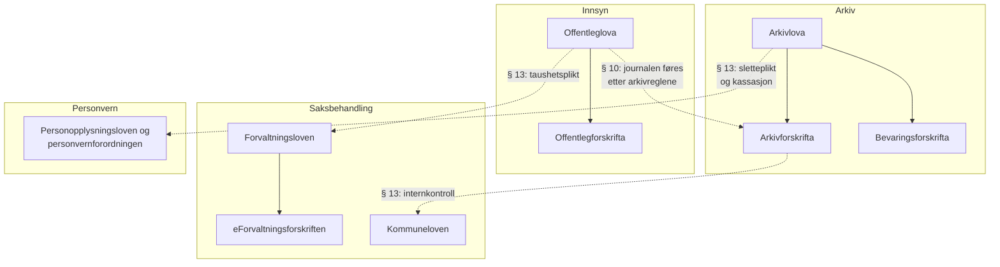

# Lovoversikt

[← Oversikt](README.md) · [Ordliste](ordliste.md)

Oversikten viser reglene prosessbeskrivelsene bygger på, og hvor de brukes. Den er kontrollert mot Lovdata
20. november 2026. Lover og forskrifter endres. Slå opp i gjeldende tekst før du bruker en henvisning i en
virkelig sak.

## Hvordan lese en lovhenvisning

«Offentleglova § 13 første ledd, jf. forvaltningsloven § 13 første ledd nr. 1» leses slik:

| Del | Betydning |
|---|---|
| Offentleglova | Loven, med korttittelen |
| § 13 | Paragrafen |
| første ledd | Det første avsnittet i paragrafen |
| jf. | «Jamfør»: les denne sammen med den neste |
| nr. 1 | Det første punktet i en nummerert liste. Lister kan også ha bokstaver |

Et avslag på innsyn skal vise til paragraf, ledd og bokstav eller nummer (offentleglova § 31). Vær like nøyaktig
når du registrerer en hjemmel i systemet.

Flere av lovene er skrevet på nynorsk og har nynorsk korttittel: arkivlova, arkivforskrifta, bevaringsforskrifta,
offentleglova og offentlegforskrifta. Korttitlene brukes slik de står i Lovdata.

## Regelverket i ett bilde

| Gruppe | Spørsmålet reglene svarer på |
|---|---|
| Arkiv | Hva skal dokumenteres, registreres og tas vare på? |
| Innsyn | Hvem får se det? |
| Saksbehandling | Hvordan skal saken behandles, og hvem bestemmer? |
| Personvern | Hvordan skal opplysninger om enkeltpersoner vernes? |

De stiplede pilene viser hvor en lov sender deg videre til en annen. Arkivforskrifta § 14 bygger dessuten på
offentleglovas begreper: det er saksdokumenter etter offentleglova § 4 som skal journalføres.

## Arkivlova

Lov 20. juni 2025 nr. 96 om dokumentasjon og arkiv. I kraft 1. januar 2026, unntatt § 11 om utførsel og lagring
utenfor Norge.

| Paragraf | Innhold | Brukes i |
|---|---|---|
| § 1 | Formålet: en forsvarlig og etterrettelig forvaltning, der dokumentasjonen forvaltes som arkiv og er tilgjengelig | [Grunnlaget](00-grunnlag.md) |
| § 2 | Definisjoner: arkiv, dokumentasjon, kassere, avlevere, organ | [Grunnlaget](00-grunnlag.md), [P11](11-bevaring-og-kassasjon.md) |
| § 4 | Nasjonalarkivet er nasjonal arkivmyndighet og skal veilede | [Grunnlaget](00-grunnlag.md) |
| § 5 | Arkivplikten: opphav, sammenheng, uendret og tilgjengelig | Alle prosessene |
| § 8 | Dokumentasjonsplan og internkontroll | [Grunnlaget](00-grunnlag.md), [P6](06-kvalitetskontroll.md) |
| § 12 | Dokumentasjon som skal tas vare på for ettertiden | [P11](11-bevaring-og-kassasjon.md) |
| § 13 | Kassasjon. Forholdet til sletteplikt i andre lover | [P11](11-bevaring-og-kassasjon.md) |
| § 14 | Langtidsbevaring. Kommunene skal ha ordninger og beholder råderetten | [P11](11-bevaring-og-kassasjon.md) |
| §§ 21 til 23 | Tilsyn, pålegg om retting, tvangsmulkt og straff | [Grunnlaget](00-grunnlag.md) |

## Arkivforskrifta

Forskrift 17. desember 2025 nr. 2647 om dokumentasjon og arkiv. I kraft 1. januar 2026.

| Paragraf | Innhold | Brukes i |
|---|---|---|
| § 1 | Hva organet skal ta hensyn til når det avgjør hva som skal forvaltes som arkiv | [P1](01-postmottak.md) |
| § 3 | Organet fastsetter selv oppbevaringstider for det som ikke skal tas vare på for ettertiden | [P5](05-avskriving-og-avslutning.md), [P11](11-bevaring-og-kassasjon.md) |
| § 5 | Krav til informasjonssystemene: metadata, vern mot endringer, sporing, eksport, kontrollert kassasjon, gjenfinning for innsyn, uttak til journal | [P2](02-registrering.md), [P6](06-kvalitetskontroll.md), [P8](08-innsyn.md), [P11](11-bevaring-og-kassasjon.md) |
| § 7 | Vedlikehold av digitale arkiv | [P11](11-bevaring-og-kassasjon.md) |
| § 9 | Skanning av papir i den daglige oppgaveløsningen, og destruksjon av papiret | [P1](01-postmottak.md) |
| § 11 | Retting av feil i registrerte opplysninger | [P6](06-kvalitetskontroll.md) |
| § 12 | Innholdet i dokumentasjonsplanen | [Grunnlaget](00-grunnlag.md), [P9](09-skjerming-og-tilgang.md), [P11](11-bevaring-og-kassasjon.md) |
| § 13 | Internkontroll. For kommuner etter kommuneloven § 25-1 | [P6](06-kvalitetskontroll.md) |
| § 14 | Hvilke dokumenter som skal registreres i journalen | [P1](01-postmottak.md), [P2](02-registrering.md), [P4](04-utgaende-og-interne.md), [P8](08-innsyn.md), [P10](10-politisk-behandling.md) |
| § 15 | Hvilke opplysninger journalen skal ha. Innsyn i journalen og unntak | [P2](02-registrering.md), [P7](07-offentlig-journal.md), [P9](09-skjerming-og-tilgang.md) |
| § 16 | Tekniske krav til skanning: original størrelse, 300 PPI, 24 bit RGB | [P1](01-postmottak.md) |
| § 19 | Papir som ikke kan destrueres etter skanning | [P1](01-postmottak.md) |

## Bevaringsforskrifta

Forskrift 19. desember 2025 nr. 2729 om kva dokumentasjon som skal takast vare på for ettertida. Gitt av
Nasjonalarkivet. I kraft 1. januar 2026.

| Paragraf | Innhold | Brukes i |
|---|---|---|
| § 1 | Hva forskriften gjelder | [P11](11-bevaring-og-kassasjon.md) |
| § 3 | Dokumentasjon om nye og uomtalte oppgaver tas vare på inntil Nasjonalarkivet har avklart | [P11](11-bevaring-og-kassasjon.md) |
| Kapittel 3, §§ 19 til 81 | Hva som skal tas vare på fra kommuner og fylkeskommuner, oppgave for oppgave | [P11](11-bevaring-og-kassasjon.md) |
| § 20 | Journaler skal tas vare på | [P11](11-bevaring-og-kassasjon.md) |
| § 21 | Administrativ og politisk organisering, blant annet saker behandlet i formannskapet | [P10](10-politisk-behandling.md) |

## Offentleglova

Lov 19. mai 2006 nr. 16 om rett til innsyn i dokument i offentleg verksemd.

| Paragraf | Innhold | Brukes i |
|---|---|---|
| § 3 | Hovedregelen: saksdokumenter, journaler og registre er åpne for innsyn. Alle kan kreve innsyn | [P7](07-offentlig-journal.md), [P8](08-innsyn.md) |
| § 4 | Definisjoner: dokument og saksdokument. Når et dokument er opprettet | [Grunnlaget](00-grunnlag.md), [P1](01-postmottak.md), [P4](04-utgaende-og-interne.md) |
| § 5 | Utsatt innsyn | [P8](08-innsyn.md) |
| § 8 | Innsyn er som hovedregel gratis | [P8](08-innsyn.md) |
| § 9 | Sammenstilling fra databaser | [P8](08-innsyn.md) |
| § 10 | Plikt til å føre journal etter arkivreglene. Publisering på internett | [P2](02-registrering.md), [P7](07-offentlig-journal.md) |
| § 11 | Merinnsyn | [P8](08-innsyn.md), [P9](09-skjerming-og-tilgang.md) |
| § 12 | Når resten av dokumentet kan unntas | [P8](08-innsyn.md) |
| § 13 | Taushetsbelagte opplysninger er unntatt | [P2](02-registrering.md), [P8](08-innsyn.md), [P9](09-skjerming-og-tilgang.md) |
| § 14 | Organinterne dokumenter kan unntas. Unntak fra unntaket i andre ledd | [P4](04-utgaende-og-interne.md), [P8](08-innsyn.md) |
| § 15 | Dokumenter innhentet utenfra til intern saksforberedelse | [P8](08-innsyn.md) |
| § 16 | Særregler for kommuner: saksframlegg, sakslister med mer kan ikke unntas som interne | [P4](04-utgaende-og-interne.md), [P8](08-innsyn.md), [P10](10-politisk-behandling.md) |
| § 23 | Forhandlingsposisjon, anskaffelser | [P8](08-innsyn.md), [P9](09-skjerming-og-tilgang.md) |
| § 24 | Kontrolltiltak, tips om lovbrudd | [P8](08-innsyn.md), [P9](09-skjerming-og-tilgang.md) |
| § 25 | Tilsettingssaker og søkerlister | [P7](07-offentlig-journal.md), [P8](08-innsyn.md) |
| § 26 | Eksamen, fødselsnummer med mer | [P8](08-innsyn.md), [P9](09-skjerming-og-tilgang.md) |
| § 28 | Innsynskravet: skriftlig eller muntlig, bestemt sak | [P8](08-innsyn.md) |
| § 29 | Konkret og selvstendig vurdering, uten ugrunnet opphold | [P8](08-innsyn.md) |
| § 30 | Hvordan innsyn gis. Rett til kopi | [P8](08-innsyn.md) |
| § 31 | Avslag og begrunnelse | [P8](08-innsyn.md) |
| § 32 | Klage. Fem arbeidsdager uten svar regnes som avslag | [P8](08-innsyn.md) |

## Offentlegforskrifta

Forskrift 17. oktober 2008 nr. 1119 til offentleglova.

| Paragraf | Innhold | Brukes i |
|---|---|---|
| § 4 | Betaling for innsyn | [P8](08-innsyn.md) |
| § 6 | Journaler på internett: hvem som har plikt, hva journalen skal vise, og hva som ikke skal stå der | [P7](07-offentlig-journal.md), [P9](09-skjerming-og-tilgang.md) |
| § 7 | Dokumenter på internett, og opplysninger som ikke skal legges ut | [P7](07-offentlig-journal.md), [P9](09-skjerming-og-tilgang.md) |
| § 9 | Unntak for visse dokumenter og journalinnføringer, blant annet i enkeltsaker etter barnevernsloven og sosialtjenesteloven | [P7](07-offentlig-journal.md), [P9](09-skjerming-og-tilgang.md) |

## Forvaltningsloven

Lov 10. februar 1967 om behandlingsmåten i forvaltningssaker.

| Paragraf | Innhold | Brukes i |
|---|---|---|
| § 2 | Definisjoner: vedtak, enkeltvedtak, part, dokument | [P3](03-saksbehandling.md) |
| § 6 | Habilitet | [P3](03-saksbehandling.md) |
| § 11 | Veiledningsplikt | [P1](01-postmottak.md), [P3](03-saksbehandling.md), [P8](08-innsyn.md) |
| § 11 a | Saksbehandlingstid og foreløpig svar | [P3](03-saksbehandling.md), [P5](05-avskriving-og-avslutning.md) |
| § 11 d | Muntlige opplysninger skal skrives ned | [P1](01-postmottak.md), [P3](03-saksbehandling.md) |
| §§ 13 til 13 c | Taushetsplikt, begrensninger og varighet | [P9](09-skjerming-og-tilgang.md) |
| § 16 | Forhåndsvarsel | [P3](03-saksbehandling.md), [P4](04-utgaende-og-interne.md) |
| § 17 | Utrednings- og informasjonsplikt | [P3](03-saksbehandling.md) |
| §§ 18, 19 og 21 | Partsinnsyn, unntak og klage | [P8](08-innsyn.md) |
| §§ 23 til 25 | Skriftlighet og begrunnelse | [P3](03-saksbehandling.md) |
| § 27 | Underretning om vedtaket | [P3](03-saksbehandling.md), [P4](04-utgaende-og-interne.md), [P10](10-politisk-behandling.md) |
| §§ 28 og 29 | Klagerett, klageinstans og klagefrist | [P3](03-saksbehandling.md), [P8](08-innsyn.md) |
| §§ 32 og 33 | Klagens form, og underinstansens behandling | [P3](03-saksbehandling.md), [P8](08-innsyn.md) |

### Ny forvaltningslov

Stortinget har vedtatt lov 20. juni 2025 nr. 81 om saksbehandlingen i offentlig forvaltning. Den trer i kraft når
Kongen bestemmer, og var ikke satt i kraft 20. november 2026. Tabellen viser hvor de mest brukte reglene står i den
nye loven, etter paragrafoverskriftene i den vedtatte teksten. Kontroller mot Lovdata når loven er satt i kraft.

| Tema | Loven fra 1967 | Loven fra 2025 |
|---|---|---|
| Veiledningsplikt | § 11 | §§ 14 og 15 |
| Saksbehandlingstid og opplysning om framdrift | § 11 a | § 17 |
| Habilitet | §§ 6 til 10 | §§ 25 til 29 |
| Taushetsplikt | §§ 13 til 13 g | §§ 30 til 39 |
| Forhåndsvarsel | § 16 | § 42 |
| Utredningsplikt | § 17 | § 44 |
| Partsinnsyn | §§ 18 til 21 | §§ 46 til 53 |
| Vedtakets form og begrunnelse | §§ 23 til 25 | §§ 55 til 57 |
| Melding om vedtak | § 27 | §§ 58 og 59 |
| Klage | §§ 28 til 36 | §§ 61 til 69 |

## Andre regler

| Regel | Innhold | Brukes i |
|---|---|---|
| Kommuneloven (lov 22. juni 2018 nr. 83) § 11-3 | Innkalling og saksliste | [P10](10-politisk-behandling.md) |
| Kommuneloven § 11-4 | Møtebok | [P10](10-politisk-behandling.md) |
| Kommuneloven § 11-5 | Møteoffentlighet og lukking | [P10](10-politisk-behandling.md) |
| Kommuneloven § 11-13 | Utvidet innsynsrett for folkevalgte organer | [P8](08-innsyn.md) |
| Kommuneloven § 13-1 | Kommunedirektørens myndighet og oppgaver | [Grunnlaget](00-grunnlag.md), [P3](03-saksbehandling.md), [P10](10-politisk-behandling.md) |
| Kommuneloven § 25-1 | Internkontroll | [Grunnlaget](00-grunnlag.md), [P5](05-avskriving-og-avslutning.md), [P6](06-kvalitetskontroll.md) |
| eForvaltningsforskriften (forskrift 25. juni 2004 nr. 988) § 6 | Bekreftelse på mottatt henvendelse | [P1](01-postmottak.md) |
| eForvaltningsforskriften §§ 8 og 9 | Digital utsending av vedtak, varsling og reservasjon | [P3](03-saksbehandling.md), [P4](04-utgaende-og-interne.md) |
| Personvernforordningen artikkel 5 | Prinsippene: riktighet, lagringsbegrensning, sikkerhet | [P6](06-kvalitetskontroll.md), [P9](09-skjerming-og-tilgang.md), [P11](11-bevaring-og-kassasjon.md) |
| Personvernforordningen artikkel 15 | Innsyn i egne personopplysninger | [P8](08-innsyn.md) |
| Personvernforordningen artikkel 17 og 89 | Sletting, og unntaket for arkivformål i allmennhetens interesse | [P11](11-bevaring-og-kassasjon.md) |
| Personvernforordningen artikkel 32 og 33 | Sikkerhet, og melding om brudd innen 72 timer | [P6](06-kvalitetskontroll.md), [P9](09-skjerming-og-tilgang.md) |
| Helsepersonelloven § 21 | Helsepersonells taushetsplikt | [P9](09-skjerming-og-tilgang.md) |
| Barnevernsloven § 13-1 | Taushetsplikt i barnevernet | [P9](09-skjerming-og-tilgang.md) |
| Sosialtjenesteloven § 44 | Taushetsplikt i sosialtjenesten | [P9](09-skjerming-og-tilgang.md) |
| Beskyttelsesinstruksen (17. mars 1972 nr. 3352) §§ 2 til 4 | Gradering FORTROLIG og STRENGT FORTROLIG | [P9](09-skjerming-og-tilgang.md) |
| Sikkerhetsloven (lov 1. juni 2018 nr. 24) § 5-3 | Sikkerhetsgradering | [P9](09-skjerming-og-tilgang.md) |

Personvernforordningen gjelder som norsk lov gjennom personopplysningsloven (lov 15. juni 2018 nr. 38).

## Gammelt og nytt arkivregelverk

Mye læremateriell, mange rutiner og de fleste systemer viser fortsatt til regelverket fra før 2026. Tabellen
hjelper deg å finne den nye regelen. Sammenhengen er omtrentlig: reglene er skrevet på nytt, ikke bare flyttet.

| Tema | Før 2026 | Fra 2026 |
|---|---|---|
| Plikten til å ha arkiv | Arkivlova 1992 § 6 | Arkivlova § 5 |
| Oversikt over arkivet og rutinene | Arkivplan, arkivforskriften 2017 § 4 | Dokumentasjonsplan, arkivlova § 8 og arkivforskrifta § 12 |
| Journalføringsplikten | Arkivforskriften 2017 § 9 | Arkivforskrifta § 14 |
| Opplysningene i journalen | Arkivforskriften 2017 § 10 | Arkivforskrifta § 15 |
| Hva som holdes utenfor arkivet | «Arkivavgrensing», arkivforskriften 2017 § 14 | Vurderingen etter arkivforskrifta § 1. Ordet brukes ikke i forskriften lenger |
| Krav til systemene | Krav om Noark-standarden | Funksjonelle krav i arkivforskrifta § 5 |
| Bevaring og kassasjon i kommunene | Riksarkivarens forskrift kapittel 7 | Bevaringsforskrifta kapittel 3 |
| Arkivmyndigheten | Riksarkivaren og Arkivverket | Nasjonalarkivet |

## Standarden

**Noark 5 versjon 6.0** (24. september 2025) er standarden for struktur og metadata i sak- og arkivsystemer.
Ark-Ivar bruker begrepene derfra: arkiv, arkivdel, klasse, saksmappe, journalpost, dokumentbeskrivelse,
dokumentobjekt, og de obligatoriske verdiene for journalposttype, journalstatus, saksstatus, dokumentstatus,
avskrivningsmåte og skjerming. Standarden er ikke en lov. Den er en måte å oppfylle kravene i arkivforskrifta § 5
på, og den nevnes i arkivforskrifta § 28 om uttrekk fra statlige organer.

## Kilder

| Kilde | Adresse |
|---|---|
| Arkivlova | https://lovdata.no/dokument/NL/lov/2025-06-20-96 |
| Arkivforskrifta | https://lovdata.no/dokument/SF/forskrift/2025-12-17-2647 |
| Bevaringsforskrifta | https://lovdata.no/dokument/SF/forskrift/2025-12-19-2729 |
| Offentleglova | https://lovdata.no/dokument/NL/lov/2006-05-19-16 |
| Offentlegforskrifta | https://lovdata.no/dokument/SF/forskrift/2008-10-17-1119 |
| Forvaltningsloven (1967) | https://lovdata.no/dokument/NL/lov/1967-02-10 |
| Forvaltningsloven (2025, ikke i kraft) | https://lovdata.no/dokument/NL/lov/2025-06-20-81 |
| Kommuneloven | https://lovdata.no/dokument/NL/lov/2018-06-22-83 |
| eForvaltningsforskriften | https://lovdata.no/dokument/SF/forskrift/2004-06-25-988 |
| Personopplysningsloven | https://lovdata.no/dokument/NL/lov/2018-06-15-38 |
| Noark 5 versjon 6.0 | https://www.nasjonalarkivet.no/content/uploads/2025/10/Noark-5-versjon-6.pdf |
